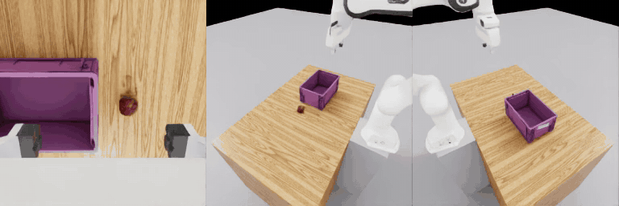

# urdf2vla

**ロボットの URDF から、NVIDIA Isaac Sim で VLA（Vision-Language-Action）モデルを学習するまで。Omniverse を先に覚える必要はありません。**

[English](README.md)



USD への変換、articulation の調整、カメラの配置、Isaac Lab の環境、データセットの形式、GR00T の fine-tune を、
順番に実行するコマンドにまとめました。各コマンドは自分の結果を検査し、次へ進むか、ロボットについて質問するか、
何を直せばよいかを伝えます。

- 本物の物体を使った Pick & Place（りんご・ライム・洋梨・色付きの立方体 → 箱）。エピソードごとに 1 つを選び、指示文でその名前を言う（Omniverse でシーンを作る必要なし）
- 推測ではなく質問。ブラウザの 3D 画面（`urdf2vla view`）で見ながら答えられる
- 保持できないグリッパ・物体にめり込む指・止まったカメラを、記録の前に見つける物理の検査
- 既定は DROID と同じカメラ配置（手先 + 左 + 右）
- NVIDIA GR00T N1.7 用のデータ変換と fine-tune。GPU が足りなければ大きな GPU で学習する一式を作る
- Claude Code 用の Agent Skill:「自分のロボットで VLA 開発を始めたい」

Isaac Sim 6.2.0、Isaac Lab 3.0.0、Isaac Lab Arena、Isaac GR00T N1.7 を使い、すべて urdf2vla が作る Docker コンテナで動きます。

## クイックスタート

Linux、NVIDIA の RTX GPU とドライバ 580 以降、NVIDIA Container Toolkit 付きの Docker、空きディスク 150 GB 程度、
[uv](https://docs.astral.sh/uv/) が必要です。GR00T N1.7 の学習には 44 GB の GPU が必要です（別のマシンでもかまいません）。

```bash
git clone https://github.com/momoiorg-repository/urdf2vla.git && cd urdf2vla
uv venv .venv && uv pip install -e '.[view]' && source .venv/bin/activate
bash docker/build.sh                # 初回だけ: シミュレーション用と GR00T 用の image を作る（1〜2 時間）
bash docker/run.sh && bash docker/run.sh gr00t

urdf2vla init projects/tutorial_franka --from examples/franka/project.yaml
urdf2vla inspect_robot --project projects/tutorial_franka
# … 各コマンドの JSON の "next" に従うか、下のチュートリアルへ
```

## ドキュメント

**📖 [https://momoiorg-repository.github.io/urdf2vla/ja/](https://momoiorg-repository.github.io/urdf2vla/ja/)**（日本語 / [English](https://momoiorg-repository.github.io/urdf2vla/)）

サイトは [`docs/`](docs/) から `.github/workflows/docs.yml` が作ります。手元で読むには
`uv pip install -e '.[docs]' && mkdocs serve`。

- [インストール](https://momoiorg-repository.github.io/urdf2vla/ja/install/)
- [チュートリアル: Franka で一通り](https://momoiorg-repository.github.io/urdf2vla/ja/tutorial/)
- [自分のロボットを使う](https://momoiorg-repository.github.io/urdf2vla/ja/guides/your-robot/) · [ブラウザでロボットを確かめる](https://momoiorg-repository.github.io/urdf2vla/ja/guides/view/) ·
  [デモを記録する](https://momoiorg-repository.github.io/urdf2vla/ja/guides/recording/) · [学習と評価](https://momoiorg-repository.github.io/urdf2vla/ja/guides/training/) ·
  [Claude Code から使う](https://momoiorg-repository.github.io/urdf2vla/ja/guides/claude-code/)
- [トラブルシューティング](https://momoiorg-repository.github.io/urdf2vla/ja/troubleshooting/) · [リファレンス](https://momoiorg-repository.github.io/urdf2vla/ja/reference/)

設計の考え方・シミュレータのハマりどころ・検証状況: [DEVELOPMENT.md](DEVELOPMENT.md)

## いまの状態

2 本指のグリッパの付いた単腕のロボットと、Pick & Place のタスク 1 つ（物体を箱に入れる）。同梱の Franka Panda で
replay の評価まで一通り検証済みです。この版での GR00T の実際の学習はまだ検証していません。双腕のロボットは取り込みと
検査まではできますが、シミュレーションはまだできません。
