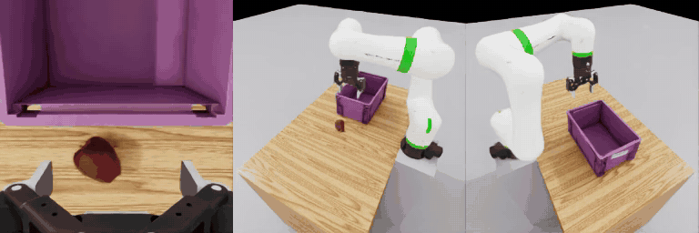

# urdf2vla

**ロボットの URDF から、NVIDIA Isaac Sim で学習・評価した VLA（Vision-Language-Action）モデルまで。**

[English](README.md) · 📖 **[ドキュメント](https://momoiorg-repository.github.io/urdf2vla/ja/)**



*urdf2vla で最初から最後まで学習したモデル（FANUC CRX-3iA、シミュレーションで 20/20）:
[`umegan/urdf2vla-crx3ia-gr00t-n1.7`](https://huggingface.co/umegan/urdf2vla-crx3ia-gr00t-n1.7)。*

Isaac Sim や Omniverse、VLA の学習に先に詳しくならなくても、自分の腕で VLA 開発を始めたいロボット開発者のための
ツールです。urdf2vla は URDF を検査済みの Pick & Place の環境として Isaac Sim に取り込み、デモを記録し、
NVIDIA Isaac GR00T N1.7 を fine-tune して、シミュレーションでモデルを評価します。工程ごとに 1 つのコマンドで、
各コマンドは自分の結果を検査し、URDF から分からないことだけを質問します。

## クイックスタート

Linux、NVIDIA の RTX GPU とドライバ 580 以降、NVIDIA Container Toolkit 付きの Docker、空きディスク 150 GB 程度、
[uv](https://docs.astral.sh/uv/) が必要です。学習には 44 GB 以上の GPU が必要です（別のマシンやクラウドの GPU でもかまいません）。

```bash
git clone https://github.com/momoiorg-repository/urdf2vla.git && cd urdf2vla
uv venv .venv && uv pip install -e '.[view]' && source .venv/bin/activate
bash docker/build.sh                # 初回だけ、1〜2 時間
bash docker/run.sh && bash docker/run.sh gr00t
urdf2vla doctor                     # マシンを検査し、問題ごとに直し方を示す
```

その後は[チュートリアル](https://momoiorg-repository.github.io/urdf2vla/ja/tutorial/)に進むか、リポジトリを
Claude Code か Codex で開いて「自分のロボットで VLA 開発を始めたい」と頼んでください。

## いまの状態

2 本指のグリッパの付いた単腕・双腕のロボット、タスクは 1 つ（物体を箱に入れる）、シミュレーションのみ。
URDF から評価済みの GR00T N1.7 のモデルまで、FANUC CRX-3iA（20/20）と Franka Panda（19/20）で NVIDIA L40S 上で一通り検証済みです。
[学習済みモデル](https://momoiorg-repository.github.io/urdf2vla/ja/models/)を参照してください。コマンドの出力は日本語です。

設計の考え方と検証の詳細: [DEVELOPMENT.md](DEVELOPMENT.md)
