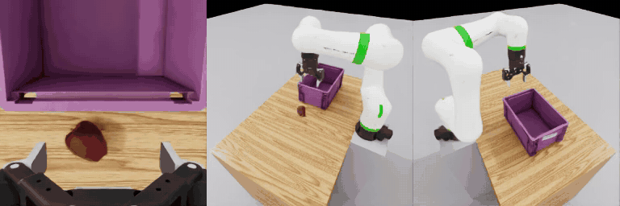

# urdf2vla

**From your robot's URDF to a trained and evaluated Vision-Language-Action (VLA) model in NVIDIA Isaac Sim.**

[日本語](README.ja.md) · 📖 **[Documentation](https://momoiorg-repository.github.io/urdf2vla/)**



*A model trained end to end with urdf2vla (FANUC CRX-3iA, 20/20 in simulation):
[`umegan/urdf2vla-crx3ia-gr00t-n1.7`](https://huggingface.co/umegan/urdf2vla-crx3ia-gr00t-n1.7).*

For robot developers who want to start VLA development with their own arm without first becoming experts in Isaac
Sim, Omniverse or VLA training. urdf2vla turns the URDF into a checked pick-and-place environment in Isaac Sim, records
demonstrations, fine-tunes NVIDIA Isaac GR00T N1.7 and evaluates the model in simulation — one command per step, each
checking its own result and asking only what the URDF can't tell it.

## Quick start

Needs Linux, an NVIDIA RTX GPU with driver 580+, Docker with the NVIDIA Container Toolkit, ~150 GB of disk and
[uv](https://docs.astral.sh/uv/). Training needs a GPU with 44 GB or more (it can be another machine or a cloud GPU).

```bash
git clone https://github.com/momoiorg-repository/urdf2vla.git && cd urdf2vla
uv venv .venv && uv pip install -e '.[view]' && source .venv/bin/activate
bash docker/build.sh                # once, 1–2 hours
bash docker/run.sh && bash docker/run.sh gr00t
urdf2vla doctor                     # checks the machine and prints the fix for each problem
```

Then follow the [tutorial](https://momoiorg-repository.github.io/urdf2vla/tutorial/), or open the repository in
Claude Code or Codex and say "I want to start VLA development with my robot".

## Status

Single- and dual-arm robots with a two-finger gripper, one task (an object into a container), simulation only.
Verified end to end, from the URDF to an evaluated GR00T N1.7 model, on the FANUC CRX-3iA (20/20) and the Franka Panda (19/20) on an NVIDIA L40S;
see [Trained models](https://momoiorg-repository.github.io/urdf2vla/models/). Command output is in Japanese; the
documentation explains every key in English.

Design notes and verification details (in Japanese): [DEVELOPMENT.md](DEVELOPMENT.md).
