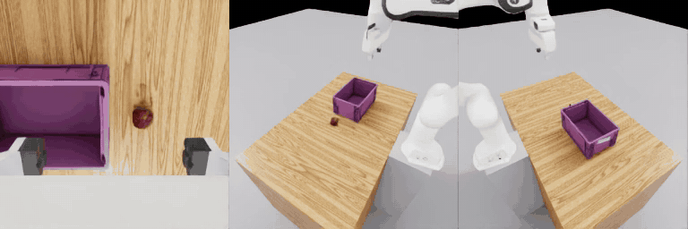

# urdf2vla

**From your robot's URDF to a trained Vision-Language-Action (VLA) model in NVIDIA Isaac Sim — without learning Omniverse first.**

[日本語](README.ja.md)



urdf2vla turns USD conversion, articulation tuning, camera placement, Isaac Lab environments, dataset formats and GR00T
fine-tuning into a sequence of plain commands. Each command checks its own result and either moves on, asks you a
question about your robot, or tells you what to change.

- A pick-and-place task with real objects (apple, lime, pear, colored cube → bin), one per episode and named in the instruction — no scene building in Omniverse
- Questions instead of guesswork, answerable in a 3D browser view (`urdf2vla view`)
- Physics checks that catch grippers that can't hold, fingers that sink into objects and frozen cameras before you record
- DROID-style cameras by default (one wrist camera per arm, plus left and right)
- Data conversion and fine-tuning for NVIDIA GR00T N1.7, packaged for a bigger GPU when yours is too small
- An agent skill for Claude Code: "I want to start VLA development with my robot"

Built on Isaac Sim 6.2.0, Isaac Lab 3.0.0, Isaac Lab Arena and Isaac GR00T N1.7, all running in Docker containers that
urdf2vla builds for you.

## Quick start

Needs Linux, an NVIDIA RTX GPU with driver 580+, Docker with the NVIDIA Container Toolkit, ~150 GB of disk, and
[uv](https://docs.astral.sh/uv/). Training GR00T N1.7 needs a 44 GB GPU (it can be another machine).

```bash
git clone https://github.com/momoiorg-repository/urdf2vla.git && cd urdf2vla
uv venv .venv && uv pip install -e '.[view]' && source .venv/bin/activate
bash docker/build.sh                # once: builds the simulation and GR00T images (1–2 hours)
bash docker/run.sh && bash docker/run.sh gr00t

urdf2vla init projects/tutorial_franka --from examples/franka/project.yaml
urdf2vla inspect_robot --project projects/tutorial_franka
# … then follow "next" in each command's JSON output, or the tutorial below
```

## Documentation

**📖 [https://momoiorg-repository.github.io/urdf2vla/](https://momoiorg-repository.github.io/urdf2vla/)** (English / [日本語](https://momoiorg-repository.github.io/urdf2vla/ja/))

The site is built from [`docs/`](docs/) by `.github/workflows/docs.yml`. To read it locally:
`uv pip install -e '.[docs]' && mkdocs serve`.

- [Install](https://momoiorg-repository.github.io/urdf2vla/install/)
- [Tutorial: Franka end to end](https://momoiorg-repository.github.io/urdf2vla/tutorial/)
- [Bring your own robot](https://momoiorg-repository.github.io/urdf2vla/guides/your-robot/) · [Check your robot in the browser](https://momoiorg-repository.github.io/urdf2vla/guides/view/) ·
  [Record demonstrations](https://momoiorg-repository.github.io/urdf2vla/guides/recording/) · [Train and evaluate](https://momoiorg-repository.github.io/urdf2vla/guides/training/) ·
  [Use it from Claude Code](https://momoiorg-repository.github.io/urdf2vla/guides/claude-code/)
- [Troubleshooting](https://momoiorg-repository.github.io/urdf2vla/troubleshooting/) · [Reference](https://momoiorg-repository.github.io/urdf2vla/reference/)

Design notes, simulator pitfalls and verification status (in Japanese): [DEVELOPMENT.md](DEVELOPMENT.md).

## Status

Single- and dual-arm robots with a two-finger gripper, one pick-and-place task (an object into a bin). The bundled
Franka Panda is verified end to end up to a replay evaluation; a full GR00T training run on this version is not yet
verified. Dual-arm support covers both arm command groups, per-arm cameras and TCPs, and grasp checks for each gripper;
the Dual Scorpion setup has been checked on the host (macOS) but not yet run in Isaac Sim. urdf2vla's command output is
currently in Japanese; the documentation explains every key and message in English.
