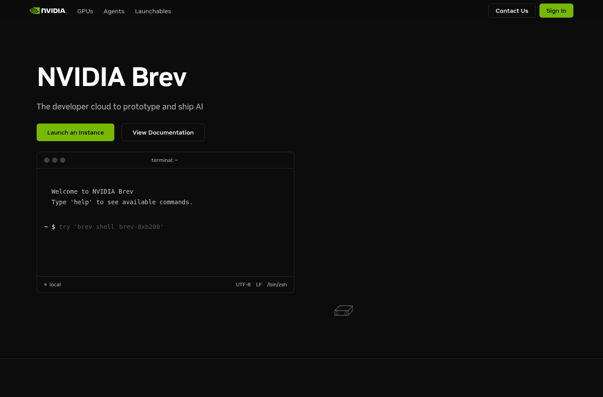
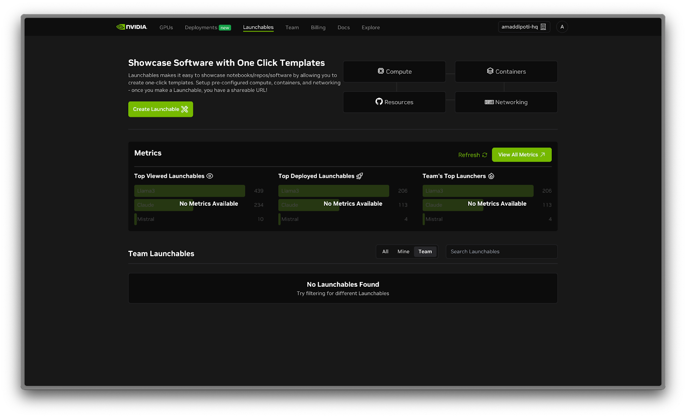
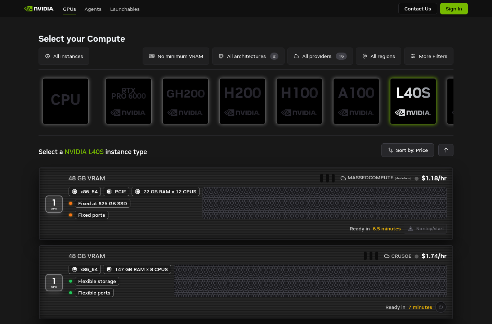
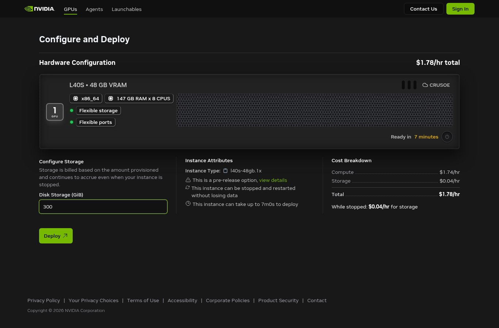
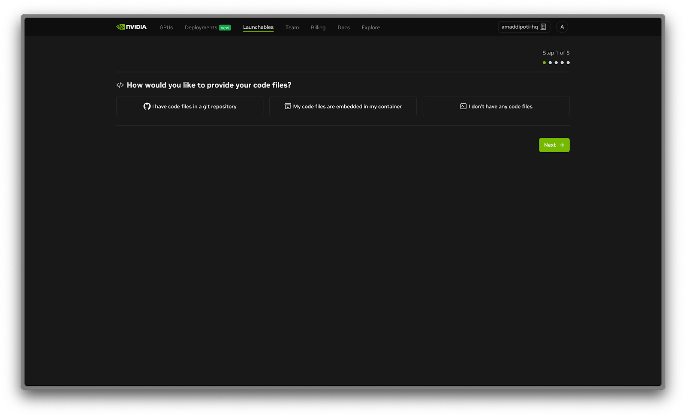
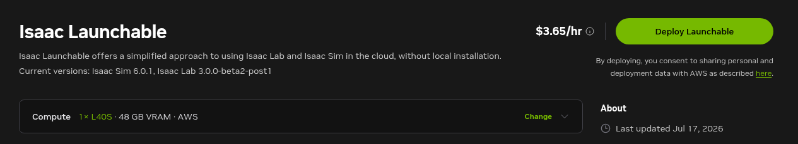
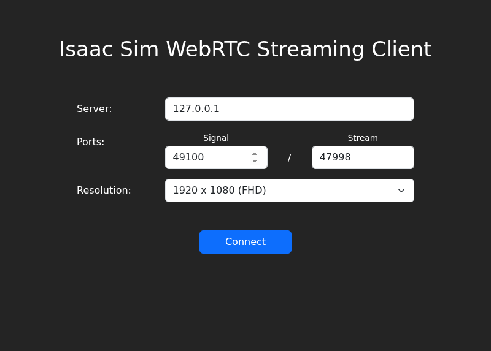
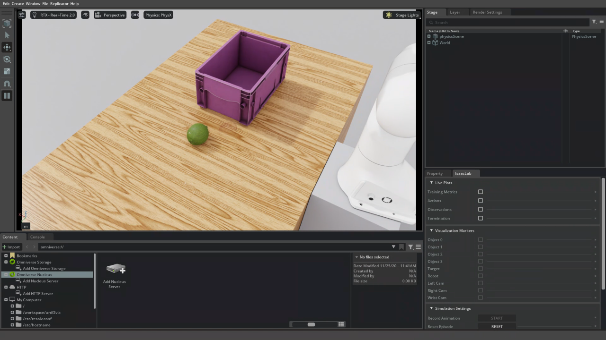

# NVIDIA Brev でセットアップする

[Brev コンソール](https://brev.nvidia.com/)を開き、[Launchable の設定](#launchable)から始めます。VM の準備ができたら、
Franka のシミュレーションを確認し、手元で Kit の画面を表示して、デモを記録できます。

## 始める前に

| 項目 | 用意するもの |
|---|---|
| Brev | GPU インスタンスを起動できる組織に所属する Brev アカウント |
| GPU とディスク | 一通り試すには **NVIDIA L40S 1 枚**と **300 GiB 以上**。Kit の配信には NVENC が、VM 上での学習には **44 GB 以上の VRAM** が必要です。 |
| Hugging Face | [モデルの学習・評価](#huggingface)で必要です。Franka のシミュレーションとデモの再生はログイン前に確認できます。 |

!!! note
    `docker/run.sh` は、手元のマシンと同じく `ACCEPT_EULA=Y` でシミュレーションのコンテナを起動します。使うことは
    Isaac Sim の image の利用規約に同意することです（[Isaac Sim のコンテナのインストール](https://docs.isaacsim.omniverse.nvidia.com/6.2.0/installation/install_container.html)）。

## Brev の VM を準備する

- Launchable を作る場合は[コンソールで設定](#launchable)します。リンクを受け取っている場合は[デプロイ](#deploy-launchable)から始めます。
- すでに Brev VM を持っている場合は[SSH で接続](#connect-vm)します。

### Brev の Launchable を作成する {#launchable}

Launchable は GPU、ソフトウェア、ネットワークの設定を保存し、そのリンクから VM を起動できるようにします。
VM の料金はデプロイしたアカウントにかかります。画像には公開コンソールとログイン後の画面の公開例を使っています。
画面の順序と見た目はコンソールの版やプロバイダーによって変わります。
[NVIDIA Brev Launchables](https://docs.nvidia.com/brev/concepts/launchables)

#### 1. サインインして作成画面を開く

[Brev コンソール](https://brev.nvidia.com)で **Sign In** を選び、Launchable を作る組織を選びます。

<figure markdown="span">
  
  <figcaption>Brev のホーム画面からサインインします。</figcaption>
</figure>

**Launchables → Create Launchable** を開きます。**Details** で名前に `urdf2vla`、説明に用途を短く入力します。

<figure markdown="span">
  
  <figcaption>NVIDIA の公開例にある Create Launchable ボタン。</figcaption>
</figure>

#### 2. GPU とディスクを選ぶ

**Default hardware configuration** で **NVIDIA L40S を 1 枚**選ぶと、同じ VM でシミュレーション、配信、学習が
できます。WebRTC を公開する場合は TCP と UDP のルールを設定できるプランを選びます。

<figure markdown="span">
  
  <figcaption>プランごとに GPU の枚数、ストレージ、ポート設定を確認します。</figcaption>
</figure>

**Disk Storage (GiB)** は **300** 以上に設定し、そのプランの料金を確認します。

<figure markdown="span">
  
  <figcaption>公開の構成画面でディスク容量と合計料金を確認できます。</figcaption>
</figure>

#### 3. セットアップスクリプトを登録する

**Software configuration** で **VM Mode** を選び、Jupyter はオフにします。
[brev_launchable.sh](https://raw.githubusercontent.com/momoiorg-repository/urdf2vla/main/docker/brev_launchable.sh) を開き、
ファイル全体を **Setup script** に貼り付けます。**Source** は **I don’t have any code files** を選びます。
スクリプトが urdf2vla を clone して両方のコンテナをビルドします。

既定のリビジョンは `main` です。マージ前に試す場合は、貼り付けたスクリプトの `URDF2VLA_REF` に公開ブランチを
指定します。毎回同じ版を使うにはリリースタグを指定します。

<figure markdown="span">
  
  <figcaption>コードファイルなしを選び、リポジトリの取得をセットアップスクリプトに任せます。</figcaption>
</figure>

#### 4. ポートと任意の認証情報を設定する

**Network** で、使うビューアに必要な項目を追加します。

| 機能 | Brev の設定 |
|---|---|
| Isaac Sim のシグナリング | **TCP/UDP Ports**。宛先 `49100`、**TCP**、デプロイした人の IP に制限 |
| Isaac Sim の映像 | **TCP/UDP Ports**。宛先 `47998`、**UDP**、デプロイした人の IP に制限 |
| URDF のブラウザビューア | **Secure Link**。名前は `Robot viewer`、HTTP ポートは `8080` |

デプロイ後に WebRTC の各ルールの **Public Port** を確認します。宛先と異なる番号が割り当てられる場合があります。
[WebRTC クライアント](#desktop-streaming-client)には公開ポート番号を入力します。

Franka の動作確認では **Launch parameters** は空欄のままで構いません。学習する場合は、VM 上で後から Hugging Face に
サインインするか、既定値が空の任意の **Text** パラメーター `HF_TOKEN` を追加します。このパラメーターを使う場合は
デプロイ時に組織の secret を選びます。[NVIDIA Brev の Launch parameters](https://docs.nvidia.com/brev/concepts/launchables#launch-parameters)

#### 5. 保存してデプロイする {#deploy-launchable}

1. 新しく作る場合は **View access** を **Only my organization** にし、**Create Launchable** を選んで生成されたリンクをコピーします。
2. 作成したリンクか、チームから受け取ったリンクを開きます。GPU と見積もり料金を確認します。
3. **Deploy Launchable** を選び、起動が始まったら **Go to Instance Page** を開きます。

<figure markdown="span">
  
  <figcaption>NVIDIA の公開 Isaac Launchable で、Deploy Launchable の位置と見積もり料金を確認できます。</figcaption>
</figure>

### VM に接続する {#connect-vm}

VM が **Running** になったら **Access** を開き、インスタンス名を確認します。手元のマシンに
[Brev CLI](https://docs.nvidia.com/brev/cli/getting-started) を入れ、次のコマンドで接続します。
`INSTANCE` を Brev に表示された名前に置き換えます。

<figure markdown="span">
  
  <figcaption>インスタンス画面の Access を開きます。VM が起動済みでも、urdf2vla の準備は続いている場合があります。</figcaption>
</figure>

```bash
brev login
brev shell INSTANCE
```

Launchable で起動した場合は[セットアップの確認](#check-setup)に進みます。通常の VM を作った場合は、次のスクリプトを実行します。

### 既存の VM でセットアップを実行する {#script}

通常の Brev VM を作った場合や、既存の VM に urdf2vla を入れる場合は、SSH で接続した VM の端末で実行します。Launchable で起動した場合は[セットアップの確認](#check-setup)に進みます。

既存の VM でセットアップを始める前に `nvidia-smi`、`docker info`、`df -h . /data` を確認します。スクリプトはドライバを更新して再起動したり、Docker の保存先を切り替えたりする場合があります。切り替え前のイメージとコンテナは元の保存先に残ります。

```bash
curl -fsSL https://raw.githubusercontent.com/momoiorg-repository/urdf2vla/main/docker/brev_setup.sh -o /tmp/urdf2vla_brev_setup.sh
bash /tmp/urdf2vla_brev_setup.sh
```

リポジトリはスクリプトが空きのいちばん大きいディスクに clone します。clone 済みなら、その中で
`bash docker/brev_setup.sh` を実行してください。その場所のまま使い、学習の checkpoint（1 つ 24 GB）に空きが足りなければ
注意を表示します。

| 段階 | スクリプトがすること |
|---|---|
| [ドライバ](#driver) | 580 より古ければ、Brev の hold を外し、580 系に固定して 580 を入れ、再起動します。再起動の後は続きを自動で実行します |
| [ディスク](#disk) | システムのディスクの空きが 130 GB 未満で、もっと大きいディスクがあれば、Docker の保存先をそこに切り替えます。`/etc/docker/daemon.json` の NVIDIA の設定は維持します。リポジトリを大きいディスクに clone した場合は、`~/urdf2vla` からリンクします。 |
| [CDI](#cdi) | `/etc/cdi/nvidia.yaml` を作り、コンテナから GPU が見えることを確かめます |
| [ビルドと起動](#build) | あなたを `docker` グループに入れ、uv と `urdf2vla` コマンド（`.venv`）を入れ、`docker/build.sh` と 2 つのコンテナの `docker/run.sh`、最後に `urdf2vla doctor` を実行します |

途中で止まった場合は、ログで原因を確認して修正し、同じスクリプトを実行すると、止まった工程から再開します。

### セットアップの完了を確認する {#check-setup}

VM でセットアップの状態とログを確認します。既存のチェックアウトを使った場合は、そのフォルダで
`bash docker/brev_setup.sh --status` を実行します。ドライバ更新で VM が再起動した場合は接続し直してください。
再起動後は systemd サービスが続きを実行します。

```bash
bash ~/urdf2vla/docker/brev_setup.sh --status
tail -f /var/log/urdf2vla-setup.log
```

セットアップの目安は約 30 分です。Ctrl+C でログの表示を止め、完了後に VM 上のリポジトリを開いて検査します。既存のチェックアウトを使った場合は、そのフォルダに移動します。

```bash
cd ~/urdf2vla
source .venv/bin/activate
urdf2vla doctor
```

`doctor` のエラーがあれば対応してから、Franka の動作確認に進みます。

## Franka でデプロイを確認する {#franka-smoke-test}

VM 上の urdf2vla リポジトリで、以下のコマンドを順に実行します。初回は Isaac Sim がシェーダーをコンパイルするため、起動に数分かかることがあります。結果が `ok` 以外なら、その工程で止めて原因を確認します。既存のプロジェクトは `urdf2vla status --project projects/brev_franka` で進み具合を確認できます。

```bash
project=projects/brev_franka
urdf2vla init "$project" --from examples/franka/project.yaml
urdf2vla inspect_robot --project "$project"
urdf2vla configure_robot --project "$project"
urdf2vla configure_task --project "$project"
urdf2vla configure_camera --project "$project"
urdf2vla import_robot --project "$project"
urdf2vla launch_sim --project "$project"
```

プロジェクトの `snapshots/` にある `*_start.png` と `*_end.png` を開き、アーム、台、物体、箱が写っていることを確認します。シーンを確認できたら、[Kit の画面を表示](#kit-livestream)するか、[デモの記録と再生](#franka-replay-test)に進みます。

## Isaac Sim の Kit ビューポートを配信する {#kit-livestream}

L40S など、NVIDIA NVENC に対応する GPU を使います。手元のマシンから Kit の両方のポートに到達できる必要があります。
公開配信には、プロバイダーのファイアウォールか Brev の **Ports** タブを使います。
WebRTC 配信自体には認証がないため、両方の公開ポートをデプロイした人の IP に制限します。[Brev のネットワーク設定](https://docs.nvidia.com/brev/concepts/launchables#network) ·
[Isaac Sim 6.2 の配信クライアント](https://docs.isaacsim.omniverse.nvidia.com/6.2.0/installation/manual_livestream_clients.html)

| 宛先ポート | プロトコル | 用途 |
|---|---|---|
| `49100` | TCP | WebRTC シグナリング |
| `47998` | UDP | WebRTC 映像 |

Brev の **Public Port** と **Destination Port** を確認します。宛先ポートは VM 上で Kit が使う番号です。Brev の公開
エンドポイントに接続するときは、クライアントに割り当てられた公開ポート番号を指定します。

<figure markdown="span">
  
  <figcaption>NVIDIA の公開例では、デプロイ済みインスタンスでポートと IP 制限を確認できます。</figcaption>
</figure>

`import_robot` が成功したら、VM のリポジトリで接続方法に対応するコマンドを実行します。

=== "公開エンドポイント"

    `STREAM_IPV4` は、手元から両方の公開ポートに接続できるエンドポイントの IPv4 アドレスに置き換えます。
    Brev にホスト名とポート番号が表示されている場合は、VM で `getent ahostsv4 PUBLIC_HOSTNAME` を実行し、
    ホスト名だけを検索します。モード `1` は Kit ビジュアライザーを有効にし、このアドレスをクライアントに通知します。

    ```bash
    urdf2vla launch_sim --project projects/brev_franka --livestream 1 --public-ip STREAM_IPV4
    ```

=== "プライベートネットワーク"

    VM と手元のマシンを、相互に通信できる同じプライベートネットワークまたは VPN につなぎます。

    ```bash
    urdf2vla launch_sim --project projects/brev_franka --livestream 2
    ```

### Isaac Sim WebRTC Streaming Client で接続する {#desktop-streaming-client}

**手元のマシン**の OS と CPU アーキテクチャに合う **Isaac Sim WebRTC Streaming Client** を取得します。
[NVIDIA のクライアント配布ページ](https://docs.isaacsim.omniverse.nvidia.com/6.2.0/installation/download.html#latest-release)

| 手元の OS | インストール方法 |
|---|---|
| Windows | `.exe` インストーラーを実行し、スタートメニューから **Isaac Sim WebRTC Streaming Client** を開きます。 |
| macOS | Apple シリコンまたは Intel 向けの `.dmg` を開き、アプリを **Applications** にドラッグします。 |
| Ubuntu または Debian | ダウンロード先で、対象の `.deb` パッケージを `sudo apt install ./isaacsim-webrtc-streaming-client-*-linux-*.deb` でインストールし、アプリケーションメニューから開きます。 |

1. Brev VM で `launch_sim` を起動したまま、プロジェクトの `logs/` にある最新の `*_launch_sim.log` に `env ready` が出るまで待ちます。
2. 手元でクライアントを開きます。**Server** には、モード `1` なら `--public-ip` に渡した IPv4、モード `2` なら到達可能な VM のプライベート IPv4 を入力します。
3. Brev の公開エンドポイントを使う場合は、TCP の **Public Port** を **Signal** に、UDP の **Public Port** を **Stream** に入力します。Kit の既定ポートに直接接続する場合は `49100` と `47998` を使います。
4. **Connect** を押します。接続を切るにはクライアントを閉じ、Kit を停止するには VM の端末で Ctrl+C を押します。

<figure markdown="span">
  
  <figcaption>Isaac Sim WebRTC Streaming Client 2.0.0 の既定値。</figcaption>
</figure>

接続できない場合は **Signal** に入力した TCP ポートを確認し、ほかの配信クライアントを閉じます。接続できても画面が
空白の場合は、**Stream** に入力した UDP ポートを確認し、**View → Reload** を試します。
[NVIDIA のクライアント設定とトラブルシューティング](https://docs.isaacsim.omniverse.nvidia.com/6.2.0/installation/manual_livestream_clients.html#isaac-sim-short-webrtc-streaming-client)

### ポート番号が異なる場合のブラウザビューア {#remapped-kit-ports}

NVIDIA のブラウザビューアには、シグナリングと映像の公開ポートを個別に指定できます。`launch_sim --livestream 1` の
`--public-ip` に公開エンドポイントの到達可能な IPv4 アドレスを渡し、Kit は既定の宛先ポートで起動します。ビューアの
ビルドには、Brev に表示されたホスト名（`:port` の部分を除く）と **Public Port** の番号を使います。
[Isaac Sim 6.2 のブラウザビューア](https://github.com/isaac-sim/IsaacSim/blob/v6.2.0/tools/docker/web-viewer/Dockerfile)

```bash
viewer_dir=$(mktemp -d)
curl -fsSL https://raw.githubusercontent.com/isaac-sim/IsaacSim/v6.2.0/tools/docker/web-viewer/Dockerfile \
  -o "$viewer_dir/Dockerfile"
docker build -t urdf2vla/kit-web-viewer \
  --build-arg ISAACSIM_HOST=PUBLIC_HOSTNAME \
  --build-arg ISAACSIM_SIGNAL_PORT=PUBLIC_TCP_PORT \
  --build-arg ISAACSIM_STREAM_PORT=PUBLIC_UDP_PORT "$viewer_dir"
docker run --rm -p 127.0.0.1:8210:8210 urdf2vla/kit-web-viewer
```

手元のマシンで `brev port-forward INSTANCE --port 8210:8210` を実行し、Chromium または Chrome で
`http://localhost:8210` を開きます。ブラウザは WebRTC に Brev の公開エンドポイントを使います。Kit に同時に接続できるのは
クライアント 1 台です。既存の接続を閉じてから開いてください。[Brev のポートフォワーディング](https://docs.nvidia.com/brev/cli/connectivity) ·
[Isaac Sim クライアントの制限](https://docs.isaacsim.omniverse.nvidia.com/6.2.0/installation/manual_livestream_clients.html)

<figure markdown="span">
  
  <figcaption>Brev 経由でブラウザビューアに配信された Franka のシーン。</figcaption>
</figure>

### SSH でのビューアと遠隔操作

Secure Link を追加した場合は、VM で `urdf2vla view --project projects/brev_franka --port 8080` を起動し、Brev コンソールから **Robot viewer** を開きます。

- `urdf2vla view` はポート 8080 で動きます: `ssh -L 8080:localhost:8080 <インスタンス>` で転送し、`http://localhost:8080` を開きます。
- 端末のキーボードで記録します: 1 つ目の SSH で `collect_dataset --device socket`、2 つ目で `urdf2vla teleop-keys`。

## デモ 3 件を記録して再生する {#franka-replay-test}

シーンの検査が通ったら、Isaac Sim と GR00T コンテナを使って記録から再生まで確認します。記録済みの行動を使うため、
学習済みチェックポイントや Hugging Face へのログインは不要です。Kit で配信中の場合は GPU を空けるために停止します。
繰り返し試す場合は、別のデータセット名を使います。

```bash
project=projects/brev_franka
dataset=brev_smoke
urdf2vla configure_vla_interface --project "$project"
urdf2vla setup_teleoperation --project "$project"
urdf2vla collect_dataset --project "$project" --device scripted --num-demos 3 --dataset "$dataset"
urdf2vla convert_dataset --project "$project" --dataset "$dataset"
urdf2vla evaluate_vla --project "$project" --replay --dataset "$dataset" --episodes 3 --video
```

記録では成功したデモだけを保存するため、3 回以上試行することがあります。`build/collect_report.yaml` で保存件数を、
`build/eval_report.yaml` で再生の結果を確認します。再生では記録された行動とサーバーとの通信を検査します。
`--video` を指定すると、`build/eval_videos/` にエピソードごとの MP4 が保存されます。

<figure>
  <video controls muted playsinline preload="none" width="100%" poster="../../../assets/brev_franka_replay.jpg" src="../../../assets/brev_franka_replay.mp4" aria-label="3 台のカメラで見た Franka のデモ再生"></video>
  <figcaption>Franka がキューブを箱に入れるデモの再生。左から手先、左、右のカメラ。</figcaption>
</figure>

モデルを学習して評価する場合は、次に [Hugging Face のアクセスを設定](#huggingface)します。

## GR00T モデルを学習・評価する {#huggingface}

GR00T N1.7 は画像と言語のモデル `nvidia/Cosmos-Reason2-2B` を使います。これは **gated**（利用規約への同意が要る）で、
アクセスできるまで学習と評価が `401 Client Error … Cannot access gated repo` で止まります。

1. [huggingface.co/nvidia/Cosmos-Reason2-2B](https://huggingface.co/nvidia/Cosmos-Reason2-2B) を開き、利用規約に同意します。
2. [huggingface.co/settings/tokens](https://huggingface.co/settings/tokens) で read 権限のトークンを作ります。
3. インスタンスでログインします（トークンは `~/.cache/huggingface/token` に保存され、コンテナと共有されます）。

    ```bash
    hf auth login
    ```

インスタンスを止めるとホームディレクトリが消える場合は、トークンを `/data` にも置き（例: `/data/secrets/hf_token`、
権限 600）、再開のあと `~/.cache/huggingface/token` にコピーし直します。

続きは[GR00T のファインチューニングと評価](training.md)を参照してください。

## FANUC CRX-3iA の実測値

FANUC CRX-3iA の実測値です。環境は NVIDIA L40S（46 GB）、CPU 8、メモリ 144 GB、Ubuntu 22.04 です。

| 工程 | 結果 | 時間 | GPU メモリの最大 |
|---|---|---|---|
| `import_robot`（1 回目） | 検査 10/10、初期姿勢を質問 | 447 秒（Isaac Sim の初回の起動でシェーダのキャッシュを作る） | 4.9 GB |
| `import_robot`（`answer robot.default_pose=suggested` の後） | 10/10 | 37 秒 | 4.8 GB |
| `launch_sim` | 22/22（カメラ、物体、把持） | 204 秒 | 5.5 GB |
| `setup_teleoperation` | 4/4 | 64 秒 | 5.5 GB |
| `collect_dataset --device scripted --num-demos 50` | 59 回中 50 回成功（84.7 %） | 33 分 | 5.5 GB |
| `convert_dataset` | 5/5 | 68 秒 | – |
| `convert_dataset --layout droid` | 6/6（100 エピソード: 各デモを左と右のカメラで） | 3 分 | – |
| `train_vla`（urdf2vla の並び、カメラ 3 台、10,000 step、batch 32） | release_check 10/10 | 約 2 時間 40 分（1.07 step/秒） | 41.9 GB |
| `train_vla`（`--layout droid`、カメラ 2 台） | release_check 10/10 | 2 時間 8 分（1.38 step/秒） | 40.9 GB |
| `evaluate_vla --episodes 20 --video` | [結果](#results)を参照 | 10〜11 分 | 12.4 GB |

学習と評価は同時に GPU に載りません（41 GB + Isaac Sim + 推論サーバ）。学習中に別の checkpoint を評価するには、
checkpoint を保存した直後に学習を止めて評価し、同じ `train_vla` を実行し直します。最後の checkpoint から再開します。

30 分の評価の前に、モデルがグリッパを開くかを確かめられます（1 分ほど、シミュレーションなし）。

```bash
urdf2vla train_vla --project projects/crx3ia --dataset demos_droid --check-only training/crx3ia_demos_droid/checkpoints/checkpoint-10000
```

### 学習済みモデルの評価結果 {#results}

どちらのモデルも `nvidia/GR00T-N1.7-DROID`（単腕のロボットの既定）から、同じスクリプトのデモ 50 個で fine-tune し、
同じ 20 エピソード（同じ乱数の種: 毎回ランダムな物体と位置）で評価しました。

| | urdf2vla の並び（既定） | `--layout droid` |
|---|---|---|
| モデルが見るカメラ | 手先 + 左 + 右 | 手先 + 外部カメラ 1 台（学習はエピソードごとに左か右、評価は左） |
| 腕の状態と行動 | 関節目標 6 | DROID の手先の姿勢 + 関節 7（7 つ目は 0 で埋める） |
| **成功** | **20/20** | 19/20（洋梨を 1 回離さなかった） |
| りんご / 立方体 / ライム / 洋梨 | 5/5、7/7、3/3、5/5 | 5/5、7/7、3/3、4/5 |
| エピソードの長さ（中央値） | 174 step（8.7 秒） | 173 step |
| 置いた位置と目標の距離（中央値） | 15 mm | 12 mm |

カメラ 3 台のモデルは Hugging Face にあります:
[`umegan/urdf2vla-crx3ia-gr00t-n1.7`](https://huggingface.co/umegan/urdf2vla-crx3ia-gr00t-n1.7)（NVIDIA Open Model
License。urdf2vla での評価の手順はモデルカードにあります）。

**既定の urdf2vla の並び**（全カメラ、`convert_dataset` に `--layout` を付けない）を使ってください。同等以上の結果で、
毎フレーム 3 方向の画像をモデルが見ます。DROID の並びは学習が約 30 % 速いので、試験用に残しています。

最初の DROID の並びのモデルは、グリッパを開いてから 13 step で終わるエピソードで学習し、0/3 でした。どの物体も掴んで
箱まで運び、離しませんでした。今の `convert_dataset` は最後のフレームを足して開く動作を学べるようにし、それを検査し
（`gripper_timing`）、`train_vla` は評価の前に学習したモデルを検査します（`release_check`: そのモデルは 0/10、上の 2 つは 10/10）。


評価の動画と画像: [公開モデルとデータセット](../models.md#crx3ia)。

## セットアップのトラブルシューティング

セットアップが途中で止まった場合や、手動で準備する場合に参照してください。

### ドライバ 580 以降を入れる {#driver}

Isaac Sim 6.2 と GR00T の image には**ドライバ 580 以降**が要ります。古いドライバでは、最初の Isaac Sim の工程が
`The NVIDIA driver on your system is too old (found version 12070)` で止まります（image の PyTorch が CUDA 13 向け）。

`nvidia-smi` で確かめます。古ければ、新しいドライバの入ったインスタンスのイメージを選ぶのが早いです。
その場で上げる手順（このインスタンスは 565.57.01 でした）:

```bash
# Brev は入っているドライバを hold している。hold を外す（nvidia-modprobe、nvidia-settings、nvidia-prime も）
sudo apt-mark unhold $(apt-mark showhold | grep -E 'nvidia|cuda-drivers')
# ドライバのパッケージを 580 の系列にそろえる（これがないと CUDA のリポジトリから新しい系列が混ざる）
apt-get download nvidia-driver-pinning-580 && sudo dpkg -i nvidia-driver-pinning-580_*.deb
# 古いドライバを外して 580 を入れる（カーネルモジュールは DKMS でビルドされる）
sudo apt-get purge -y $(dpkg -l | awk '$1 ~ /^[ih]i$/ && $2 ~ /565/ {print $2}')
sudo apt-get install -y nvidia-driver-580-open nvidia-utils-580 nvidia-compute-utils-580
sudo reboot
```

再起動のあと `nvidia-smi` が 580 を示します。続けて [CDI の定義](#cdi)を作り直してください。

### Docker の保存先を大きいディスクに切り替える {#disk}

Brev のインスタンスはシステムのディスクが小さく（このインスタンスは 124 GB）、大きいディスクが `/data`（295 GB）に
あります。Docker の image とリポジトリを `/data` に置きます。

```bash
# Docker: /etc/docker/daemon.json に "data-root": "/data/docker" を足す（nvidia の runtime の設定は残す）
sudo systemctl restart docker && docker info | grep "Root Dir"
# リポジトリ
cd /data && git clone https://github.com/momoiorg-repository/urdf2vla.git
```

容量を使うもの（実測）:

| | |
|---|---|
| image | Isaac Lab Arena 38 GB、GR00T 26 GB（と、層を共有する 26 GB の base image）。合わせて約 64 GB。ビルドのキャッシュが最大 50 GB（`docker builder prune` で消せる） |
| データセット | FANUC のデモ 50 個: HDF5 で 2.6 GB、変換後 61 MB |
| GR00T のモデル | `~/.cache/huggingface` に 6.5 GB（`nvidia/GR00T-N1.7-DROID`）+ 4.6 GB（`nvidia/Cosmos-Reason2-2B`） |
| **checkpoint** | **1 つ 24 GB**（重み 11 GB + optimizer の状態 13 GB）。`train_vla` は既定で 2 つ残す（`--save-total-limit`） |

足りなくなるのは checkpoint です。1 回の学習で 5 つ残していたとき、2 回の学習で 295 GB のディスクがいっぱいになり、
2 回目は保存の途中で止まりました。今の `train_vla` は、checkpoint の分の空きがなければ始めません。学習が終わった
checkpoint の `optimizer.pt` は学習の再開にしか使わないので、消して空きを作れます（重みは `evaluate_vla` に使えます）。

### CDI で Docker から GPU を使う {#cdi}

Brev の NVIDIA Container Toolkit は **CDI モード**で、`docker run --gpus all` は `/etc/cdi/nvidia.yaml` にある GPU の
定義を使います。このインスタンスではこのファイルがなく、`docker run --gpus all` が次のエラーで止まりました。

```text
could not apply required modification to OCI specification: error modifying OCI spec:
failed to inject CDI devices: unresolvable CDI devices nvidia.com/gpu=all
```

作ります:

```bash
sudo nvidia-ctk cdi generate --output=/etc/cdi/nvidia.yaml
docker run --rm --gpus all ubuntu nvidia-smi        # GPU が表示されれば OK
```

- ドライバが **580 より古い**と `nvidia-ctk` が落ちます（`nvSandboxUtilsShutdown` で `free(): invalid pointer`）。
  `--feature-flag=disable-nvsandboxutils` を付けます。
- **ドライバを更新したら作り直します。** ファイルにはドライバのライブラリの版が書かれていて、このインスタンスでは
  更新のあとも自動では作り直されませんでした。

### コンテナをビルドして起動する {#build}

```bash
uv venv .venv && uv pip install -e '.[view,dev,docs]' xacro && source .venv/bin/activate
bash docker/build.sh            # L40S で Arena の image 13 分、GR00T の image 4 分
bash docker/run.sh && bash docker/run.sh gr00t
urdf2vla doctor
```

`docker/build.sh` は SSH が切れても続くように実行してください（`tmux`、または `setsid nohup … &`）。起動したシェルが
終わるとビルドも止まります。

### GR00T サーバーのポート {#port}

Brev では NVIDIA DCGM の `nv-hostengine` が `127.0.0.1:5555`（GR00T の推論サーバの既定のポート）を使っています。
`evaluate_vla` は空いているポートに自動で移り、警告で知らせます。`doctor` は info として表示します。
