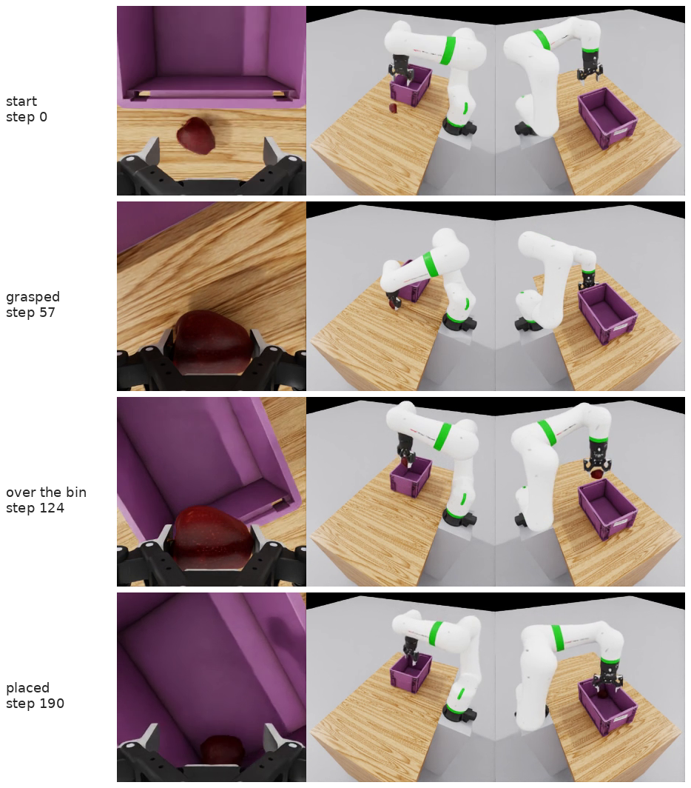

# NVIDIA Brev で動かす

NVIDIA Brev のクラウドの GPU で、新しいインスタンスから学習済みモデルまで urdf2vla を動かす手順です。このページの
数値はすべて 1 台のインスタンスで測ったものです: **NVIDIA L40S（46 GB）**、CPU 8、メモリ 144 GB、Ubuntu 22.04、
FANUC CRX-3iA の例。

下の各項目は `urdf2vla doctor` が検査します。問題があれば直し方と、このページの該当の節へのリンクを表示します。
準備の各段階のあとで実行してください。

```bash
urdf2vla doctor
```

## 始める前に用意するもの

| | |
|---|---|
| インスタンス | インスタンスの上で学習するなら **44 GB 以上**の GPU 1 枚（L40S、A100、H100）。小さい GPU でも学習以外はすべて動きます |
| ディスク | Docker の image とリポジトリを置くディスクに **300 GB 以上**（[ディスク](#disk)） |
| Hugging Face | アカウント、read 権限のトークン、`nvidia/Cosmos-Reason2-2B` の利用規約への同意（[Hugging Face](#huggingface)） |
| 時間 | 準備 約 30 分、デモの記録 35 分、学習 1 回 2 時間 |

## 1. ドライバ 580 以降 {#driver}

Isaac Sim 6.2 と GR00T の image には**ドライバ 580 以降**が要ります。古いドライバでは、最初の Isaac Sim の工程が
`The NVIDIA driver on your system is too old (found version 12070)` で止まります（image の PyTorch が CUDA 13 向け）。

`nvidia-smi` で確かめます。古ければ、新しいドライバの入ったインスタンスのイメージを選ぶのが早いです。
その場で上げる手順（このインスタンスは 565.57.01 でした）:

```bash
# Brev は入っているドライバを hold している。hold を外す（nvidia-modprobe、nvidia-settings、nvidia-prime も）
sudo apt-mark unhold $(apt-mark showhold | grep -E 'nvidia|cuda-drivers')
# ドライバのパッケージを 580 の系列にそろえる（これがないと CUDA のリポジトリから新しい系列が混ざる）
apt-get download nvidia-driver-pinning-580 && sudo dpkg -i nvidia-driver-pinning-580_*.deb
# 古いドライバを外して 580 を入れる（カーネルモジュールは DKMS でビルドされる）
sudo apt-get purge -y $(dpkg -l | awk '$1 ~ /^[ih]i$/ && $2 ~ /565/ {print $2}')
sudo apt-get install -y nvidia-driver-580-open nvidia-utils-580 nvidia-compute-utils-580
sudo reboot
```

再起動のあと `nvidia-smi` が 580 を示します。続けて CDI の定義を作り直してください（次の節）。

## 2. Docker から GPU を使う（CDI） {#cdi}

Brev の NVIDIA Container Toolkit は **CDI モード**で、`docker run --gpus all` は `/etc/cdi/nvidia.yaml` にある GPU の
定義を使います。このインスタンスではこのファイルがなく、`docker run --gpus all` が次のエラーで止まりました。

```text
could not apply required modification to OCI specification: error modifying OCI spec:
failed to inject CDI devices: unresolvable CDI devices nvidia.com/gpu=all
```

作ります:

```bash
sudo nvidia-ctk cdi generate --output=/etc/cdi/nvidia.yaml
docker run --rm --gpus all ubuntu nvidia-smi        # GPU が表示されれば OK
```

- ドライバが **580 より古い**と `nvidia-ctk` が落ちます（`nvSandboxUtilsShutdown` で `free(): invalid pointer`）。
  `--feature-flag=disable-nvsandboxutils` を付けます。
- **ドライバを更新したら作り直します。** ファイルにはドライバのライブラリの版が書かれていて、このインスタンスでは
  更新のあとも自動では作り直されませんでした。

## 3. Docker の保存先を大きいディスクに {#disk}

Brev のインスタンスはシステムのディスクが小さく（このインスタンスは 124 GB）、大きいディスクが `/data`（295 GB）に
あります。Docker の image とリポジトリを `/data` に置きます。

```bash
# Docker: /etc/docker/daemon.json に "data-root": "/data/docker" を足す（nvidia の runtime の設定は残す）
sudo systemctl restart docker && docker info | grep "Root Dir"
# リポジトリ
cd /data && git clone https://github.com/momoiorg-repository/urdf2vla.git
```

容量を使うもの（実測）:

| | |
|---|---|
| image | Isaac Lab Arena 38 GB、GR00T 26 GB（と、層を共有する 26 GB の base image）。合わせて約 64 GB。ビルドのキャッシュが最大 50 GB（`docker builder prune` で消せる） |
| データセット | FANUC のデモ 50 個: HDF5 で 2.6 GB、変換後 61 MB |
| GR00T のモデル | `~/.cache/huggingface` に 6.5 GB（`nvidia/GR00T-N1.7-DROID`）+ 4.6 GB（`nvidia/Cosmos-Reason2-2B`） |
| **checkpoint** | **1 つ 24 GB**（重み 11 GB + optimizer の状態 13 GB）。`train_vla` は既定で 2 つ残す（`--save-total-limit`） |

足りなくなるのは checkpoint です。1 回の学習で 5 つ残していたとき、2 回の学習で 295 GB のディスクがいっぱいになり、
2 回目は保存の途中で止まりました。今の `train_vla` は、checkpoint の分の空きがなければ始めません。学習が終わった
checkpoint の `optimizer.pt` は学習の再開にしか使わないので、消して空きを作れます（重みは `evaluate_vla` に使えます）。

## 4. ビルドと起動 {#build}

```bash
uv venv .venv && uv pip install -e '.[view,dev,docs]' xacro && source .venv/bin/activate
bash docker/build.sh            # L40S で Arena の image 13 分、GR00T の image 4 分
bash docker/run.sh && bash docker/run.sh gr00t
urdf2vla doctor
```

`docker/build.sh` は SSH が切れても続くように実行してください（`tmux`、または `setsid nohup … &`）。起動したシェルが
終わるとビルドも止まります。

## 5. Hugging Face {#huggingface}

GR00T N1.7 は画像と言語のモデル `nvidia/Cosmos-Reason2-2B` を使います。これは **gated**（利用規約への同意が要る）で、
アクセスできるまで学習と評価が `401 Client Error … Cannot access gated repo` で止まります。

1. [huggingface.co/nvidia/Cosmos-Reason2-2B](https://huggingface.co/nvidia/Cosmos-Reason2-2B) を開き、利用規約に同意します。
2. [huggingface.co/settings/tokens](https://huggingface.co/settings/tokens) で read 権限のトークンを作ります。
3. GR00T のコンテナの中でログインします。トークンは `~/.cache/huggingface/token` に保存され、コンテナとホストで共有されます。

    ```bash
    docker exec -it -u $(id -un) -e HOME=$HOME urdf2vla-gr00t /workspace/.venv/bin/hf auth login
    ```

インスタンスを止めるとホームディレクトリが消える場合は、トークンを `/data` にも置き（例: `/data/secrets/hf_token`、
権限 600）、再開のあと `~/.cache/huggingface/token` にコピーし直します。

## 6. 例を動かす

手順は[自分のロボットで](your-robot.md)と同じです。L40S、FANUC CRX-3iA での実測:

| 工程 | 結果 | 時間 | GPU メモリの最大 |
|---|---|---|---|
| `import_robot`（1 回目） | 検査 10/10、初期姿勢を質問 | 447 秒（Isaac Sim の初回の起動でシェーダのキャッシュを作る） | 4.9 GB |
| `import_robot`（`answer robot.default_pose=suggested` の後） | 10/10 | 37 秒 | 4.8 GB |
| `launch_sim` | 22/22（カメラ、物体、把持） | 204 秒 | 5.5 GB |
| `setup_teleoperation` | 4/4 | 64 秒 | 5.5 GB |
| `collect_dataset --device scripted --num-demos 50` | 59 回中 50 回成功（84.7 %） | 33 分 | 5.5 GB |
| `convert_dataset` | 5/5 | 68 秒 | – |
| `convert_dataset --layout droid` | 6/6（100 エピソード: 各デモを左と右のカメラで） | 3 分 | – |
| `train_vla`（urdf2vla の並び、カメラ 3 台、10,000 step、batch 32） | release_check 10/10 | 約 2 時間 40 分（1.07 step/秒） | 41.9 GB |
| `train_vla`（`--layout droid`、カメラ 2 台） | release_check 10/10 | 2 時間 8 分（1.38 step/秒） | 40.9 GB |
| `evaluate_vla --episodes 20 --video` | [結果](#results)を参照 | 10〜11 分 | 12.4 GB |

学習と評価は同時に GPU に載りません（41 GB + Isaac Sim + 推論サーバ）。学習中に別の checkpoint を評価するには、
checkpoint を保存した直後に学習を止めて評価し、同じ `train_vla` を実行し直します。最後の checkpoint から再開します。

30 分の評価の前に、モデルがグリッパを開くかを確かめられます（1 分ほど、シミュレーションなし）。

```bash
urdf2vla train_vla --project projects/crx3ia --dataset demos_droid --check-only training/crx3ia_demos_droid/checkpoints/checkpoint-10000
```

## 結果 {#results}

どちらのモデルも `nvidia/GR00T-N1.7-DROID`（単腕のロボットの既定）から、同じスクリプトのデモ 50 個で fine-tune し、
同じ 20 エピソード（同じ乱数の種: 毎回ランダムな物体と位置）で評価しました。

| | urdf2vla の並び（既定） | `--layout droid` |
|---|---|---|
| モデルが見るカメラ | 手先 + 左 + 右 | 手先 + 外部カメラ 1 台（学習はエピソードごとに左か右、評価は左） |
| 腕の状態と行動 | 関節目標 6 | DROID の手先の姿勢 + 関節 7（7 つ目は 0 で埋める） |
| **成功** | **20/20** | 19/20（洋梨を 1 回離さなかった） |
| りんご / 立方体 / ライム / 洋梨 | 5/5、7/7、3/3、5/5 | 5/5、7/7、3/3、4/5 |
| エピソードの長さ（中央値） | 174 step（8.7 秒） | 173 step |
| 置いた位置と目標の距離（中央値） | 15 mm | 12 mm |

カメラ 3 台のモデルは Hugging Face にあります:
[`umegan/urdf2vla-crx3ia-gr00t-n1.7`](https://huggingface.co/umegan/urdf2vla-crx3ia-gr00t-n1.7)（NVIDIA Open Model
License。urdf2vla での評価の手順はモデルカードにあります）。

**既定の urdf2vla の並び**（全カメラ、`convert_dataset` に `--layout` を付けない）を使ってください。同等以上の結果で、
毎フレーム 3 方向の画像をモデルが見ます。DROID の並びは学習が約 30 % 速いので、試験用に残しています。

最初の DROID の並びのモデルは、グリッパを開いてから 13 step で終わるエピソードで学習し、0/3 でした。どの物体も掴んで
箱まで運び、離しませんでした。今の `convert_dataset` は最後のフレームを足して開く動作を学べるようにし、それを検査し
（`gripper_timing`）、`train_vla` は評価の前に学習したモデルを検査します（`release_check`: そのモデルは 0/10、上の 2 つは 10/10）。



評価の動画と画像: [学習済みモデル](../models.md#crx3ia)。

## GR00T のサーバのポート {#port}

Brev では NVIDIA DCGM の `nv-hostengine` が `127.0.0.1:5555`（GR00T の推論サーバの既定のポート）を使っています。
`evaluate_vla` は空いているポートに自動で移り、警告で知らせます。`doctor` は info として表示します。

## SSH でのビューアと遠隔操作

- `urdf2vla view` はポート 8080 で動きます: `ssh -L 8080:localhost:8080 <インスタンス>` で転送し、`http://localhost:8080` を開きます。
- 端末のキーボードで記録します: 1 つ目の SSH で `collect_dataset --device socket`、2 つ目で `urdf2vla teleop-keys`。
