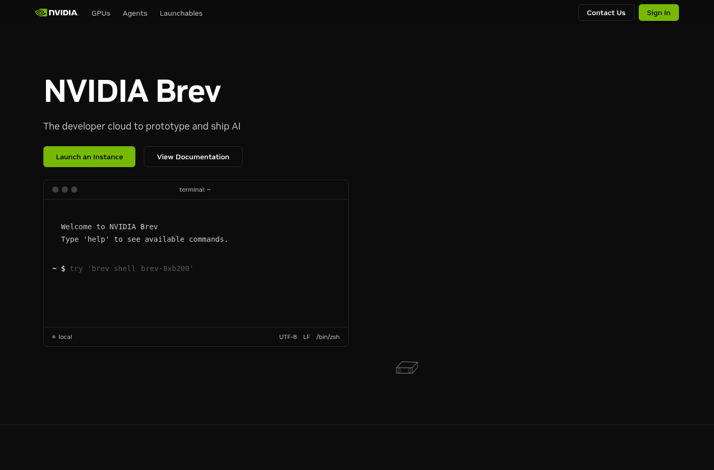
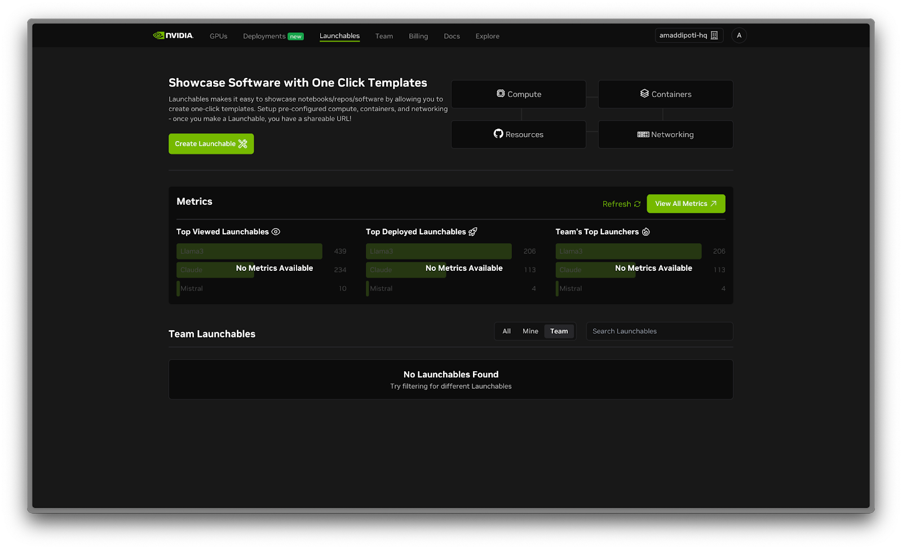
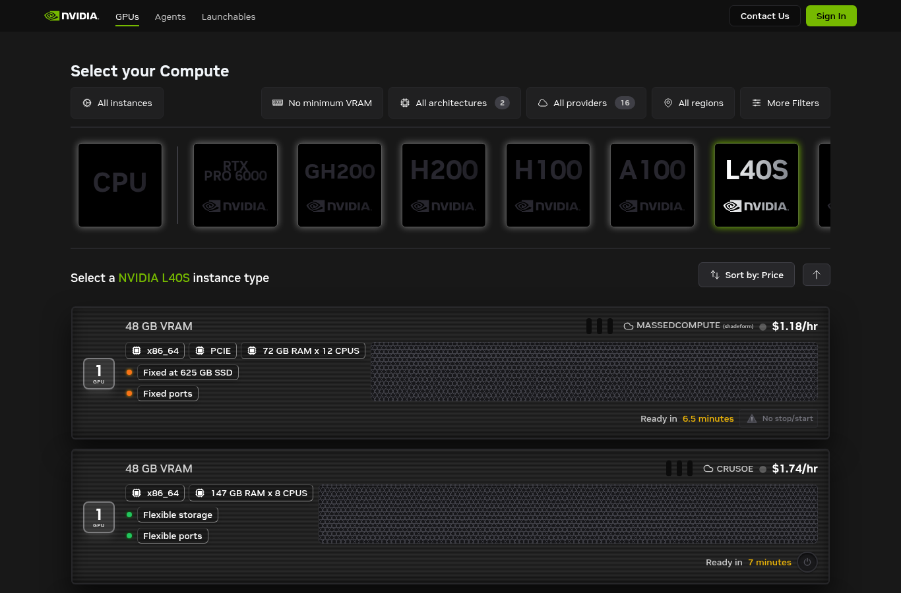
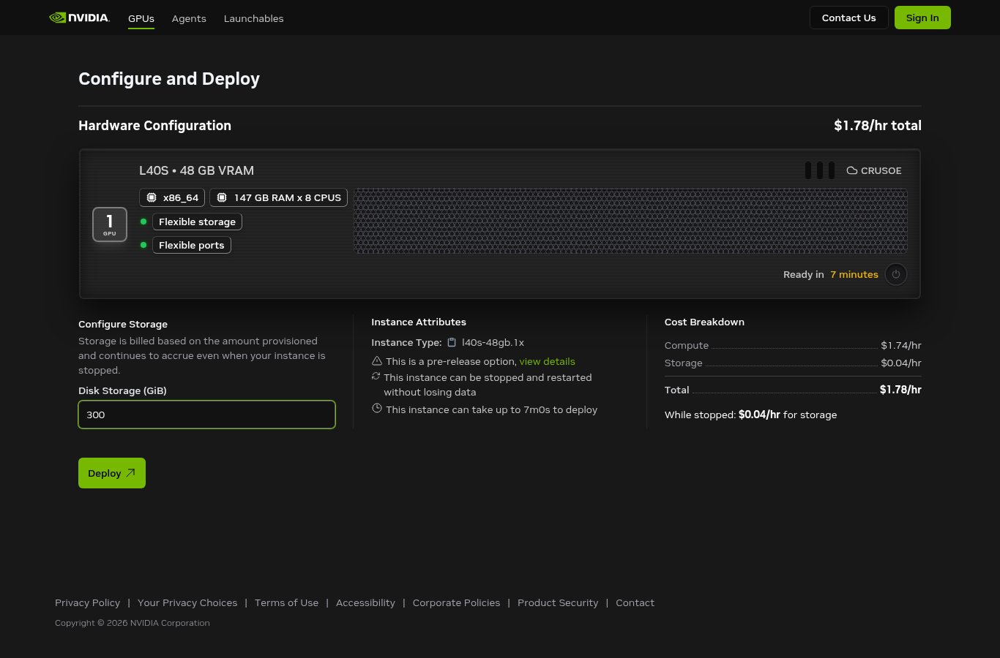
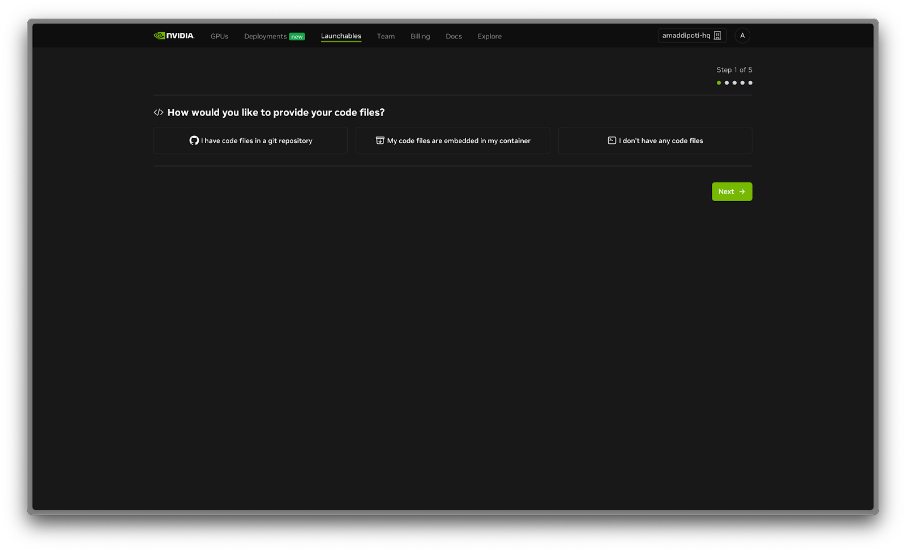
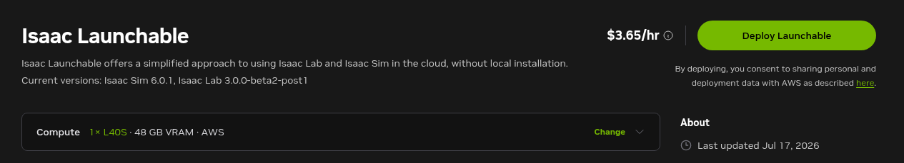
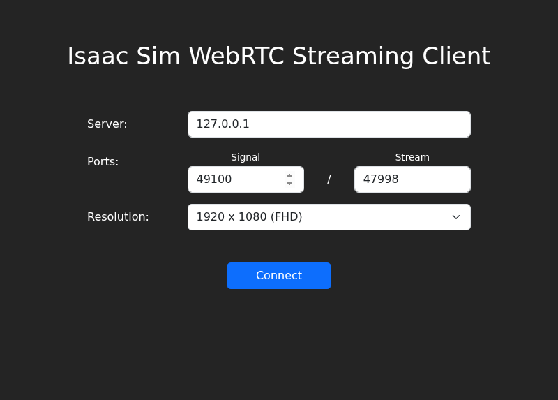
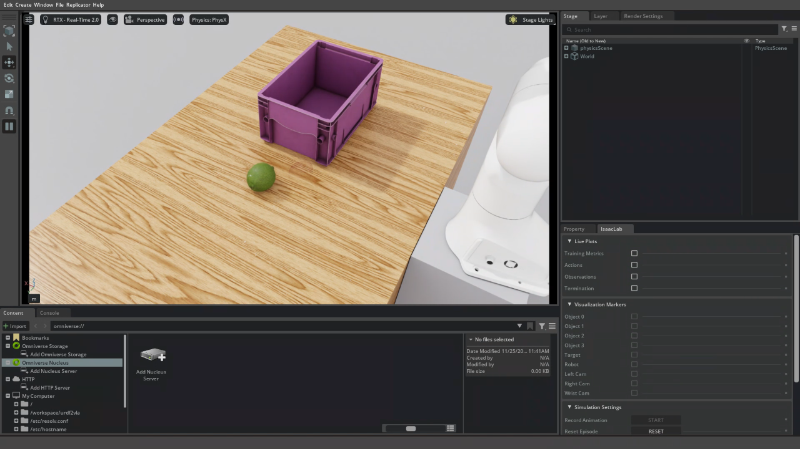
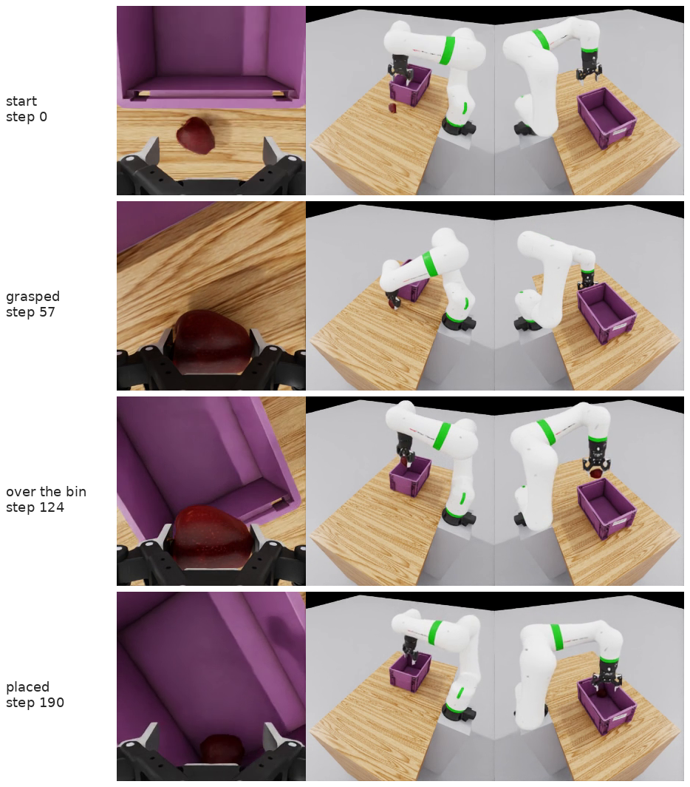

# Running on NVIDIA Brev

Start in the [Brev Console](https://brev.nvidia.com/) and follow the [Launchable setup](#launchable). Once the VM is ready,
you can verify the Franka simulation, open the Kit viewport, and record demonstrations.

## Before you start

| Item | What you need |
|---|---|
| Brev access | A Brev account in an organization that can deploy GPU instances |
| Compute and storage | One NVIDIA L40S and at least **300 GiB** for the full workflow. Choose a GPU with NVENC to stream Kit and at least **44 GB of VRAM** to train on the VM. |
| Hugging Face | Required for [model training and evaluation](#huggingface). You can run the Franka simulation and replay before signing in. |

!!! note
    `docker/run.sh` starts the simulation container with `ACCEPT_EULA=Y`, as it does on your own machine: using it means
    accepting the license of the Isaac Sim image (see
    [Isaac Sim's container installation](https://docs.isaacsim.omniverse.nvidia.com/6.2.0/installation/install_container.html)).

## Set up a Brev VM

- To create a reusable Launchable, start in the [Brev Console](#launchable). If you already have a Launchable link, skip to [deployment](#deploy-launchable).
- If you already have a Brev VM, start by [connecting over SSH](#connect-vm).

### Create a Brev Launchable {#launchable}

A Launchable saves the GPU, software, and network settings for a VM deployers can start from a link. Brev bills
the account that deploys the VM. The screenshots show the public console and published examples of signed-in
screens. The order and appearance of controls can vary by console version and provider.
[NVIDIA Brev Launchables](https://docs.nvidia.com/brev/concepts/launchables)

#### 1. Sign in and open the builder

Open the [Brev Console](https://brev.nvidia.com), select **Sign In**, and choose the organization that will own
the Launchable.

<figure markdown="span">
  
  <figcaption>Sign in from the Brev home page.</figcaption>
</figure>

Open **Launchables → Create Launchable**. Under **Details**, enter `urdf2vla` as the name and a short description.

<figure markdown="span">
  
  <figcaption>The Create Launchable button in NVIDIA’s published console example.</figcaption>
</figure>

#### 2. Choose the GPU and disk

Under **Default hardware configuration**, choose **one NVIDIA L40S** for simulation, streaming, and training on
the same VM. For public WebRTC streaming, choose an offer that allows custom TCP and UDP rules.

<figure markdown="span">
  
  <figcaption>Check the GPU count, storage, and port features on each offer.</figcaption>
</figure>

Set **Disk Storage (GiB)** to **300** or more and review the price for that offer.

<figure markdown="span">
  
  <figcaption>The public compute preview shows where to check storage and the total price.</figcaption>
</figure>

#### 3. Add the setup script

In **Software configuration**, choose **VM Mode** and leave Jupyter off. Open the raw
[brev_launchable.sh setup script](https://raw.githubusercontent.com/momoiorg-repository/urdf2vla/main/docker/brev_launchable.sh)
and paste the whole file into **Setup script**. Under **Source**, select **I don’t have any code files**. The
script clones urdf2vla and builds both containers.

The script defaults to `main`. To test changes before merging, set `URDF2VLA_REF` in the pasted script to the
public branch containing the changes. Use a release tag for a repeatable deployment.

<figure markdown="span">
  
  <figcaption>Choose the no-code-files option so the setup script can clone the repository.</figcaption>
</figure>

#### 4. Configure ports and optional credentials

Under **Network**, add these entries only for the viewers you plan to use.

| Feature | Brev setting |
|---|---|
| Isaac Sim signaling | **TCP/UDP Ports**, destination `49100`, protocol **TCP**, restricted to the deployer’s IP |
| Isaac Sim video | **TCP/UDP Ports**, destination `47998`, protocol **UDP**, restricted to the deployer’s IP |
| URDF browser viewer | **Secure Link**, name `Robot viewer`, HTTP port `8080` |

After deployment, check **Public Port** for each WebRTC rule. Brev may assign numbers that differ from the
destination ports. Enter the public numbers in the [WebRTC client](#desktop-streaming-client).

Leave **Launch parameters** empty for the Franka smoke test. For training, either sign in to Hugging Face on
the VM later or add an optional **Text** parameter named `HF_TOKEN` with an empty default. At deployment,
select a saved organization secret if you use this parameter. [NVIDIA Brev launch parameters](https://docs.nvidia.com/brev/concepts/launchables#launch-parameters)

#### 5. Save and deploy {#deploy-launchable}

1. To save a new Launchable, select **Only my organization** under **View access**, select **Create Launchable**, and copy the generated link.
2. Open the deployment link you just created or the one your team shared. Check the compute and estimated cost.
3. Select **Deploy Launchable**, then select **Go to Instance Page**.

<figure markdown="span">
  
  <figcaption>NVIDIA’s public Isaac Launchable shows where to find Deploy Launchable and the estimated price.</figcaption>
</figure>

### Connect to the VM {#connect-vm}

When the VM reaches **Running**, open **Access** and note the instance name. On your workstation, install the
[Brev CLI](https://docs.nvidia.com/brev/cli/getting-started), then sign in and connect. Replace `INSTANCE` with
the name shown in Brev.

<figure markdown="span">
  
  <figcaption>Open Access on the instance page. The Brev VM can be running while the urdf2vla setup script still works.</figcaption>
</figure>

```bash
brev login
brev shell INSTANCE
```

If you deployed a Launchable, [check the setup status](#check-setup) next. If you created a plain VM, run the setup script below.

### Run setup on an existing VM {#script}

For a plain Brev VM, run these commands in the VM terminal after connecting over SSH. For a VM started from the Launchable, continue to [Check that setup is ready](#check-setup).

On an existing VM, check `nvidia-smi`, `docker info`, and `df -h . /data` first. Setup can upgrade the driver and reboot, or switch Docker to a new storage directory. Existing containers and images stay in the previous directory if Docker switches storage.

```bash
curl -fsSL https://raw.githubusercontent.com/momoiorg-repository/urdf2vla/main/docker/brev_setup.sh -o /tmp/urdf2vla_brev_setup.sh
bash /tmp/urdf2vla_brev_setup.sh
```

The script clones the repository itself, onto the disk with the most free space. If you've already cloned it, run
`bash docker/brev_setup.sh` in it instead: it uses that checkout where it is, and warns if its disk is too small for
training checkpoints (24 GB each).

| Step | What the script does |
|---|---|
| [Driver](#driver) | Below 580: releases Brev's holds, pins the 580 branch, installs 580 and reboots. After the reboot, setup continues by itself |
| [Disk](#disk) | If the system disk has less than 130 GB free and a larger disk exists, switches Docker to a new directory there and keeps the NVIDIA settings in `/etc/docker/daemon.json`. When the script clones the repository to the larger disk, it links it from `~/urdf2vla`. |
| [CDI](#cdi) | Generates `/etc/cdi/nvidia.yaml` and checks that a container sees the GPU |
| [Build and start](#build) | Adds you to the `docker` group, installs uv and the `urdf2vla` command (`.venv`), runs `docker/build.sh` and `docker/run.sh` for both containers, then `urdf2vla doctor` |

If setup fails, fix the error shown in the log and rerun the setup script. It resumes at the failed stage.

### Check that setup is ready {#check-setup}

On the VM, check the setup status and log. For an existing checkout, run `bash docker/brev_setup.sh --status`
from that checkout. If the driver upgrade reboots the VM, reconnect. The systemd service resumes setup after boot.

```bash
bash ~/urdf2vla/docker/brev_setup.sh --status
tail -f /var/log/urdf2vla-setup.log
```

Allow around 30 minutes for setup. Press Ctrl+C to stop following the log. When setup reports completion, open the checkout and run the checks. If you reused a checkout, use its actual path.

```bash
cd ~/urdf2vla
source .venv/bin/activate
urdf2vla doctor
```

Resolve any `doctor` errors before running the Franka smoke test.

## Verify the deployment with Franka {#franka-smoke-test}

Run these commands in the VM checkout. The first Isaac Sim start may take several minutes while Kit compiles shaders. Stop if a command returns a status other than `ok`. To resume an existing project, run `urdf2vla status --project projects/brev_franka`.

```bash
project=projects/brev_franka
urdf2vla init "$project" --from examples/franka/project.yaml
urdf2vla inspect_robot --project "$project"
urdf2vla configure_robot --project "$project"
urdf2vla configure_task --project "$project"
urdf2vla configure_camera --project "$project"
urdf2vla import_robot --project "$project"
urdf2vla launch_sim --project "$project"
```

Open the `*_start.png` and `*_end.png` files in the project's `snapshots/` directory. Check that the Franka arm, table, object, and bin are visible. Then [open the Kit viewport](#kit-livestream) or [record and replay three demonstrations](#franka-replay-test).

## Stream the Isaac Sim Kit viewport {#kit-livestream}

Use a GPU with NVIDIA NVENC, such as the L40S. The workstation needs a route to both Kit ports. For public access,
use the provider firewall or the Brev **Ports** tab. Restrict public access to
the deployer's IP because the native WebRTC stream has no built-in authentication. [Brev networking options](https://docs.nvidia.com/brev/concepts/launchables#network) ·
[Isaac Sim 6.2 livestream clients](https://docs.isaacsim.omniverse.nvidia.com/6.2.0/installation/manual_livestream_clients.html)

| Destination port | Protocol | Purpose |
|---|---|---|
| `49100` | TCP | WebRTC signaling |
| `47998` | UDP | WebRTC media |

Check the **Public Port** and **Destination Port** columns in Brev. The destination ports are Kit's ports on the VM.
When you connect through Brev's public endpoint, use the assigned public port numbers in your client.
[Kit stream settings](https://docs.omniverse.nvidia.com/kit/docs/omni.kit.livestream.app/latest/Overview.html)

<figure markdown="span">
  
  <figcaption>NVIDIA’s example shows the port controls and IP restriction on a deployed instance.</figcaption>
</figure>

After `import_robot` succeeds, run the command for your connection from the urdf2vla checkout on the VM.

=== "Public endpoint"

    Replace `STREAM_IPV4` with a public endpoint IPv4 address that the workstation can reach on both public ports.
    If Brev lists an endpoint as a hostname and port, look up the hostname alone on the VM with `getent ahostsv4 PUBLIC_HOSTNAME`.
    Mode `1` selects the Kit visualizer and advertises the address to the client.

    ```bash
    urdf2vla launch_sim --project projects/brev_franka --livestream 1 --public-ip STREAM_IPV4
    ```

=== "Private network"

    Connect the VM and workstation to the same routed private network or VPN. Use mode `2` to stream over that network.

    ```bash
    urdf2vla launch_sim --project projects/brev_franka --livestream 2
    ```

### Connect with the Isaac Sim WebRTC Streaming Client {#desktop-streaming-client}

On your **workstation**, download the **Isaac Sim WebRTC Streaming Client** for your OS and CPU architecture.
[NVIDIA client downloads](https://docs.isaacsim.omniverse.nvidia.com/6.2.0/installation/download.html#latest-release)

| Workstation | Installation |
|---|---|
| Windows | Run the `.exe` installer, then open **Isaac Sim WebRTC Streaming Client** from Start. |
| macOS | Open the `.dmg` for Apple silicon or Intel, then drag the app to **Applications**. |
| Ubuntu or Debian | From the download directory, run `sudo apt install ./isaacsim-webrtc-streaming-client-*-linux-*.deb` with the package for your architecture, then launch the app from the application menu. |

1. Keep `launch_sim` running on the Brev VM. Wait for `env ready` in the newest `*_launch_sim.log` under the project's `logs/` directory.
2. Open the client on your workstation. In **Server**, enter the IPv4 address supplied to `--public-ip` for mode `1`, or the reachable private IPv4 address of the VM for mode `2`.
3. For a Brev public endpoint, enter the TCP **Public Port** under **Signal** and the UDP **Public Port** under **Stream**. For a private or direct connection to Kit's default ports, use `49100` and `47998`.
4. Select **Connect**. Close the client to disconnect and press Ctrl+C in the VM terminal to stop Kit.

<figure markdown="span">
  
  <figcaption>Isaac Sim WebRTC Streaming Client 2.0.0 with its default values.</figcaption>
</figure>

If the client cannot connect, check the TCP port entered under **Signal** and close any other streaming client.
If it connects but shows a blank viewport, check the UDP port entered under **Stream** and try **View → Reload**.
[NVIDIA client setup and troubleshooting](https://docs.isaacsim.omniverse.nvidia.com/6.2.0/installation/manual_livestream_clients.html#isaac-sim-short-webrtc-streaming-client)

### Browser viewer for remapped ports {#remapped-kit-ports}

NVIDIA's browser viewer accepts separate public signaling and media ports. In `launch_sim --livestream 1`, set
`--public-ip` to a reachable IPv4 address of the public endpoint. Keep Kit on its default destination ports.
Build the viewer with the hostname and **public** port numbers shown in Brev, without the `:port` suffix on the
hostname. [Isaac Sim 6.2 browser viewer](https://github.com/isaac-sim/IsaacSim/blob/v6.2.0/tools/docker/web-viewer/Dockerfile)

```bash
viewer_dir=$(mktemp -d)
curl -fsSL https://raw.githubusercontent.com/isaac-sim/IsaacSim/v6.2.0/tools/docker/web-viewer/Dockerfile \
  -o "$viewer_dir/Dockerfile"
docker build -t urdf2vla/kit-web-viewer \
  --build-arg ISAACSIM_HOST=PUBLIC_HOSTNAME \
  --build-arg ISAACSIM_SIGNAL_PORT=PUBLIC_TCP_PORT \
  --build-arg ISAACSIM_STREAM_PORT=PUBLIC_UDP_PORT "$viewer_dir"
docker run --rm -p 127.0.0.1:8210:8210 urdf2vla/kit-web-viewer
```

From your workstation, forward the viewer's HTTP port using `brev port-forward INSTANCE --port 8210:8210` and open
`http://localhost:8210` in Chromium or Chrome. The browser uses the public Brev endpoint for WebRTC. Close other
streaming clients before connecting. Kit supports one client at a time. [Brev port forwarding](https://docs.nvidia.com/brev/cli/connectivity) ·
[Isaac Sim client limits](https://docs.isaacsim.omniverse.nvidia.com/6.2.0/installation/manual_livestream_clients.html)

<figure markdown="span">
  
  <figcaption>The Franka scene streamed through Brev to the browser viewer.</figcaption>
</figure>

### Viewer and teleoperation over SSH

If you configured a Secure Link, run `urdf2vla view --project projects/brev_franka --port 8080` on the VM and open **Robot viewer** in the Brev Console.

- `urdf2vla view` serves on port 8080: `ssh -L 8080:localhost:8080 <instance>` and open `http://localhost:8080`.
- Record with the terminal keyboard: `collect_dataset --device socket` in one SSH session and `urdf2vla teleop-keys`
  in a second one.

## Record and replay three demonstrations {#franka-replay-test}

After the scene checks pass, run a short smoke test through Isaac Sim and the GR00T container. This test uses
recorded actions, so it requires no model checkpoint or Hugging Face sign-in. Stop any Kit livestream first to free
the GPU. Use a fresh dataset name for a repeated run.

```bash
project=projects/brev_franka
dataset=brev_smoke
urdf2vla configure_vla_interface --project "$project"
urdf2vla setup_teleoperation --project "$project"
urdf2vla collect_dataset --project "$project" --device scripted --num-demos 3 --dataset "$dataset"
urdf2vla convert_dataset --project "$project" --dataset "$dataset"
urdf2vla evaluate_vla --project "$project" --replay --dataset "$dataset" --episodes 3 --video
```

Recording can take more than three attempts because it saves only successful demonstrations. Check
`build/collect_report.yaml` for the saved count and `build/eval_report.yaml` for the replay results. Replay checks the
recorded actions and the server connection. The `--video` option saves one MP4 per episode in `build/eval_videos/`.

<figure>
  <video controls muted playsinline preload="none" width="100%" poster="../../assets/brev_franka_replay.jpg" src="../../assets/brev_franka_replay.mp4" aria-label="Franka replay from three cameras"></video>
  <figcaption>The Franka places a cube in the bin during replay. From left to right: wrist, left, and right camera.</figcaption>
</figure>

To train and evaluate a model, [set up Hugging Face access](#huggingface) next.

## Train or evaluate a GR00T model {#huggingface}

GR00T N1.7 uses the vision-language model `nvidia/Cosmos-Reason2-2B`, which is **gated**: training and evaluation
stop with `401 Client Error … Cannot access gated repo` until you have access.

1. Open [huggingface.co/nvidia/Cosmos-Reason2-2B](https://huggingface.co/nvidia/Cosmos-Reason2-2B) and accept the
   license.
2. Create a token with read access at [huggingface.co/settings/tokens](https://huggingface.co/settings/tokens).
3. Log in on the instance (the token is saved in `~/.cache/huggingface/token`, which the containers share):

    ```bash
    hf auth login
    ```

Keep a copy of the token on `/data` (for example `/data/secrets/hf_token`, mode 600) if your instance's home
directory doesn't survive a stop, and copy it back to `~/.cache/huggingface/token` afterwards.

Continue with [Train and evaluate](training.md).

## FANUC CRX-3iA benchmark

FANUC CRX-3iA measurements from one NVIDIA L40S (46 GB), 8 CPUs, 144 GB RAM, and Ubuntu 22.04.

| Step | Result | Time | Peak GPU memory |
|---|---|---|---|
| `import_robot` (first run) | 10/10 checks, asks for the starting pose | 447 s (first start of Isaac Sim fills the shader cache) | 4.9 GB |
| `import_robot` (after `answer robot.default_pose=suggested`) | 10/10 | 37 s | 4.8 GB |
| `launch_sim` | 22/22 (cameras, objects, grasp holds) | 204 s | 5.5 GB |
| `setup_teleoperation` | 4/4 | 64 s | 5.5 GB |
| `collect_dataset --device scripted --num-demos 50` | 50 of 59 attempts (84.7 %) | 33 min | 5.5 GB |
| `convert_dataset` | 5/5 | 68 s | – |
| `convert_dataset --layout droid` | 6/6 (100 episodes: each demo with the left and the right camera) | 3 min | – |
| `train_vla` (urdf2vla layout, 3 cameras, 10,000 steps, batch 32) | release check 10/10 | about 2 h 40 min (1.07 steps/s) | 41.9 GB |
| `train_vla` (`--layout droid`, 2 cameras) | release check 10/10 | 2 h 8 min (1.38 steps/s) | 40.9 GB |
| `evaluate_vla --episodes 20 --video` | see [Results](#results) | 10–11 min | 12.4 GB |

Training and evaluation don't fit on the GPU at the same time (41 GB + Isaac Sim + the inference server). To
evaluate a checkpoint while another training runs, stop the training right after it saves a checkpoint, evaluate,
and run the same `train_vla` command again: it resumes from the last checkpoint.

Before a 30-minute evaluation, check that the model releases the gripper (about a minute, no simulation):

```bash
urdf2vla train_vla --project projects/crx3ia --dataset demos_droid --check-only training/crx3ia_demos_droid/checkpoints/checkpoint-10000
```

### Trained-model results {#results}

Both models were fine-tuned from `nvidia/GR00T-N1.7-DROID` (the default for single-arm robots) on the same 50 scripted
demos, and evaluated on the same 20 episodes (same seed: random object and position each episode).

| | urdf2vla layout (default) | `--layout droid` |
|---|---|---|
| Cameras the model sees | wrist + left + right | wrist + one exterior (training: left or right per episode; evaluation: left) |
| Arm state and actions | 6 joint targets | DROID's end-effector pose + 7 joints (the 7th padded) |
| **Success** | **20/20** | 19/20 (one pear never released) |
| Apple / cube / lime / pear | 5/5, 7/7, 3/3, 5/5 | 5/5, 7/7, 3/3, 4/5 |
| Median episode | 174 steps (8.7 s) | 173 steps |
| Median distance from the target | 15 mm | 12 mm |

The 3-camera model is on Hugging Face:
[`umegan/urdf2vla-crx3ia-gr00t-n1.7`](https://huggingface.co/umegan/urdf2vla-crx3ia-gr00t-n1.7) (NVIDIA Open Model
License; its model card shows how to evaluate it with urdf2vla).

**Use the default urdf2vla layout** (all cameras, `convert_dataset` without `--layout`). It was as good or better,
and every frame shows the model all three views. The DROID layout trains about 30 % faster; keep it for experiments.

A first DROID-layout model trained on episodes that ended 13 steps after the gripper opened scored 0/3: it grasped
and carried every object to the bin but never let go. `convert_dataset` now holds the final frame so the release
is learned, checks it (`gripper_timing`), and `train_vla` checks the trained model before you evaluate it
(`release_check`: 0/10 for that model, 10/10 for both models above).



Videos and images of the evaluation: [Trained models](../models.md#crx3ia).

## Troubleshoot or set up manually

Use these steps if the setup script stops or you need to configure the VM by hand.

### Install NVIDIA driver 580 or newer {#driver}

Isaac Sim 6.2 and the GR00T image need driver **580 or newer**. With an older driver, the first Isaac Sim step stops
with `The NVIDIA driver on your system is too old (found version 12070)`: the image's PyTorch is built for CUDA 13.

Check with `nvidia-smi`. If the driver is older, the fastest fix is to pick an instance image with a newer driver.
To upgrade in place (our instance came with 565.57.01):

```bash
# Brev holds the installed driver; release the holds (also on nvidia-modprobe, nvidia-settings, nvidia-prime)
sudo apt-mark unhold $(apt-mark showhold | grep -E 'nvidia|cuda-drivers')
# keep every driver package on the 580 branch (otherwise the CUDA repository mixes in a newer branch)
apt-get download nvidia-driver-pinning-580 && sudo dpkg -i nvidia-driver-pinning-580_*.deb
# remove the old driver, install 580 (the kernel module is built with DKMS)
sudo apt-get purge -y $(dpkg -l | awk '$1 ~ /^[ih]i$/ && $2 ~ /565/ {print $2}')
sudo apt-get install -y nvidia-driver-580-open nvidia-utils-580 nvidia-compute-utils-580
sudo reboot
```

After reboot, confirm the driver version with `nvidia-smi`, then regenerate the [CDI specification](#cdi).

### Move Docker storage to a larger disk {#disk}

Brev instances have a small system disk (124 GB on ours) and a large one under `/data` (295 GB). Put Docker's images
and the repository on `/data`:

```bash
# Docker: add "data-root": "/data/docker" to /etc/docker/daemon.json (keep the nvidia runtime entries), then
sudo systemctl restart docker && docker info | grep "Root Dir"
# repository
cd /data && git clone https://github.com/momoiorg-repository/urdf2vla.git
```

What takes the space (measured):

| | |
|---|---|
| Images | Isaac Lab Arena 38 GB, GR00T 26 GB (plus a 26 GB base image that shares its layers). About 64 GB, plus up to 50 GB of build cache (`docker builder prune` frees it) |
| Dataset | 50 FANUC demos: 2.6 GB (HDF5), 61 MB converted |
| GR00T models | 6.5 GB (`nvidia/GR00T-N1.7-DROID`) + 4.6 GB (`nvidia/Cosmos-Reason2-2B`) in `~/.cache/huggingface` |
| **Checkpoints** | **24 GB each** (11 GB weights + 13 GB optimizer state). `train_vla` keeps 2 by default (`--save-total-limit`) |

Checkpoints are the part that runs out. With 5 kept per run, two runs filled the 295 GB disk and the second one
died while saving. `train_vla` now refuses to start when there isn't room for its checkpoints. To free space after a
run, delete `optimizer.pt` from finished checkpoints: it's only needed to resume training, and the weights stay
usable for `evaluate_vla`.

### Enable Docker GPU access with CDI {#cdi}

The NVIDIA Container Toolkit on Brev runs in **CDI mode**: `docker run --gpus all` uses a description of the GPU in
`/etc/cdi/nvidia.yaml`. On our instance that file was missing, and `docker run --gpus all` failed with:

```text
could not apply required modification to OCI specification: error modifying OCI spec:
failed to inject CDI devices: unresolvable CDI devices nvidia.com/gpu=all
```

Generate it:

```bash
sudo nvidia-ctk cdi generate --output=/etc/cdi/nvidia.yaml
docker run --rm --gpus all ubuntu nvidia-smi        # should print the GPU
```

- With a driver **older than 580**, `nvidia-ctk` crashes (`free(): invalid pointer` in `nvSandboxUtilsShutdown`). Add
  `--feature-flag=disable-nvsandboxutils`.
- **After a driver upgrade, generate it again.** The file names the driver's library versions, and it was not
  refreshed by itself after our upgrade.

### Build and start the containers {#build}

```bash
uv venv .venv && uv pip install -e '.[view,dev,docs]' xacro && source .venv/bin/activate
bash docker/build.sh            # Arena image 13 min, GR00T image 4 min on the L40S
bash docker/run.sh && bash docker/run.sh gr00t
urdf2vla doctor
```

Run `docker/build.sh` in a way that survives your SSH session ending (`tmux`, or `setsid nohup … &`): the build
stops if the shell that started it exits.

### The GR00T server port {#port}

Brev runs NVIDIA DCGM, whose `nv-hostengine` listens on `127.0.0.1:5555`, the GR00T inference server's default
port. `evaluate_vla` moves to the next free port by itself and says so in its warnings; `doctor` reports it as info.
