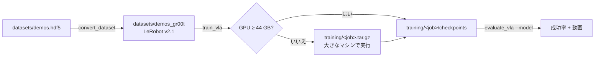

# 学習と評価

urdf2vla はデモで **NVIDIA Isaac GR00T N1.7** を fine-tune します。腕 1 本のロボットは `nvidia/GR00T-N1.7-DROID`
（単腕の DROID のデータで fine-tune した GR00T）から、腕 2 本は `nvidia/GR00T-N1.7-3B` から始めます。変換・学習・モデルの推論サーバは
すべて GR00T のコンテナ（`bash docker/run.sh gr00t`）で動きます。



## 1. 記録を変換する

```bash
urdf2vla convert_dataset --project projects/myrobot --dataset demos
```

`datasets/demos_gr00t/` に LeRobot v2.1 形式で書き、GR00T N1.7 が必要とするものを加えます: `modality.json`（どの列が
どの関節・グリッパ・カメラか）、正規化の統計、fine-tune 用の modality config。その後、GR00T 自身のデータローダで読み、
動画の全フレームを元の画像と比べます。変換の誤りを、何時間も学習した後ではなくここで見つけるためです。`--force` で
作り直します。

各エピソードの末尾には最後のフレーム（グリッパは開いたまま、腕は止まったまま）を繰り返して足します。GR00T は
行動の列がまるごと収まる step からしか学習の標本を取らないので、こうしないとグリッパを開く瞬間を学べません。
`gripper_timing` の検査で、どの開閉も評価で実行される行動の列の範囲に入ることを確かめます。これがないと、
学習の損失は十分に下がっていても、掴んで箱まで運び、離さないモデルになることがあります。

各エピソードは自分の指示文を持ちます。`meta/tasks.jsonl` に異なる指示文（*"put the apple in the bin"*、
*"put the lime in the bin"* など）を並べ、各フレームがそのエピソードの指示文を指すので、モデルは指示文が名指しする
ものに従って動くことを学びます。

## 2. 学習する

```bash
urdf2vla train_vla --project projects/myrobot --dataset demos
```

`train_vla` は学習ジョブ `training/<プロジェクト>_<データセット>/train.sh` を書き、GR00T で引数を検査してから、GPU を
確かめます。

- **44 GB 以上:** その場で学習を始め、checkpoint を `training/<job>/checkpoints/` に書きます。
- **それ未満:** ジョブと変換済みのデータセットを `training/<job>.tar.gz` にまとめ、そのことを `warnings` で伝えます。
  言語モデルと画像エンコーダを凍結しても、30 億パラメータのモデルのためにこれだけのメモリが要ります。

| 既定 | 値 | オプション |
|---|---|---|
| 学習ステップ数 | 10,000 | `--max-steps` |
| global batch size | 32 | `--batch-size` |
| checkpoint の保存 | 1,000 ステップごと | `--save-steps` |
| 残す checkpoint | 2 つ（1 つ約 24 GB: 重み 11 GB + optimizer の状態 13 GB） | `--save-total-limit` |
| 学習するもの | projector と拡散モデルの行動ヘッド（LLM と画像エンコーダは凍結） | — |
| ベースモデル | 腕 1 本は `nvidia/GR00T-N1.7-DROID`、2 本は `nvidia/GR00T-N1.7-3B` | `--base-model` |

どちらのベースモデルも、利用規約への同意が要る `nvidia/Cosmos-Reason2-2B` を使います。先に Hugging Face で同意して
ログインしてください（`urdf2vla doctor` が確かめます。[NVIDIA Brev で動かす](brev.md#huggingface)）。

その場での学習が終わると、`train_vla` は最後の checkpoint で **release_check** を実行します（シミュレーションなし、
1 分ほど）: デモがグリッパを開く直前に、モデルも開くか。割合が低ければ `warnings` で伝えます。
`--check-only <checkpoint>` で、どの checkpoint にも実行できます。

!!! note "`convert_dataset --layout droid`"
    7 関節以下の腕 1 本なら、GR00T の DROID の並び（`datasets/<名前>_droid_gr00t`: 手先カメラと外部カメラ 1 台、
    手先の姿勢と関節 7）にも変換できます。`train_vla --dataset <名前>_droid` で学習し、`evaluate_vla --droid` で
    評価します。各デモを外部カメラごとに 1 回ずつ書きます。FANUC の例では学習が約 30 % 速かったものの、既定の並びを
    上回らなかった（19/20 と 20/20、[結果](brev.md#results)）ので、既定の並びをすすめます。

### 別のマシンで学習する {#another-machine}

まとめたジョブは、GR00T の image が動く所ならどこでも動きます。学習するマシンで:

1. **image を用意します。** urdf2vla を clone して `bash docker/build.sh gr00t` を実行するか、image をコピーします。

    ```bash
    docker save urdf2vla/gr00t:23ace64 | gzip > urdf2vla-gr00t.tar.gz     # 手元のマシンで
    docker load < urdf2vla-gr00t.tar.gz                                  # 学習するマシンで
    ```

2. ベースモデルを取得できるよう **Hugging Face にログインします**（`hf auth login`）。

3. **ジョブを実行します。** 正確なコマンドは `train.sh` の先頭に書いてあります。

    ```bash
    tar -xzf myrobot_demos.tar.gz && cd myrobot_demos
    docker run --rm --gpus all --shm-size=16g -u "$(id -u):$(id -g)" -e USER="$(id -un)" -e HOME=/tmp \
      -e HF_HOME=/hf -v "$HOME/.cache/huggingface":/hf -v "$PWD":/job urdf2vla/gr00t:23ace64 bash /job/train.sh
    ```

    `-u` であなたのユーザとして実行するので、checkpoint と Hugging Face のキャッシュが root の所有になりません。

4. **checkpoint を持ち帰り**、プロジェクトに置きます（例: `projects/myrobot/training/myrobot_demos/checkpoints/`）。

Docker を使わず、Isaac-GR00T N1.7 を入れた環境で動かすなら:
`GR00T_ROOT=/path/to/Isaac-GR00T GR00T_PYTHON=python bash train.sh`

## 3. 評価する

```bash
urdf2vla evaluate_vla --project projects/myrobot \
  --model training/myrobot_demos/checkpoints/checkpoint-10000 --episodes 20 --video
```

`evaluate_vla` は GR00T のコンテナで checkpoint を読んだ推論サーバを、シミュレーション用コンテナで Isaac Sim を起動し、
物体とその位置をランダムにしてエピソードを実行します。シミュレータがカメラ画像・ロボットの状態・タスクの文を送り、
モデルが次の行動を返します。結果は `build/eval_report.yaml` に書きます。

- エピソード全体での `success_rate`（成功の判定は記録のときと同じ）
- `--video` を付けると、モデルが見た画像の動画をエピソードごとに `build/eval_videos/` に
- 最後の場面の `snapshots/eval_*.png`

| オプション | 意味 |
|---|---|
| `--model` | checkpoint のフォルダ。相対パスはプロジェクトからの相対。コンテナから読めるよう、リポジトリの中に置いてください |
| `--episodes` | エピソード数（既定 10） |
| `--execution-horizon` | 予測した行動のうち、次にモデルに聞くまでに実行する数（既定 16） |
| `--replay` | モデルの代わりに変換済みのデータセットを再生します。モデル以外のすべてを試せます（[チュートリアル](../tutorial.md#replay)） |

失敗したエピソードには、報告書で名前が付きます: `never_closed`、`missed_grasp`、`never_released`、
`released_off_target`。いちばん多いものは、見るところと一緒に `warnings` で伝えます。

!!! success "NVIDIA L40S での実測"
    FANUC CRX-3iA、スクリプトのデモ 50 個、`nvidia/GR00T-N1.7-DROID` から 10,000 ステップ fine-tune（約 2 時間 40 分、
    41.9 GB）: 評価で **20/20**、20 エピソードで約 10 分。詳しくは [NVIDIA Brev で動かす](brev.md#results)。
