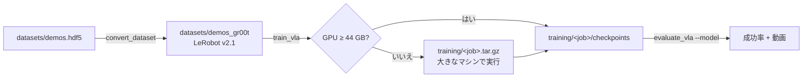

# 学習と評価

urdf2vla はデモで **NVIDIA Isaac GR00T N1.7**（`nvidia/GR00T-N1.7-3B`）を fine-tune します。変換・学習・モデルの推論サーバは
すべて GR00T のコンテナ（`bash docker/run.sh gr00t`）で動きます。



## 1. 記録を変換する

```bash
urdf2vla convert_dataset --project projects/myrobot --dataset demos
```

`datasets/demos_gr00t/` に LeRobot v2.1 形式で書き、GR00T N1.7 が必要とするものを加えます: `modality.json`（どの列が
どの関節・グリッパ・カメラか）、正規化の統計、fine-tune 用の modality config。その後、GR00T 自身のデータローダで読み、
動画の全フレームを元の画像と比べます。変換の誤りを、何時間も学習した後ではなくここで見つけるためです。`--force` で
作り直します。

## 2. 学習する

```bash
urdf2vla train_vla --project projects/myrobot --dataset demos
```

`train_vla` は学習ジョブ `training/<プロジェクト>_<データセット>/train.sh` を書き、GR00T で引数を検査してから、GPU を
確かめます。

- **44 GB 以上:** その場で学習を始め、checkpoint を `training/<job>/checkpoints/` に書きます。
- **それ未満:** ジョブと変換済みのデータセットを `training/<job>.tar.gz` にまとめ、そのことを `warnings` で伝えます。
  言語モデルと画像エンコーダを凍結しても、30 億パラメータのモデルのためにこれだけのメモリが要ります。

| 既定 | 値 | オプション |
|---|---|---|
| 学習ステップ数 | 10,000 | `--max-steps` |
| global batch size | 32 | `--batch-size` |
| checkpoint の保存 | 1,000 ステップごと（最新 5 つを残す） | `--save-steps` |
| 学習するもの | projector と拡散モデルの行動ヘッド（LLM と画像エンコーダは凍結） | — |
| ベースモデル | Hugging Face の `nvidia/GR00T-N1.7-3B` | `--base-model` |

### 別のマシンで学習する {#another-machine}

まとめたジョブは、GR00T の image が動く所ならどこでも動きます。学習するマシンで:

1. **image を用意します。** urdf2vla を clone して `bash docker/build.sh gr00t` を実行するか、image をコピーします。

    ```bash
    docker save urdf2vla/gr00t:23ace64 | gzip > urdf2vla-gr00t.tar.gz     # 手元のマシンで
    docker load < urdf2vla-gr00t.tar.gz                                  # 学習するマシンで
    ```

2. ベースモデルを取得できるよう **Hugging Face にログインします**（`hf auth login`）。

3. **ジョブを実行します。** 正確なコマンドは `train.sh` の先頭に書いてあります。

    ```bash
    tar -xzf myrobot_demos.tar.gz && cd myrobot_demos
    docker run --rm --gpus all --shm-size=16g -u "$(id -u):$(id -g)" -e USER="$(id -un)" -e HOME=/tmp \
      -e HF_HOME=/hf -v "$HOME/.cache/huggingface":/hf -v "$PWD":/job urdf2vla/gr00t:23ace64 bash /job/train.sh
    ```

    `-u` であなたのユーザとして実行するので、checkpoint と Hugging Face のキャッシュが root の所有になりません。

4. **checkpoint を持ち帰り**、プロジェクトに置きます（例: `projects/myrobot/training/myrobot_demos/checkpoints/`）。

Docker を使わず、Isaac-GR00T N1.7 を入れた環境で動かすなら:
`GR00T_ROOT=/path/to/Isaac-GR00T GR00T_PYTHON=python bash train.sh`

## 3. 評価する

```bash
urdf2vla evaluate_vla --project projects/myrobot \
  --model training/myrobot_demos/checkpoints/checkpoint-10000 --episodes 20 --video
```

`evaluate_vla` は GR00T のコンテナで checkpoint を読んだ推論サーバを、シミュレーション用コンテナで Isaac Sim を起動し、
立方体の位置をランダムにしてエピソードを実行します。シミュレータがカメラ画像・ロボットの状態・タスクの文を送り、
モデルが次の行動を返します。結果は `build/eval_report.yaml` に書きます。

- エピソード全体での `success_rate`（成功の判定は記録のときと同じ）
- `--video` を付けると、モデルが見た画像の動画をエピソードごとに `build/eval_videos/` に
- 最後の場面の `snapshots/eval_*.png`

| オプション | 意味 |
|---|---|
| `--model` | checkpoint のフォルダ。相対パスはプロジェクトからの相対。コンテナから読めるよう、リポジトリの中に置いてください |
| `--episodes` | エピソード数（既定 10） |
| `--execution-horizon` | 予測した行動のうち、次にモデルに聞くまでに実行する数（既定 16） |
| `--replay` | モデルの代わりに変換済みのデータセットを再生します。モデル以外のすべてを試せます（[チュートリアル](../tutorial.md#replay)） |

!!! warning "検証した範囲"
    この版（Isaac Lab 3.0）では、変換・ジョブの作成・引数の検査・replay の評価を一通り試しています。実際の学習と、
    その checkpoint での評価は、44 GB の GPU が必要なためまだ実行していません。
