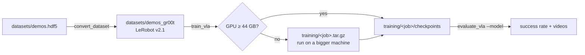

# Train and evaluate

urdf2vla fine-tunes **NVIDIA Isaac GR00T N1.7** (`nvidia/GR00T-N1.7-3B`) on your demonstrations. Converting, training
and serving the model all happen in the GR00T container (`bash docker/run.sh gr00t`).



## 1. Convert the recording

```bash
urdf2vla convert_dataset --project projects/myrobot --dataset demos
```

This writes `datasets/demos_gr00t/` in the LeRobot v2.1 format with what GR00T N1.7 needs on top: `modality.json`
(which columns are which joints, gripper and cameras), normalization statistics, and a modality config file for
fine-tuning. It then loads the result with GR00T's own data loader and compares every video frame with the original
images, so a broken conversion is caught here rather than after hours of training. `--force` rebuilds an existing
conversion.

Each episode keeps its own instruction: `meta/tasks.jsonl` lists every distinct instruction (*"put the apple in the
tray"*, *"put the lime in the tray"*, …) and every frame points to its episode's one, so the model learns to act on what
the instruction names.

## 2. Train

```bash
urdf2vla train_vla --project projects/myrobot --dataset demos
```

`train_vla` writes a training job, `training/<project>_<dataset>/train.sh`, checks its arguments with GR00T, and then
looks at your GPU:

- **44 GB or more:** it trains right away and writes checkpoints to `training/<job>/checkpoints/`.
- **Less:** it packs the job and the converted dataset into `training/<job>.tar.gz` and tells you so in `warnings`.
  The memory need comes from the 3-billion-parameter model even with its language model and vision encoder frozen.

| Default | Value | Option |
|---|---|---|
| Training steps | 10,000 | `--max-steps` |
| Global batch size | 32 | `--batch-size` |
| Checkpoint every | 1,000 steps (last 5 kept) | `--save-steps` |
| What is trained | the projector and the diffusion action head (LLM and vision encoder frozen) | — |
| Base model | `nvidia/GR00T-N1.7-3B` from Hugging Face | `--base-model` |

### Training on another machine {#another-machine}

The packed job runs anywhere the GR00T image runs. On the training machine:

1. **Get the image.** Either clone urdf2vla there and run `bash docker/build.sh gr00t`, or copy the image:

    ```bash
    docker save urdf2vla/gr00t:23ace64 | gzip > urdf2vla-gr00t.tar.gz     # on your machine
    docker load < urdf2vla-gr00t.tar.gz                                  # on the training machine
    ```

2. **Log in to Hugging Face** (`hf auth login`) so the base model can be downloaded.

3. **Run the job.** The exact command is at the top of `train.sh`:

    ```bash
    tar -xzf myrobot_demos.tar.gz && cd myrobot_demos
    docker run --rm --gpus all --shm-size=16g -u "$(id -u):$(id -g)" -e USER="$(id -un)" -e HOME=/tmp \
      -e HF_HOME=/hf -v "$HOME/.cache/huggingface":/hf -v "$PWD":/job urdf2vla/gr00t:23ace64 bash /job/train.sh
    ```

    `-u` runs it as you, so the checkpoints and the Hugging Face cache aren't owned by root.

4. **Bring the checkpoints back** into your project, e.g. to `projects/myrobot/training/myrobot_demos/checkpoints/`.

Without Docker, in an environment where Isaac-GR00T N1.7 is installed:
`GR00T_ROOT=/path/to/Isaac-GR00T GR00T_PYTHON=python bash train.sh`.

## 3. Evaluate

```bash
urdf2vla evaluate_vla --project projects/myrobot \
  --model training/myrobot_demos/checkpoints/checkpoint-10000 --episodes 20 --video
```

`evaluate_vla` starts the GR00T inference server with your checkpoint in the GR00T container, starts Isaac Sim in the
simulation container, and runs episodes with a random object at a random position: the simulator sends the camera images, the robot
state and the task text; the model answers with the next actions. The result is in `build/eval_report.yaml`:

- `success_rate` over the episodes, with the same success rule as recording,
- with `--video`, one video per episode in `build/eval_videos/` showing what the model saw,
- `snapshots/eval_*.png` of the final scene.

| Option | Meaning |
|---|---|
| `--model` | checkpoint folder; relative paths are relative to the project. Keep it inside the repository so the containers can read it. |
| `--episodes` | number of episodes (default 10) |
| `--execution-horizon` | how many of the predicted actions to execute before asking the model again (default 16) |
| `--replay` | instead of a model, replay the converted dataset — tests everything except the model (see the [tutorial](../tutorial.md#replay)) |

!!! warning "What has been verified"
    With this version (Isaac Lab 3.0), conversion, job packaging, argument checks and replay evaluation are tested end
    to end. A full training run and an evaluation of the resulting checkpoint have not been run yet, because they need
    a 44 GB GPU.
