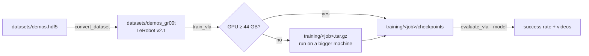

# Train and evaluate

urdf2vla fine-tunes **NVIDIA Isaac GR00T N1.7** on your demonstrations: from `nvidia/GR00T-N1.7-DROID` (GR00T
fine-tuned on the single-arm DROID dataset) for a robot with one arm, and from `nvidia/GR00T-N1.7-3B` for two arms. Converting, training
and serving the model all happen in the GR00T container (`bash docker/run.sh gr00t`).



## 1. Convert the recording

```bash
urdf2vla convert_dataset --project projects/myrobot --dataset demos
```

This writes `datasets/demos_gr00t/` in the LeRobot v2.1 format with what GR00T N1.7 needs on top: `modality.json`
(which columns are which joints, gripper and cameras), normalization statistics, and a modality config file for
fine-tuning. It then loads the result with GR00T's own data loader and compares every video frame with the original
images, so a broken conversion is caught here rather than after hours of training. `--force` rebuilds an existing
conversion.

The end of each episode is extended by repeating its last frame (the gripper open, the arm still) so that GR00T, which
only starts training samples where a full action chunk fits, also learns the moment the gripper opens. The
`gripper_timing` check confirms that every release falls inside the part of an action chunk that evaluation executes.
Without it a model can grasp, carry the object to the bin and never let go, while its training loss looks fine.

Each episode keeps its own instruction: `meta/tasks.jsonl` lists every distinct instruction (*"put the apple in the
bin"*, *"put the lime in the bin"*, …) and every frame points to its episode's one, so the model learns to act on what
the instruction names.

## 2. Train

```bash
urdf2vla train_vla --project projects/myrobot --dataset demos
```

`train_vla` writes a training job, `training/<project>_<dataset>/train.sh`, checks its arguments with GR00T, and then
looks at your GPU:

- **44 GB or more:** it trains right away and writes checkpoints to `training/<job>/checkpoints/`.
- **Less:** it packs the job and the converted dataset into `training/<job>.tar.gz` and tells you so in `warnings`.
  The memory need comes from the 3-billion-parameter model even with its language model and vision encoder frozen.

| Default | Value | Option |
|---|---|---|
| Training steps | 10,000 | `--max-steps` |
| Global batch size | 32 | `--batch-size` |
| Checkpoint every | 1,000 steps | `--save-steps` |
| Checkpoints kept | 2 (each is about 24 GB: 11 GB weights + 13 GB optimizer state) | `--save-total-limit` |
| What is trained | the projector and the diffusion action head (LLM and vision encoder frozen) | — |
| Base model | `nvidia/GR00T-N1.7-DROID` for one arm, `nvidia/GR00T-N1.7-3B` for two | `--base-model` |

Both base models use the gated `nvidia/Cosmos-Reason2-2B`: accept its license on Hugging Face and log in first
(`urdf2vla doctor` checks it; see [Run on NVIDIA Brev](brev.md#huggingface)).

When training on the machine ends, `train_vla` runs a **release check** on the last checkpoint, without simulation
(about a minute): just before each demo opens the gripper, does the model open it too? A low rate is reported in
`warnings`. Run it on any checkpoint with `--check-only <checkpoint>`.

!!! note "`convert_dataset --layout droid`"
    For a single arm with up to 7 joints, the conversion can also write GR00T's DROID layout
    (`datasets/<name>_droid_gr00t`: the wrist camera and one exterior camera, the end-effector pose and 7 joints);
    train it with `train_vla --dataset <name>_droid` and evaluate with `evaluate_vla --droid`. Each demo is written
    once per exterior camera. On the FANUC example it trained about 30 % faster but did not beat the default layout
    (19/20 vs 20/20, see [results](brev.md#results)), so the default layout is recommended.

### Training on another machine {#another-machine}

The packed job runs anywhere the GR00T image runs. On the training machine:

1. **Get the image.** Either clone urdf2vla there and run `bash docker/build.sh gr00t`, or copy the image:

    ```bash
    docker save urdf2vla/gr00t:23ace64 | gzip > urdf2vla-gr00t.tar.gz     # on your machine
    docker load < urdf2vla-gr00t.tar.gz                                  # on the training machine
    ```

2. **Log in to Hugging Face** (`hf auth login`) so the base model can be downloaded.

3. **Run the job.** The exact command is at the top of `train.sh`:

    ```bash
    tar -xzf myrobot_demos.tar.gz && cd myrobot_demos
    docker run --rm --gpus all --shm-size=16g -u "$(id -u):$(id -g)" -e USER="$(id -un)" -e HOME=/tmp \
      -e HF_HOME=/hf -v "$HOME/.cache/huggingface":/hf -v "$PWD":/job urdf2vla/gr00t:23ace64 bash /job/train.sh
    ```

    `-u` runs it as you, so the checkpoints and the Hugging Face cache aren't owned by root.

4. **Bring the checkpoints back** into your project, e.g. to `projects/myrobot/training/myrobot_demos/checkpoints/`.

Without Docker, in an environment where Isaac-GR00T N1.7 is installed:
`GR00T_ROOT=/path/to/Isaac-GR00T GR00T_PYTHON=python bash train.sh`.

## 3. Evaluate

```bash
urdf2vla evaluate_vla --project projects/myrobot \
  --model training/myrobot_demos/checkpoints/checkpoint-10000 --episodes 20 --video
```

`evaluate_vla` starts the GR00T inference server with your checkpoint in the GR00T container, starts Isaac Sim in the
simulation container, and runs episodes with a random object at a random position: the simulator sends the camera images, the robot
state and the task text; the model answers with the next actions. The result is in `build/eval_report.yaml`:

- `success_rate` over the episodes, with the same success rule as recording,
- with `--video`, one video per episode in `build/eval_videos/` showing what the model saw,
- `snapshots/eval_*.png` of the final scene.

| Option | Meaning |
|---|---|
| `--model` | checkpoint folder; relative paths are relative to the project. Keep it inside the repository so the containers can read it. |
| `--episodes` | number of episodes (default 10) |
| `--execution-horizon` | how many of the predicted actions to execute before asking the model again (default 16) |
| `--replay` | instead of a model, replay the converted dataset — tests everything except the model (see the [tutorial](../tutorial.md#replay)) |

Each failed episode gets a name in the report: `never_closed`, `missed_grasp`, `never_released` or
`released_off_target`. The most common one comes back in `warnings` with what to look at.

!!! success "Measured on an NVIDIA L40S"
    FANUC CRX-3iA, 50 scripted demos, fine-tuned from `nvidia/GR00T-N1.7-DROID` for 10,000 steps (about 2 h 40 min,
    41.9 GB): **20/20** in evaluation, in about 10 minutes for 20 episodes. Details in
    [Run on NVIDIA Brev](brev.md#results).
