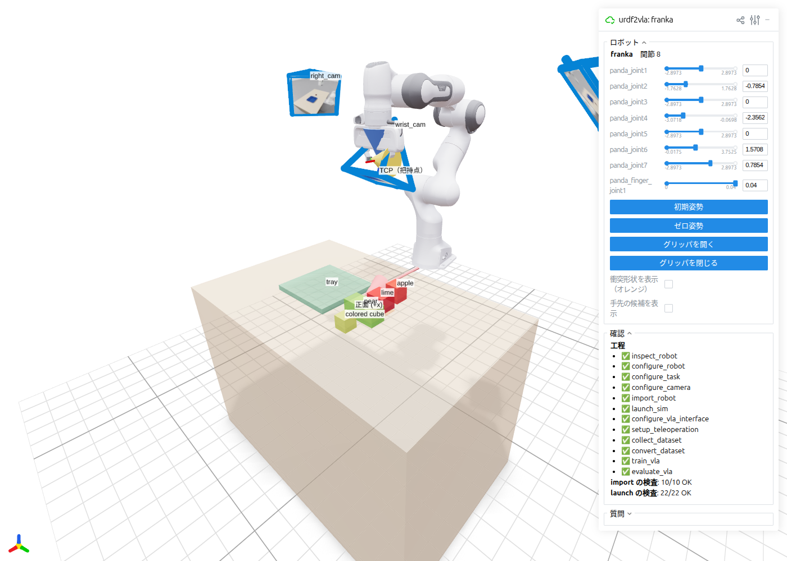
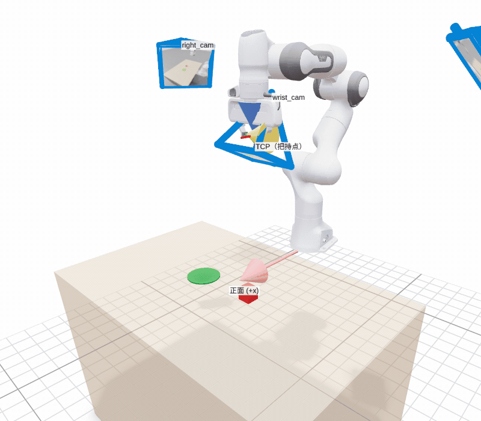
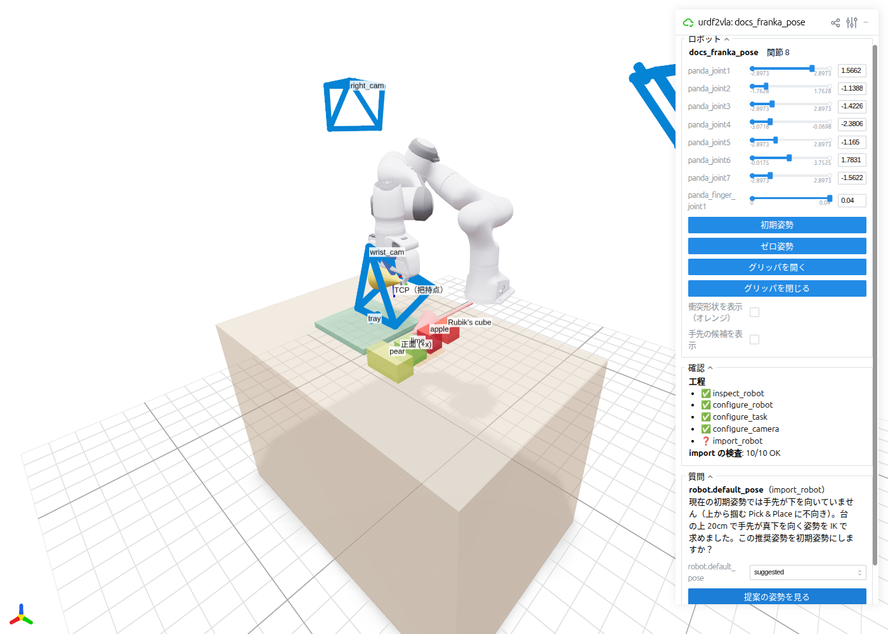

# ブラウザでロボットを確かめる

`urdf2vla view` は、ロボット・把持点・台・カメラを Web ブラウザの 3D 画面に表示します。Isaac Sim や Omniverse を
開かずに設定を確かめ、urdf2vla の質問に答えられます。

URDF と urdf2vla の設定だけを読むので、`inspect_robot` の直後から使え、コンテナも要りません。

```bash
uv pip install -e '.[view]'                 # 初回だけ
urdf2vla view --project projects/myrobot
```

```text
[urdf2vla] view: http://localhost:8080 （別の PC からは http://<このマシンのアドレス>:8080） Ctrl-C で終了
```

表示されたアドレスをブラウザで開きます。同じネットワークの別の PC からは 2 つ目のアドレスを使います。止めるには端末で
++ctrl+c++ を押します。8080 番が使われていれば次の空いているポートで開き、そのポートを表示します（`--port` で指定も可）。

<figure markdown="span">
  { width="900" }
  <figcaption>チュートリアルの Franka: 把持点（TCP）、物体の候補とトレイのある台、<code>launch_sim</code> で撮った
  画像付きの手先・左・右のカメラ。</figcaption>
</figure>

## 確かめること

| 3D 画面のもの | 分かること |
|---|---|
| **TCP（把持点）** の座標軸と青・橙の矢印 | グリッパが掴む位置。青 = 接近方向（初期姿勢では台の方＝下を向くはず）、橙 = 指が開く向き |
| **正面 (+x)** の赤い矢印 | ロボットの正面。台とカメラはこの前に置かれます |
| 台・名前付きの箱・オレンジの範囲・緑の箱 | 場面: 物体の候補（外接箱と名前）、エピソードで物体を置く範囲、トレイ |
| 青い四角錐 | カメラの位置と視野。`launch_sim` の後は、そのカメラが撮った画像が中に表示されます |
| オレンジの形（任意） | 衝突形状。物理エンジンが接触に実際に使う形です |

スライダで関節を動かすと、TCP・手先カメラ・グリッパがついてきます。ボタンで設定した初期姿勢に戻したり、グリッパを
開閉したりできます。

<figure markdown="span">
  { width="900" }
</figure>

## 質問に答える

工程が `needs_input` を返すと、**質問** の欄に、まだ答えていない質問と urdf2vla が見つけた候補が並びます。答えを選んで
**回答を保存** を押すと、`urdf2vla answer` と同じように `answers.yaml` に書き込みます。その後、`next` の工程を実行します。

- 手先の link の候補（`arms.0.ee_link`）を選ぶと、その link が 3D で強調されます。
- urdf2vla が関節の値を提案しているとき（IK で求めた初期姿勢など）は、**提案の姿勢を見る** でロボットをその姿勢にして、
  答える前に確かめられます。

<figure markdown="span">
  { width="900" }
</figure>

!!! tip "SimReady のグリッパは暗い箱で表示されます"
    グリッパを SimReady のアセットに付け替えた場合、この画面には URDF の腕と、グリッパの付く位置に箱を表示します
    （アセット自体は Isaac Sim の中にしかありません）。本物のグリッパを見るには `launch_sim --livestream` を使います。
