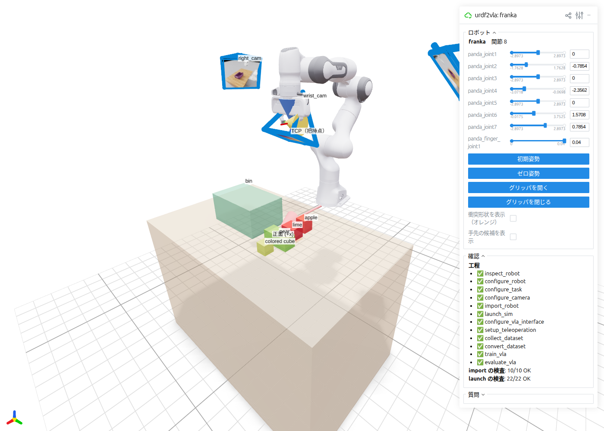
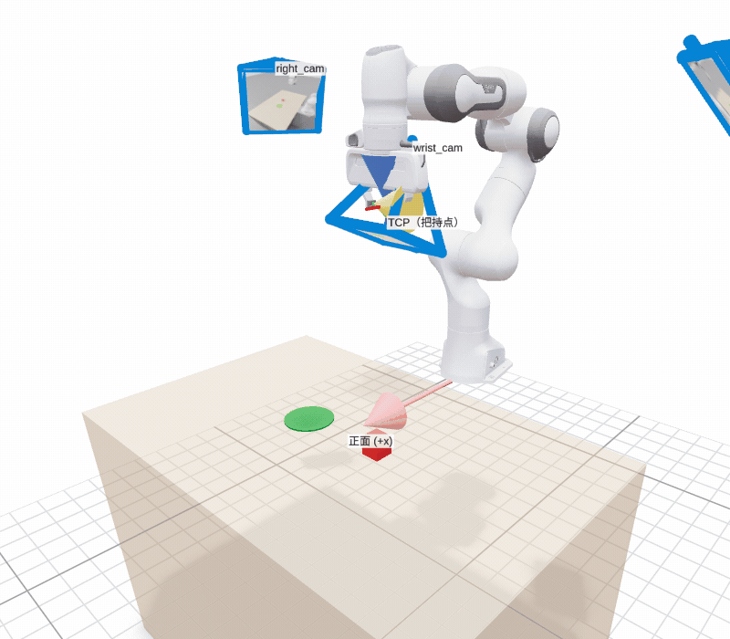
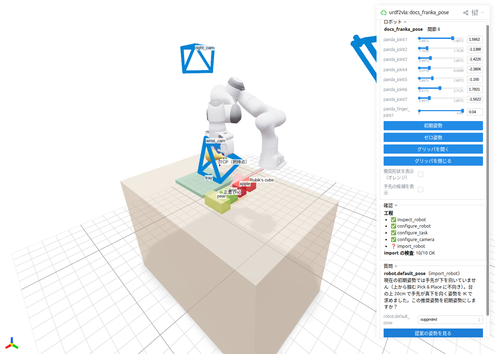

# Check your robot in the browser

`urdf2vla view` opens a 3D page in your web browser showing your robot, its grasp point, the table and the cameras, so you
can check the setup — and answer urdf2vla's questions — without opening Isaac Sim or Omniverse.

It reads only the URDF and urdf2vla's settings, so it works right after `inspect_robot` and doesn't need the containers.

```bash
uv pip install -e '.[view]'                 # once
urdf2vla view --project projects/myrobot
```

```text
[urdf2vla] view: http://localhost:8080 （別の PC からは http://<this machine's address>:8080） Ctrl-C で終了
```

Open the address in a browser. From another computer on your network, use the second address it prints. Press
++ctrl+c++ in the terminal to stop it. If port 8080 is taken, the next free port is used and printed;
`--port` chooses another one.

<figure markdown="span">
  { width="900" }
  <figcaption>The Franka from the tutorial: the grasp point (TCP), the table with the candidate objects and the bin, and the
  wrist, left and right cameras with the images they captured in <code>launch_sim</code>.</figcaption>
</figure>

## What to check

| In the 3D view | What it tells you |
|---|---|
| **TCP（把持点）** frame with a blue and an orange arrow | Where the gripper grasps. Blue = approach direction (should point down at the table in the initial pose), orange = the direction the fingers open. |
| **正面 (+x)** red arrow | The robot's front. The table and cameras are placed in front of it. |
| Table, labelled boxes, orange patch, green box | The scene: the candidate objects (their bounding boxes, with names), the area where an episode puts its object, and the bin. |
| Blue pyramids | Camera positions and fields of view. After `launch_sim`, each shows the image that camera captured. |
| Orange shapes (optional) | Collision shapes — what the physics engine actually uses for contact. |

Move the joints with the sliders and the TCP, the wrist camera and the gripper follow. Use the buttons to jump to the
configured initial pose and to open or close the gripper.

<figure markdown="span">
  { width="900" }
</figure>

## Answering questions

When a step returns `needs_input`, the **質問 (Questions)** panel lists the open questions with the choices urdf2vla found.
Pick an answer and press **回答を保存 (Save answers)**. The answers are written to `answers.yaml`, exactly as
`urdf2vla answer` would; then run the step named in `next`.

- Choosing a hand-link candidate (`arms.0.ee_link`) highlights that link in 3D.
- When urdf2vla proposes joint values — for example a starting pose found by inverse kinematics — the
  **提案の姿勢を見る (Show the suggested pose)** button moves the robot to it, so you can look before you accept.

<figure markdown="span">
  { width="900" }
</figure>

## The labels

The page is currently in Japanese. The controls are:

| Label | Meaning |
|---|---|
| ロボット | Robot: joint sliders and buttons |
| 初期姿勢 / ゼロ姿勢 | Go to the initial pose / all joints at zero |
| グリッパを開く / グリッパを閉じる | Open / close the gripper |
| 衝突形状を表示（オレンジ） | Show collision shapes (orange) |
| 手先の候補を表示 | Show the hand-link candidates |
| 確認 | Status: which steps have run and how many checks passed |
| 質問 / 回答を保存 | Questions / save the answers |
| 提案の姿勢を見る | Show the suggested pose |

!!! tip "A SimReady gripper is drawn as a dark box"
    If you replaced the gripper with a SimReady asset, the viewer shows the URDF arm plus a box where the gripper is
    mounted (the asset itself only exists in Isaac Sim). Use `launch_sim --livestream` to see the real gripper.
