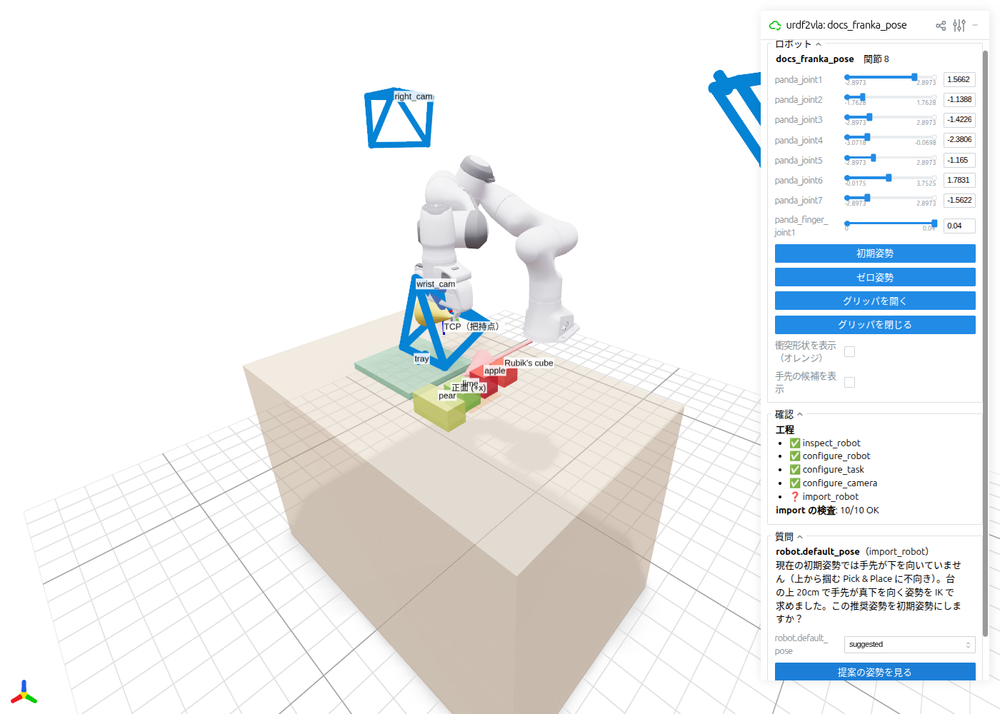

# 自分のロボットを使う

自分の URDF から、シミュレーションが動くところまでの手順です。まだなら先に Franka の [チュートリアル](../tutorial.md)
を通してください。手順は同じで、うまくいったときの様子が分かります。

## 1. URDF を確かめる

urdf2vla は URDF から読めることはすべて読みます。始める前に次を確かめてください。

- **メッシュが見つかること。** `package://my_robot_description/meshes/...` は、URDF の親フォルダと `robot.package_paths`
  に書いたフォルダから探します。リポジトリの外にあるメッシュは、コンテナから読めるようにプロジェクトに自動でコピーします。
- **関節の可動範囲とトルクが実際の値であること。** すべての関節のトルクが同じ値だったり、可動範囲のない関節があったり
  すると警告します（CAD から書き出した URDF には仮の値がよく入っています）。トルクは URDF を編集せずに上書きできます（下記）。
- **グリッパが URDF に入っていること**、または [SimReady のグリッパ](#simready) を付ける予定であること。
  いま対応しているのは、2 本指のグリッパの付いた単腕のロボットです（直動・回転の指、mimic の有無は問いません）。

## 2. プロジェクトを作る

```bash
urdf2vla init projects/myrobot --urdf /path/to/my_robot.urdf
```

`projects/myrobot/project.yaml` ができます。編集するのはこのファイルだけです。urdf2vla が作るものは、同じフォルダの
`generated/`、`build/`、`snapshots/`、`logs/` に入ります。これらは手で編集しないでください。

```yaml title="projects/myrobot/project.yaml"
name: myrobot

robot:
  urdf: /path/to/my_robot.urdf
  # 以下は任意。書いておくと質問されません。
  # end_effector: tool0
  # gripper_joints: [finger_left, finger_right]
  # gripper_open_position: upper        # 指が開くのは関節の lower / upper どちらの限界か
  # default_pose: {joint1: 0.0, joint2: -0.6}
  # effort_limits: {"joint[1-6]": 50.0} # N·m（関節名の正規表現 → 値）
  # base_pose: {pos: [0, 0, 0], rot_xyzw: [0, 0, 0, 1]}
  # package_paths: [../my_ws/src]

cameras:          # DROID の配置: 手先 + 左右
  - preset: wrist
  - preset: left
  - preset: right

overrides:        # generated/ を編集せずに、生成された値を変える
  robot: {}
  task: {}
  cameras: {}
```

## 3. 設定の工程を実行し、質問に答える

```bash
urdf2vla inspect_robot    --project projects/myrobot
urdf2vla configure_robot  --project projects/myrobot
urdf2vla configure_task   --project projects/myrobot
urdf2vla configure_camera --project projects/myrobot
urdf2vla import_robot     --project projects/myrobot
urdf2vla launch_sim       --project projects/myrobot
```

各コマンドは結果を JSON で出力します。`"status"` が次にすることを示します。

| `status` | 終了コード | 意味 |
|---|---|---|
| `ok` | 0 | 完了。`next` が次の工程。`warnings` があれば読んでください。 |
| `needs_input` | 2 | ロボットについての事実が必要です。`questions` に答えてから、`next` の工程を実行します。 |
| `error` | 1 | 工程か検査が失敗しました。`errors` がどれかを示します。`urdf2vla diagnose --project ...` を実行し、[トラブルシューティング](../troubleshooting.md) を見てください。 |

### 質問される可能性のあること

| キー | 答えるもの | 質問されるとき |
|---|---|---|
| `arms.0.ee_link` | ロボットの手先の link | 手先になりうる link が複数あるとき |
| `grippers.0.open_position` | `lower` / `upper` | 回転する指の関節で、開く向きが分からないとき |
| `grippers.0.open_close` | `[開, 閉]` の角度 [rad] | 指の関節に可動範囲がないとき |
| `robot.gripper_joints` | 指の関節名のリスト | グリッパが自動で見つからないとき |
| `robot.front_axis` | `+x` / `+y` / `-x` / `-y` | ロボットの正面が +x でないとき（+x を向くように回して置きます） |
| `joints.<name>.role` | `fixed_at_reset` / `passive` | 腕でもグリッパでもない可動関節があるとき |
| `robot.default_pose` | `suggested` / `keep` / `{関節: 値, …}` | 取り込み後、手先が台の方（下）を向いていないとき。`suggested` は台の上 20 cm で真下を向く IK の解 |

コマンドで答え、`next` の工程を実行します。

```bash
urdf2vla answer --project projects/myrobot arms.0.ee_link=tool0 grippers.0.open_position=lower
urdf2vla configure_robot --project projects/myrobot
```

または **ブラウザでロボットを見ながら答えます**。[`urdf2vla view`](view.md) は候補を 3D で表示し、答えを同じファイル
（`answers.yaml`）に保存します。

<figure markdown="span">
  { width="900" }
  <figcaption><code>urdf2vla view</code> での初期姿勢の質問。手先が台の方を向いていなかったので、<code>import_robot</code> が
  逆運動学（IK）で姿勢を求めて提案しています。<b>提案の姿勢を見る</b> で、<code>suggested</code> と答える前にその姿勢を確かめられます。</figcaption>
</figure>

## 4. 結果を確かめる

`launch_sim` は短い試運転の最初と最後に各カメラが見たものを `snapshots/` に保存し、記録に時間を使う前に物理の検査
（物体を掴むことを含む）をします。すべての検査が `OK` なら、[デモの記録](recording.md) へ進みます。

## 5. SimReady のグリッパに付け替える {#simready}

URDF のグリッパの中には、見た目は正しくてもシミュレーションでうまく動かないものがあります。閉リンクが簡略化されている、
mimic 関節がうまく変換されない、可動範囲が効かない、などです。症状は「開閉はできるが物体を保持できない」グリッパで、
urdf2vla の `joint_limits_hold` と `grasp_hold` の検査が失敗します。

直し方は `project.yaml` の 1 行です。URDF のグリッパを、NVIDIA の SimReady アセット（Isaac Sim に付属のロボットと
グリッパのアセット）の、物理が調整済みのグリッパに置き換えます。

```yaml
robot:
  urdf: /path/to/my_robot.urdf
  gripper: {simready: robotiq_2f_85}
```

- `configure_robot` が URDF のグリッパの link を外し、同じ場所に、接近方向と指の向きを合わせて SimReady のグリッパを
  付ける設定を作ります。手先と指の質問は出なくなります。
- `import_robot` が腕を変換し、Isaac Sim の **Robot Assembler** でグリッパを取り付けます。グリッパのアセットは初回に
  ダウンロードします。
- URDF にグリッパがなければ、取付先を指定します: `gripper: {simready: robotiq_2f_85, mount_link: flange}`
- 対応: `robotiq_2f_85`（Robotiq 2F-85）。調整した値（把持力、ソルバーの反復回数、把持点）は
  `src/urdf2vla/grippers.py` にあります。

## 6. 物体を選び、場面とカメラを調整する {#objects}

既定では、エピソードごとにりんご・ライム・洋梨・色付きの立方体のどれか 1 つを台に置き、ロボットはそれをトレイに
入れます。ほかの物体は `project.yaml` で選び、`configure_task` と **`launch_sim`** をもう一度実行します（`launch_sim` が各物体の
落ち着く向きを測り、エピソードはそれを使います）。

```yaml
task:
  objects: [lime, color_cube, rubiks_cube]   # エピソードごとに 1 つ。指示文でその名前を言う
  container: plastic_tray                     # 平らな緑の置き場所なら "disc"
```

| キー | 物体 | 大きさ (cm) | 出所 |
|---|---|---|---|
| `rubiks_cube` | ルービックキューブ（元のデータセットの利用条件を確かめていないので既定には入れない） | 5.8 × 5.8 × 5.8 | Isaac Lab Arena の物体ライブラリ（HOT3D 由来） |
| `apple` | りんご（70 % に縮小） | 5.4 × 5.7 × 6.7 | NVIDIA SimReady |
| `lime` | ライム | 6.4 × 7.5 × 6.1 | NVIDIA SimReady |
| `pear` | 洋梨 | 6.1 × 13.4 × 6.2 | NVIDIA SimReady |
| `color_cube` | 色付きの立方体 | 5.0 × 5.0 × 5.0 | Isaac Sim の props |
| `cube` | 赤い立方体（プリミティブ、ダウンロード不要） | 4.5 × 4.5 × 4.5 | — |
| `plastic_tray`（容器） | トレイ | 25.6 × 27.0 × 2.1 | NVIDIA SimReady |

別の物体のリストで記録したデータセットは、新しいリストでは再生できません（エピソードはリストの何番目を使ったかを記録します）。
物体のリストを導入する前の記録を再生するには `task: {objects: [cube], container: disc}` にします。

グリッパの開きより幅の広い物体は、警告を出して除きます（Franka は 8 cm、SimReady の Robotiq 2F-85 は 8.5 cm）。
アセットは初回に NVIDIA のアセットサーバからダウンロードします。測った大きさのカタログは `src/urdf2vla/objects.py` です。

台・物体を置く範囲・トレイは腕の届く範囲から配置します。動かすには、生成されたキーを `overrides.task`
（`generated/task.yaml` と同じ構造）に書き、`configure_task` をもう一度実行します。

```yaml
overrides:
  task:
    target: {pos: [0.45, -0.18]}
    instruction: "place the {object} into the {target}"
```

カメラの既定は [DROID](https://droid-dataset.github.io/) の配置（手先カメラと、台を見下ろす左右のカメラ、256×256）です。
ほかに `front`（正面）と `side`（横）のプリセットがあります。実機のカメラに合わせるなら、明示的に書きます。

```yaml
cameras:
  - preset: wrist
  - {name: head_cam, mount: link, parent_link: head_link, pos: [0, 0, 0], rot_xyzw: [0, 0, 0, 1],
     convention: ros, width: 640, height: 480, intrinsic_matrix: [600, 0, 320, 0, 600, 240, 0, 0, 1]}
```

四元数は常に `[x, y, z, w]` です。

## いまの制限

- **双腕のロボット**は、解析・設定・取り込み（すべての検査を含む）まではできますが、`launch_sim` 以降はまだ対応していません。
- タスクは 1 つ: 物体を掴んで容器に入れる（または平らな置き場所に置く）Pick & Place。物体は `src/urdf2vla/objects.py` のカタログから選びます。
- グリッパ: 2 本指の平行グリッパと、片側の顎だけが動くグリッパ。吸着や多指ハンドには対応していません。
