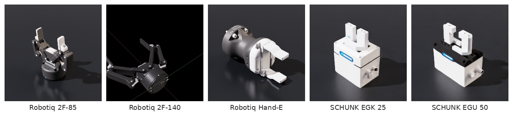
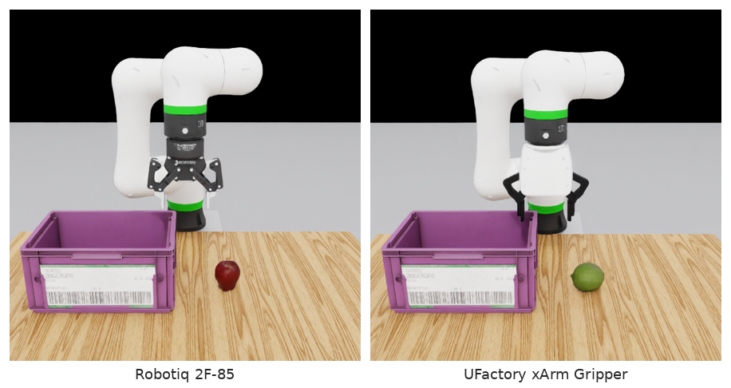
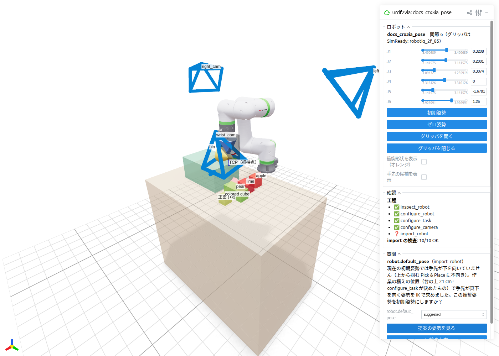
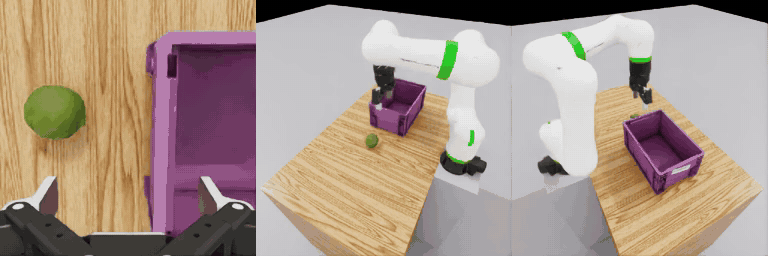

# Bring your own robot

This guide takes a robot from its URDF to a running simulation, using a **FANUC CRX-3iA** as the example. FANUC
publishes the URDF, and like most industrial arms the CRX comes **without a gripper** — so you'll also see how to
attach one, and how to swap it for another. The steps are the same for any URDF. If you haven't yet, do the
[tutorial](../tutorial.md) with the Franka first: you'll know what success looks like.

<figure markdown="span">
  { width="900" }
  <figcaption>The FANUC CRX-3iA with a Robotiq 2F-85 from NVIDIA's asset library, seen by its wrist, left and right
  cameras. The arm comes from FANUC's URDF; the gripper was attached by urdf2vla.</figcaption>
</figure>

## 1. Get the URDF

=== "FANUC CRX (the example)"

    FANUC publishes the descriptions of its robots in
    [FANUC-CORPORATION/fanuc_description](https://github.com/FANUC-CORPORATION/fanuc_description) (Apache-2.0) as
    xacro files. The example script downloads a pinned version and expands the CRX-3iA into a URDF. It needs `xacro`,
    from ROS 2 or from `pip install xacro`:

    ```bash
    source /opt/ros/jazzy/setup.bash      # xacro
    bash examples/crx3ia/fetch_urdf.sh    # → examples/crx3ia/fanuc_description/crx3ia.urdf
    ```

    Other CRX models expand the same way — `bash examples/crx3ia/fetch_urdf.sh crx10ia_l` (also `crx5ia`, `crx10ia`,
    `crx10ia_lp`, `crx20ia_l`, `crx30ia`). urdf2vla is tested with the CRX-3iA.

=== "Your own URDF"

    urdf2vla reads everything it can from the URDF. Before you start, make sure that:

    - **Meshes can be found.** `package://my_robot_description/meshes/...` paths are resolved by searching the URDF's
      parent folders and any folders you list in `robot.package_paths`; absolute paths from another machine
      (`file:///root/ws/install/...`) are matched by their tail under the same folders. Meshes outside the repository
      are copied into the project automatically, so the container can read them. Meshes of the arm and of a gripper
      you keep must be found; parts like a wrist camera or its bracket are imported without a shape, with a warning.
    - **Joint limits and efforts are real values.** urdf2vla warns when every joint has the same effort or a joint has
      no limits — CAD exporters often write placeholders. You can override efforts without editing the URDF (see below).
    - **There is a gripper** — in the URDF, or one you [attach from NVIDIA's asset library](#simready).
      Supported today: one- or two-arm robots with a two-finger gripper (see [Dual-arm robots](#dual-arm-robots)).

    A xacro file has to be expanded first: `xacro my_robot.urdf.xacro -o my_robot.urdf`.

    Besides the FANUC CRX-3iA and the Franka, these 7-axis arms went from their public URDF to recorded
    demonstrations with the steps on this page: the **KUKA LBR iiwa 14** (ROS-Industrial `kuka_experimental`, arm only,
    one line `gripper: {simready: robotiq_2f_85}`) and the **Kinova Gen3** (Kinova `ros2_kortex`, `gen3_2f85.urdf`, its
    Robotiq gripper replaced the same way).

## 2. Create a project

```bash
urdf2vla init projects/crx3ia --from examples/crx3ia/project.yaml
```

This creates `projects/crx3ia/project.yaml`, the only file you edit. Everything urdf2vla derives goes into
`generated/`, `build/`, `snapshots/` and `logs/` next to it — don't edit those by hand.

```yaml title="projects/crx3ia/project.yaml"
name: crx3ia

robot:
  urdf: ../../examples/crx3ia/fanuc_description/crx3ia.urdf
  gripper: {simready: robotiq_2f_85, mount_link: fanuc_flange}   # attach a gripper (section 3)

cameras:          # DROID layout: wrist + left + right
  - preset: wrist
  - preset: left
  - preset: right

overrides:        # change generated values without editing generated/
  robot: {}
  task: {}
  cameras: {}
```

For another robot, start from its URDF instead — `urdf2vla init projects/myrobot --urdf /path/to/my_robot.urdf` —
and add any of these under `robot:` if you already know them (anything you write here is not asked again):

```yaml
robot:
  urdf: /path/to/my_robot.urdf
  # end_effector: tool0
  # gripper_joints: [finger_left, finger_right]
  # gripper_open_position: upper        # fingers open at the joint's lower or upper limit
  # default_pose: {joint1: 0.0, joint2: -0.6}
  # effort_limits: {"joint[1-6]": 50.0} # N·m, joint-name regex → value
  # base_pose: {pos: [0, 0, 0], rot_xyzw: [0, 0, 0, 1]}
  # package_paths: [../my_ws/src]
```

!!! note "Messages are in Japanese"
    urdf2vla's command output, questions and the comments in `project.yaml` are currently in Japanese. The keys
    (`arms.0.ee_link`, `status`, …) and file names are the same in every language, and this guide explains each of them.

## 3. Attach or swap the gripper {#simready}

Decide this before you run the steps: an arm without a gripper needs one, and the first step asks about the gripper.
The gripper decides what the robot can pick up, so it is also the part you'll change most often. urdf2vla can attach a
gripper from **NVIDIA's asset library** — the robot and gripper models that ship with Isaac Sim, with physics already
set up — to any arm, with one line in `project.yaml`. The CRX-3iA example already has that line, so you can go
straight to [running the steps](#run) and come back here to swap grippers later.

<figure markdown="span">
  { width="900" }
  <figcaption>Some of the grippers in NVIDIA's Isaac Sim asset library, as NVIDIA shows them.</figcaption>
</figure>

<small>Thumbnails from the NVIDIA Isaac Sim 6.2 asset library. Robotiq 2F-85, SCHUNK EGK 25 and EGU 50 assets:
CC BY 4.0. Robotiq 2F-140 and Hand-E: BSD-3-Clause, © 2013 ROS-Industrial. Details:
[THIRD_PARTY_NOTICES.txt](../assets/THIRD_PARTY_NOTICES.txt).</small>

### When to use it

- **The arm has no gripper**, like FANUC's URDFs.
- **The URDF's gripper doesn't hold things in simulation.** Closed linkages are simplified, mimic joints are converted
  badly, or joint limits aren't enforced. The symptom is a gripper that opens and closes but can't hold the cube —
  urdf2vla's `joint_limits_hold` and `grasp_hold` checks fail.
- **You want to try another gripper** — a wider opening for bigger objects, or the gripper you have on the real robot.

### One line in `project.yaml`

```yaml
robot:
  gripper: {simready: robotiq_2f_85, mount_link: fanuc_flange}
```

| `simready:` | Gripper | Opening | Length (flange to fingertips) | Works with (CRX-3iA) | Asset license |
|---|---|---|---|---|---|
| `robotiq_2f_85` | Robotiq 2F-85 | 85 mm | 14.8 cm | apple, lime, pear, cube — 10 of 12 scripted recordings succeeded | CC BY 4.0 |
| `ufactory_xarm` | UFactory xArm Gripper | 88 mm | 16.2 cm | lime — 5 of 5 recordings. The apple and the pear slip out; the cube is held, but the long fingers touch the table before the hand is low enough to grasp it | not stated (no license file in the asset folder) |

The values are measured from each asset; they live in `src/urdf2vla/grippers.py`. The other grippers in the picture
above aren't supported yet: the Robotiq 2F-140's closed linkage comes apart in our setup, the Hand-E drives its two
jaws separately, and the SCHUNK grippers open less than the objects are wide.

### Swapping, step by step

Change the key and rerun from `configure_robot`. Everything that depends on the gripper is recomputed:

```bash
# robot.gripper.simready: ufactory_xarm
urdf2vla configure_robot  --project projects/crx3ia   # where the fingers grasp (the TCP), approach and finger directions
urdf2vla configure_task   --project projects/crx3ia   # which objects fit between the fingers, where the table goes
urdf2vla configure_camera --project projects/crx3ia   # the wrist camera follows the new gripper
urdf2vla import_robot     --project projects/crx3ia   # attaches the gripper with Isaac Sim's Robot Assembler
urdf2vla launch_sim       --project projects/crx3ia   # checks that it opens, closes and holds each object
```

| What changes | Done by | With the xArm Gripper instead of the 2F-85 |
|---|---|---|
| The grasp point (TCP) and the approach and finger directions | `configure_robot` | the grasp point is 2 cm from the fingertips instead of 1.2 cm (the xArm's finger pads are longer) |
| Objects too wide for the gripper are left out, with a warning | `configure_task` | none: all four objects fit between the fingers |
| The table is brought closer if the hand can't reach the work area pointing down | `configure_task` | the table moves 12 cm closer instead of 10 cm |
| The gripper is attached to the arm's USD (downloaded the first time) | `import_robot` | the xArm Gripper asset is downloaded and attached |
| Grip force, solver iterations; checks that it opens, closes and holds each object | `import_robot`, `launch_sim` | `grasp_hold` fails for the apple and the pear |

A failing `grasp_hold` tells you which objects this gripper can't hold, and the attempts in
`build/collect_report.yaml` tell you which ones the scripted recording can't pick up. Leave them out and run
`configure_task` and `launch_sim` again:

```yaml
task:
  objects: [lime]
```

<figure markdown="span">
  { width="900" }
  <figcaption>The same CRX-3iA with the Robotiq 2F-85 and the UFactory xArm Gripper, at the start of
  <code>launch_sim</code>. Only <code>robot.gripper.simready</code> (and, for the xArm, the object list) differs between the two
  projects.</figcaption>
</figure>

### Where the gripper goes (`mount_link`)

On an arm without a gripper, `mount_link` is optional. urdf2vla mounts the gripper on the outermost frame at the end of
the arm — the flange or tool frame, such as `tool0` or FANUC's `fanuc_flange` — with the fingers pointing out of the
flange face (along the last joint's axis, on the flange side). `configure_robot` says which frame it chose and lists
the others; write `mount_link` to choose one of them. The fingers point out of the flange whichever frame you choose,
even one whose +x, not +z, leaves the flange (FANUC's `flange`).

If the attached gripper looks wrong, the `launch_sim` snapshots show it at once.

### Replacing a gripper that's in the URDF

If the URDF has its own gripper, write only `gripper: {simready: robotiq_2f_85}`. `configure_robot` removes the URDF
gripper's links and mounts the new one at the same place, aligning its approach and finger directions with the old
one. Add `mount_link` only to mount it somewhere else. The replaced gripper's meshes don't need to be found.

### Adding another gripper

A gripper from the asset library needs one entry in `src/urdf2vla/grippers.py`: the asset path, the driven finger
joint and its open and closed positions, the joints that follow it, the approach and finger directions, the
fingertip distance and the opening. Measure them with the probe, which runs in the simulation container (the full
`docker exec` command is at the top of `src/urdf2vla/sim/gripper_probe.py`):

```bash
python -m urdf2vla.sim.gripper_probe Isaac/Robots/Robotiq/Hand-E/Robotiq_Hand_E_edit.usd --out hand_e.yaml
```

It lists the asset's joints (type, limits, drive, which joints follow which) and where each finger's collision shape
is, with the gripper open. Then run `import_robot` and `launch_sim` on a project that uses it: the checks tell you
whether the values are right. If round objects slip out of the fingertips, move the grasp point (`grasp_depth`) further
in — but not so far that the fingertips touch the table when the hand goes down to a low object.

## 4. Run the setup steps and answer questions {#run}

```bash
urdf2vla inspect_robot    --project projects/crx3ia
urdf2vla configure_robot  --project projects/crx3ia
urdf2vla configure_task   --project projects/crx3ia
urdf2vla configure_camera --project projects/crx3ia
urdf2vla import_robot     --project projects/crx3ia
```

Every command prints a JSON result. `"status"` tells you what to do next:

| `status` | Exit code | Meaning |
|---|---|---|
| `ok` | 0 | Done. `next` names the following step. Read any `warnings`. |
| `needs_input` | 2 | urdf2vla needs a fact about your robot. Answer the `questions`, then run the step in `next`. |
| `error` | 1 | A step or a check failed. `errors` says which; run `urdf2vla diagnose --project ...` and see [Troubleshooting](../troubleshooting.md). |

With the CRX-3iA you'll see:

- **`configure_robot`** — *mounting the Robotiq 2F-85 on `fanuc_flange`*. The hand questions (which link is the hand,
  which way the fingers open) are not asked, because the gripper's geometry comes from the asset.
- **`configure_task`** — *moved the table 10 cm closer*. The CRX-3iA is small, and a gripper pointing straight down
  raises its wrist by the gripper's length, so urdf2vla checks with inverse kinematics that the hand can reach the
  whole work area pointing down, and brings the table in until it can.
- **`import_robot`** — `needs_input`: FANUC's zero pose doesn't point the hand at the table, so it proposes a starting
  pose found by inverse kinematics and asks `robot.default_pose`.

Answer on the command line, then run the step named in `next` and continue:

```bash
urdf2vla answer --project projects/crx3ia robot.default_pose=suggested
urdf2vla configure_robot --project projects/crx3ia
urdf2vla import_robot    --project projects/crx3ia
urdf2vla launch_sim      --project projects/crx3ia
```

…or **answer in the browser**, looking at the robot: [`urdf2vla view`](view.md) shows the candidates in 3D and saves
your answers to the same file (`answers.yaml`).

<figure markdown="span">
  { width="900" }
  <figcaption>The starting-pose question for the CRX-3iA in <code>urdf2vla view</code>. <b>提案の姿勢を見る</b> (show the
  suggested pose) moves the robot to the proposed pose before you answer <code>suggested</code>. The gray box stands in
  for the attached gripper, which the viewer doesn't load.</figcaption>
</figure>

### The questions you may get

| Key | You answer | Asked when |
|---|---|---|
| `arms.<i>.ee_link` | the link that is the robot's hand | more than one link could be the hand; dual-arm robots get one question per arm |
| `grippers.<i>.open_position` | `lower` or `upper` | a revolute finger joint's opening direction isn't clear |
| `grippers.<i>.open_close` | `[open, closed]` angles in rad | a finger joint has no limits |
| `robot.gripper_joints` | list of finger joint names | no gripper was found automatically |
| `robot.front_axis` | `+x`, `+y`, `-x` or `-y` | the robot doesn't face +x; it is rotated so it does |
| `joints.<name>.role` | `fixed_at_reset` or `passive` | a movable joint is neither arm nor gripper |
| `robot.default_pose` | `suggested`, `keep` or `{joint: value, …}` | after import, the hand doesn't point down at the table; `suggested` is an IK solution with the hand pointing down at the working position `configure_task` chose |

## 5. Check the result and record

`launch_sim` saves what each camera sees at the start and end of a short test into `snapshots/`, and runs physics
checks — including picking up each object — before you spend time recording. For the CRX-3iA all 21 checks pass,
including `grasp_hold` with the apple, the lime, the pear and the cube. Then record, exactly as in the tutorial:

```bash
urdf2vla configure_vla_interface --project projects/crx3ia
urdf2vla setup_teleoperation     --project projects/crx3ia
urdf2vla collect_dataset         --project projects/crx3ia --device scripted --num-demos 10
```

On our machine the scripted controller recorded 10 demonstrations in 12 attempts, and all four replayed from the
converted dataset succeeded (`convert_dataset`, then `evaluate_vla --replay --episodes 4`).

<figure markdown="span">
  { width="900" }
  <figcaption>A scripted CRX-3iA demonstration, replayed from the converted dataset (<code>evaluate_vla
  --replay</code>).</figcaption>
</figure>

## 6. Choose the objects, adjust the scene and cameras {#objects}

By default every episode puts one of four objects on the table — an apple, a lime, a pear or a colored cube — and the
robot has to put it in a bin. Choose others in `project.yaml`, then run `configure_task` **and `launch_sim`** again
(`launch_sim` measures how each object comes to rest; episodes use that):

```yaml
task:
  objects: [lime, color_cube, rubiks_cube]   # one per episode, named in the instruction
  container: klt_bin                          # or plastic_tray, or "disc" for a flat green target
```

| Key | Object | Size (cm) | Source |
|---|---|---|---|
| `rubiks_cube` | Rubik's cube (not in the default list: its source dataset's license is unverified) | 5.8 × 5.8 × 5.8 | Isaac Lab Arena object library (from HOT3D) |
| `apple` | apple (scaled to 70 %) | 5.4 × 5.7 × 6.7 | NVIDIA SimReady |
| `lime` | lime | 6.4 × 7.5 × 6.1 | NVIDIA SimReady |
| `pear` | pear | 6.1 × 13.4 × 6.2 | NVIDIA SimReady |
| `color_cube` | colored cube | 5.0 × 5.0 × 5.0 | Isaac Sim props |
| `cube` | red cube (primitive, no download) | 4.5 × 4.5 × 4.5 | — |
| `klt_bin` (container, default) | bin | 19.8 × 29.7 × 14.6 | Isaac Sim props (industrial KLT bin) |
| `plastic_tray` (container) | tray | 25.6 × 27.0 × 2.1 | NVIDIA SimReady |

Datasets recorded with a different object list can't be replayed with the new one (the episodes store which entry
of the list they used). To replay recordings from before this object list existed, set
`task: {objects: [cube], container: disc}`.

Objects wider than your gripper can open are left out, with a warning (the Franka opens 8 cm; see the gripper table
above). The assets are downloaded from NVIDIA's asset server the first time. The catalog with the measured sizes is
`src/urdf2vla/objects.py`.

The table, spawn area and bin are placed from your arm's reach — and, for a single arm, checked with inverse
kinematics so the hand can reach them pointing down. To move them, write the generated keys under `overrides.task`
(same structure as `generated/task.yaml`) and run `configure_task` again:

```yaml
overrides:
  task:
    target: {pos: [0.45, -0.18]}
    instruction: "place the {object} into the {target}"
    table: {material: walnut}        # the table surface: oak (default), walnut or plain
```

Cameras: the default is the [DROID](https://droid-dataset.github.io/) layout (a wrist camera plus left and right
cameras looking down at the table, 256×256). A dual-arm robot gets one wrist camera per arm, so the default is four
images. Other presets are `front` and `side`. If you have a real camera to match, describe it explicitly:

```yaml
cameras:
  - preset: wrist
  - {name: head_cam, mount: link, parent_link: head_link, pos: [0, 0, 0], rot_xyzw: [0, 0, 0, 1],
     convention: ros, width: 640, height: 480, intrinsic_matrix: [600, 0, 320, 0, 600, 240, 0, 0, 1]}
```

Quaternions are always `[x, y, z, w]`.

## Dual-arm robots

Two arm chains are detected separately and kept separate through setup, simulation and training. Nothing needs to be
hard-coded in a Python file. For each arm, urdf2vla derives its joints, IK body, TCP, approach/finger axes and optional
wrist camera; the VLA state and action are ordered as both arm joint groups followed by both gripper scalars.

The table is centred between the shoulders, with the objects on its left half and the bin on its right half. The
built-in scripted expert grasps with the arm nearer to the object and keeps the other arm at its initial pose with its
gripper open. In this layout that is the same arm every episode, so scripted demonstrations move only one arm; the other
arm's joints and gripper are still recorded in every frame. `launch_sim` runs the grasp checks for each gripper.

Tested end to end (import, checks, scripted collection, conversion and replay evaluation) on two Franka arms side by
side. If your two arms hang off a common root link, give that link an `<inertial>`: without mass, the importer splits
the robot into two articulations and `import_robot` stops with `Expected 1 prims at '/World/Robot', found 2`.

For the bundled Dual Scorpion example, set the 8th joint of each arm as the gripper (the first 7 joints are the arm):

```yaml
robot:
  urdf: /path/to/dual_scorpion_Full_urdf/urdf/scorpion.urdf
  front_axis: +y
  gripper_joints: [joint7_R, joint7_L]
  gripper_open_close: [[-0.8, 0.0], [-0.8, 0.0]]  # provisional; confirm the opening direction
  effort_limits: {"joint[0-6]_[RL]": 60.0}         # provisional, see below
task:
  objects: [color_cube]
```

The Dual Scorpion URDF gives every joint `effort: 1.0`, which the project README calls provisional. Replace it with
the real motor values under `robot.effort_limits` before judging grasp behaviour in simulation. At 10 N·m the idle arm
sags and `setup_teleoperation` fails; the example uses 60 N·m for the arms and keeps the URDF value for the grippers.
The rotating jaw can't hold the fruit, so the example uses the cube only. Its gripper opening width also cannot be
derived from a single continuous joint, so object fit is not screened automatically.

With these settings the Dual Scorpion passes `import_robot`, `launch_sim` and `setup_teleoperation`, but scripted
collection does not succeed yet (0 of 8): the hand stops just short of the point above the object. With the object
and bin moved in front of one arm it gets above the object but stalls on the way down (0 of 4); the cause isn't
isolated yet.

The bundled OpenArm example (`examples/openarm`, Enactic OpenArm v2.0) runs end to end, but its layout is set by hand.
OpenArm's gripper sits in line with the forearm and the wrist bends at most 90°, so the hand points straight down only
when the forearm is level or tilted down. That limits top-down grasps to roughly 0.3 m or more below the shoulders. The
automatic layout puts the table higher than that, and the only top-down pose that reaches it raises the upper arm above
the shoulder. The example therefore:

- lowers the table to 0.17 m and uses the low `plastic_tray` instead of the 14.6 cm bin;
- puts the object and the tray on the left arm's side, because the arm can barely cross the body's centre line
  (joint 2 turns inward at most 10°);
- lowers the scripted approach height to 8 cm (`overrides.teleop.approach_height`);
- sets an elbow-down starting pose in `robot.default_pose` (found with IK on the host);
- lowers the finger torque to 2 N·m. At the URDF's 7 N·m, the revolute fingers push the cube against one finger, and
  it slides out once the `launch_sim` grasp check stops holding it in place;
- raises the physics solver's position iterations to 64 (`overrides.robot.asset.solver_position_iterations`). At the
  default 32 the left gripper's grasp check fails narrowly (the cube ends 2.2 cm from the TCP, against a 2 cm limit).

With these settings OpenArm passes all checks, scripted collection succeeds 8 times in 10 attempts (always the left
arm), and replay evaluation succeeds 8 of 8. Both failed attempts had the object at the tray-side edge of its area and
stopped 6 mm above the grasp height, most likely with an open finger resting on the tray rim.

## Limitations

- Arms: one or two. More than two arm chains are not supported by the simulation embodiment.
- Dual-arm robots: the scripted expert uses one arm per episode (the same arm in the default layout).
  `generate_mimic` and `evaluate_vla --droid` are single-arm only.
- One task: pick an object and place it in a container (or on a flat target). Objects come from the catalog in
  `src/urdf2vla/objects.py`.
- Grippers: two-finger parallel or single-moving-jaw grippers. Suction and multi-finger hands are not supported.
- The SimReady gripper replacement (`robot.gripper.simready`) is currently limited to single-arm robots.
