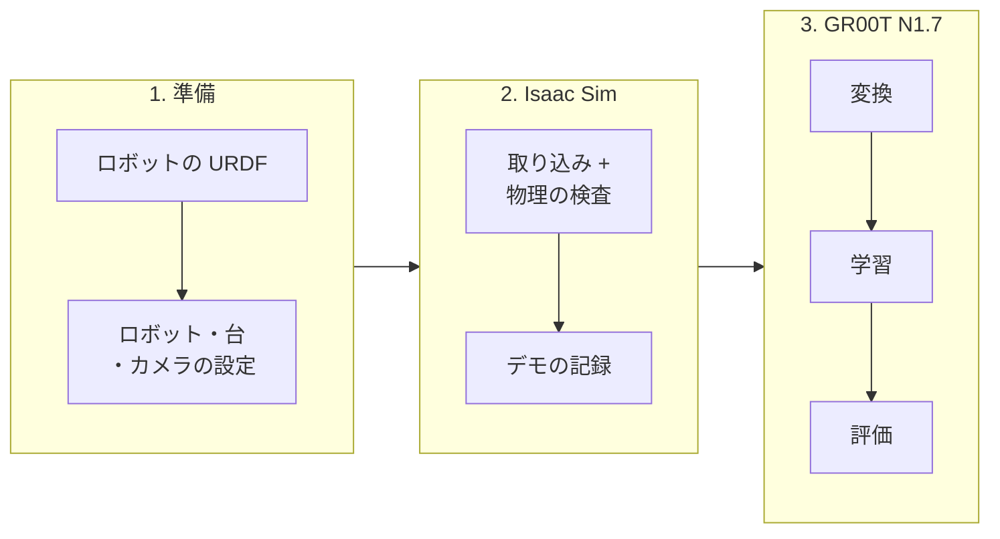

# urdf2vla

**ロボットの URDF から、NVIDIA Isaac Sim で VLA（Vision-Language-Action）モデルを学習するまで。Omniverse を先に覚える必要はありません。**

<video autoplay loop muted playsinline width="100%" src="../assets/eval_replay.mp4"></video>

<em>VLA が見ている画像: Isaac Sim での Pick & Place のエピソード中の、手先カメラと DROID と同じ配置の左右の外部カメラ。</em>

ふつうは USD への変換、articulation の調整、カメラの配置、Isaac Lab の環境、データセットの形式、GR00T の fine-tune
と、知っておくべきことがたくさんあります。urdf2vla はそれを順番に実行するコマンドにまとめました。各コマンドは自分の結果を
検査し、次へ進むか、ロボットについて質問するか、何を直せばよいかを伝えます。

## できること

- **本物の物体を使った、ロボットに合わせた Pick & Place のタスク。** エピソードごとにりんご・ライム・
  洋梨・色付きの立方体のどれか 1 つを台に置き、指示文でその名前を言います（*"put the apple in the bin"*）。物体は
  NVIDIA の SimReady アセット、箱は工場で使う KLT の部品箱、台はオークの木目で、どれも腕の届く範囲から配置するので、
  Omniverse でシーンを作る必要はありません。
- **推測ではなく質問。** URDF から決められないこと（どの link が手先か、指はどちらに開くか、よい初期姿勢）は urdf2vla が
  質問します。ブラウザでロボットを見ながら答えることもできます（[`urdf2vla view`](guides/view.md)）。
- **データを集める前に、気づきにくい失敗を見つける検査。** 開閉はできても物体を保持できないグリッパ、物体にめり込む指、
  更新が止まるカメラ。どれも検査があり、失敗したら具体的な直し方を示します。
- **DROID と同じカメラ配置が既定。** 腕ごとの手先カメラと左右の外部カメラを、作業域の大きさに合わせて置きます。
- **NVIDIA GR00T N1.7 のためのデータと学習。** 記録を GR00T が読む LeRobot v2.1 形式に変換し、GPU が足りなければ
  大きな GPU のマシンで学習できる一式を作ります。
- **Agent でも使える。** リポジトリを [Claude Code](guides/claude-code.md) で開いて「自分のロボットで VLA 開発を始めたい」
  と頼むと、同じコマンドを実行し、ロボットについて聞くときだけ止まります。

## 構成

| 層 | バージョン |
|---|---|
| シミュレータ | NVIDIA Isaac Sim 6.2.0 |
| ロボット学習のフレームワーク | Isaac Lab 3.0.0 |
| 環境の組み立て | Isaac Lab Arena（コミット `b9e37c5` に固定） |
| VLA モデル | NVIDIA Isaac GR00T N1.7（コミット `23ace64` に固定） |

重い処理はすべて、urdf2vla が作る 2 つの Docker コンテナの中で動きます。`urdf2vla` コマンド自体は手元のマシンに入れる
小さな Python パッケージです。

## はじめに読むページ

- **[インストール](install.md)** — 必要なものと、コンテナの作り方（初回は 1〜2 時間）。
- **[チュートリアル](tutorial.md)** — 同梱の Franka Panda で全工程を一度通す。
- **[自分のロボットを使う](guides/your-robot.md)** — URDF から始めて質問に答え、SimReady のグリッパに付け替える。
- **[トラブルシューティング](troubleshooting.md)** — 失敗した検査の意味と、何を変えればよいか。

!!! note "いまの対象"
    グリッパの付いた単腕・双腕のロボットと、Pick & Place のタスク 1 つ（物体を箱に入れる）。双腕では左右の腕と
    グリッパを policy の state / action に含め、scripted は物体に近い方の腕を使い、もう一方は開いたまま保持します。
    GR00T N1.7 の学習には **44 GB 以上**の GPU が必要です。
