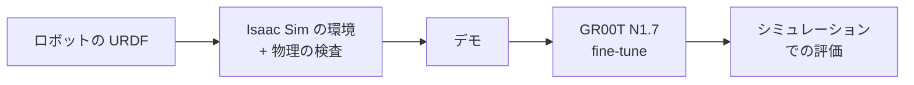

# urdf2vla でできること

urdf2vla はロボットの URDF から NVIDIA Isaac Sim に Pick & Place 環境を作るツールです。デモを記録し、GR00T で
VLA（Vision-Language-Action）モデルをファインチューニングし、シミュレーションでタスクの成功率を測れます。

## はじめに読むもの

まず実行環境を選びます。クラウド GPU を使うなら [NVIDIA Brev](guides/brev.md)、自分で管理するマシンなら [手元の Linux](install.md) でセットアップします。

| 進め方 | 最初に読むページ |
|---|---|
| **コマンドを自分で実行する** | 同梱のロボットを使う [Franka の CLI チュートリアル](tutorial.md)へ。URDF の取り込みから学習済みモデルの評価まで、端末で 1 工程ずつ実行します。 |
| **AI エージェントに工程を任せる** | [Codex または Claude Code](guides/claude-code.md) でリポジトリを開き、やりたいことを伝えます。エージェントは同梱の Skill に従って CLI を実行し、ロボット固有の判断が必要なときに質問します。 |
| **シェルスクリプトで自動化する** | 同じ CLI をスクリプトから呼び出し、終了コードと JSON の結果を使って、続行・入力待ち・停止を判断します。[シェルスクリプトでの自動化](reference.md#automation)を参照してください。 |

## 誰のためのツールか

URDF のある腕を持っていて、それで VLA 開発を始めたいロボット開発者のためのツールです。Isaac Sim や Omniverse、VLA の
学習に先に詳しくならなくても、シミュレーションの環境を作り、デモを記録し、VLA を fine-tune して、どれだけうまく動くかを
測れます。

## できること

- **URDF から Isaac Sim に Pick & Place 環境を作る。** アームの可動範囲をもとに台・物体・箱・カメラを配置します。
  NVIDIA のアセットライブラリからグリッパを取り付けたり、交換したりできます。[自分のロボットをシミュレーションする](guides/your-robot.md)。
- **ロボットとカメラを確認する。** グリッパ・初期姿勢・カメラの配置を確かめ、設定に必要な質問に答えます。
  [ブラウザで設定を確認する](guides/view.md)。
- **デモを記録する。** ロボットを自動で動かすコントローラかキーボードの遠隔操作で記録し、必要に応じて Isaac Lab Mimic で
  デモを増やせます。[学習用のデモを記録する](guides/recording.md)。
- **NVIDIA Isaac GR00T N1.7 をファインチューニングし、シミュレーションで評価する。** 成功率・失敗理由・各エピソードの動画を
  確認できます。[GR00T をファインチューニングして評価する](guides/training.md)。

## 結果

| ロボット | モデル | 学習データ | シミュレーションでの成功 |
|---|---|---|---|
| FANUC CRX-3iA + Robotiq 2F-85 | [`umegan/urdf2vla-crx3ia-gr00t-n1.7`](https://huggingface.co/umegan/urdf2vla-crx3ia-gr00t-n1.7) | [データセット](https://huggingface.co/datasets/umegan/urdf2vla-crx3ia-pickplace) | **20/20** |
| Franka Panda | [`umegan/urdf2vla-franka-gr00t-n1.7`](https://huggingface.co/umegan/urdf2vla-franka-gr00t-n1.7) | [データセット](https://huggingface.co/datasets/umegan/urdf2vla-franka-pickplace) | **19/20** |

どちらも scripted のデモ 50 本から、NVIDIA L40S 1 台で約 2 時間 40 分で学習しました。動画と詳細:
[公開モデルとデータセット](models.md)。

<video autoplay loop muted playsinline width="100%" src="../assets/crx3ia_model.mp4"></video>

<em>urdf2vla で学習した GR00T N1.7 のモデルが、Isaac Sim で FANUC CRX-3iA を動かすところ（評価で 20/20）。
各フレームはモデルが見る画像: 手先カメラと左右のカメラ。
<a href="models/">公開モデルとデータセット</a> · <a href="https://huggingface.co/umegan/urdf2vla-crx3ia-gr00t-n1.7">Hugging Face</a></em>

## 今後の発展

- **実機:** 学習したモデルをロボットのコンピュータ（Jetson Thor、RTX GPU）で動かし、シミュレーションと実際のカメラ・
  照明・物体との差を埋める。
- **シーンとタスクを増やす:** NVIDIA の SimReady アセットのシーンと物体、複数の物体を同時に、Pick & Place 以外のタスク。
- **2 本の腕の協調**、グリッパの追加、USD だけで記述されたロボット。
- **データを増やし、質を上げる:** 人が記録したデモを Mimic で増やす。

## いまの範囲

2 本指のグリッパの付いた単腕・双腕、タスクは 1 つ（物体を箱に入れる）、シミュレーションのみ。学習には **44 GB 以上**の
GPU が必要です。それ以外は 16 GB の RTX GPU で動きます。
