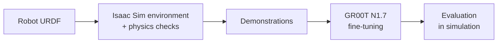

# What urdf2vla does

urdf2vla turns a robot URDF into a pick-and-place environment in NVIDIA Isaac Sim. Record demonstrations,
fine-tune a Vision-Language-Action (VLA) model with GR00T, and measure how often it completes the task in simulation.

## Where to start

Choose where to run urdf2vla. Use [NVIDIA Brev](guides/brev.md) for a cloud GPU or [local Linux](install.md) for a machine you manage.

| How you want to work | Start here |
|---|---|
| **Run commands yourself** | Follow the [Franka CLI tutorial](tutorial.md) with the bundled robot. Run each step in your terminal, from importing the URDF to evaluating the trained model. |
| **Ask an AI agent to run the steps** | Open the repo in [Codex or Claude Code](guides/claude-code.md) and describe your goal. The agent uses the repo's skill to run the CLI and asks you for robot-specific decisions as needed. |
| **Automate with shell scripts** | Call the same CLI from a script and use exit codes and JSON results to decide when to continue, pause for input, or stop. See [shell script automation](reference.md#automation). |

## Who it's for

Robot developers who have an arm with a URDF and want to start VLA development with it — build a simulation
environment, record demonstrations, fine-tune a VLA and measure how well it works — without first becoming experts in
Isaac Sim, Omniverse or VLA training.

## What you can do with it

- **Build a pick-and-place environment in Isaac Sim from a URDF.** urdf2vla uses the arm's reach to place the table,
  objects, bin and cameras. You can attach or swap a gripper from NVIDIA's asset library. [Simulate your own robot](guides/your-robot.md).
- **Check the robot and cameras.** Inspect the gripper, initial pose and camera placement, and answer configuration
  questions. [Inspect the setup in the browser](guides/view.md).
- **Record demonstrations.** Use a scripted robot controller or keyboard teleoperation, and optionally expand the
  dataset with Isaac Lab Mimic. [Record training demonstrations](guides/recording.md).
- **Fine-tune NVIDIA Isaac GR00T N1.7 and evaluate it in simulation.** See the success rate, failure reasons and
  episode videos. [Fine-tune and evaluate GR00T](guides/training.md).

## Results

| Robot | Model | Training data | Success in simulation |
|---|---|---|---|
| FANUC CRX-3iA + Robotiq 2F-85 | [`umegan/urdf2vla-crx3ia-gr00t-n1.7`](https://huggingface.co/umegan/urdf2vla-crx3ia-gr00t-n1.7) | [dataset](https://huggingface.co/datasets/umegan/urdf2vla-crx3ia-pickplace) | **20/20** |
| Franka Panda | [`umegan/urdf2vla-franka-gr00t-n1.7`](https://huggingface.co/umegan/urdf2vla-franka-gr00t-n1.7) | [dataset](https://huggingface.co/datasets/umegan/urdf2vla-franka-pickplace) | **19/20** |

Each was trained from 50 scripted demonstrations in about 2 h 40 min on one NVIDIA L40S. Videos and details:
[Published models and datasets](models.md).

<video autoplay loop muted playsinline width="100%" src="assets/crx3ia_model.mp4"></video>

<em>A GR00T N1.7 model trained with urdf2vla, running a FANUC CRX-3iA in Isaac Sim (20/20 in evaluation).
Each frame is what the model sees: the wrist camera and the left and right cameras.
<a href="models/">Published models and datasets</a> · <a href="https://huggingface.co/umegan/urdf2vla-crx3ia-gr00t-n1.7">Hugging Face</a></em>

## Where it's going

- **Real robots:** run the trained model on the robot's computer (Jetson Thor, an RTX GPU) and close the gap between
  simulation and the real cameras, lighting and objects.
- **More scenes and tasks:** scenes and objects from NVIDIA's SimReady assets, several objects at once, tasks beyond
  pick and place.
- **Two arms working together**, more grippers, and robots described only in USD.
- **More and better data:** demonstrations recorded by people, multiplied with Mimic.

## Current scope

One or two arms with a two-finger gripper, one task (an object into a container), simulation only. Training needs a
GPU with **44 GB or more**; everything else runs on a 16 GB RTX GPU.
