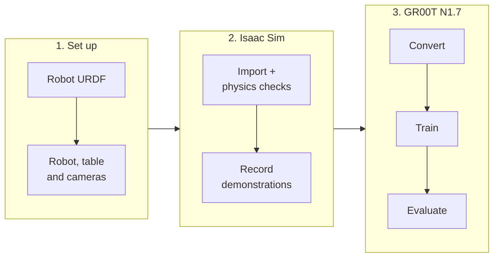

# urdf2vla

**From your robot's URDF to a trained Vision-Language-Action (VLA) model in NVIDIA Isaac Sim — without learning Omniverse first.**

<video autoplay loop muted playsinline width="100%" src="assets/eval_replay.mp4"></video>

<em>What the VLA sees: the wrist camera and the two DROID-style external cameras during a pick-and-place episode in Isaac Sim.</em>

urdf2vla turns the long list of things you normally have to know — USD conversion, articulation tuning, camera placement,
Isaac Lab environments, dataset formats, GR00T fine-tuning — into a sequence of plain commands. Each command checks its own
result and either moves on, asks you a question about your robot, or tells you what to change.

## What you get

- **A pick-and-place task with real objects, sized to your robot.** Each episode puts one object — an apple, a lime,
  a pear or a colored cube — on the table, and the instruction names it: *"put the apple in the bin"*. The objects
  are NVIDIA SimReady assets, the bin is an industrial KLT bin and the table has a real oak surface; everything is
  placed from your arm's reach, so you don't have to build a scene in Omniverse.
- **Questions instead of guesswork.** When something about your robot can't be read from the URDF (which link is the hand,
  which way the fingers open, a good starting pose), urdf2vla asks — and you can answer by looking at the robot in your
  browser with [`urdf2vla view`](guides/view.md).
- **Checks that catch silent failures before you record data.** A gripper that opens and closes but can't hold an object,
  fingers that sink into objects, cameras that stop updating — each has a check with a concrete fix.
- **DROID-style cameras by default.** A wrist camera plus left and right external cameras, scaled to your workspace.
- **Data and training for NVIDIA GR00T N1.7.** Recordings are converted to the LeRobot v2.1 format GR00T expects, and
  training is packaged for a large GPU when yours is too small.
- **An agent workflow.** Open the repository in [Claude Code or Codex](guides/claude-code.md) and say "I want to start VLA
  development with my robot" — the agent runs the same commands and only stops to ask you about your robot.

## How it's built

| Layer | Version |
|---|---|
| Simulator | NVIDIA Isaac Sim 6.2.0 |
| Robot learning framework | Isaac Lab 3.0.0 |
| Environment composition | Isaac Lab Arena (pinned commit `b9e37c5`) |
| VLA model | NVIDIA Isaac GR00T N1.7 (pinned commit `23ace64`) |

Everything heavy runs in two Docker containers that urdf2vla builds for you. The `urdf2vla` command itself is a small
Python package on your machine.

## Where to start

- **[Install](install.md)** — what you need and how to build the containers (about 1–2 hours the first time).
- **[Use it with an AI agent](guides/claude-code.md)** — new to robot simulation? After installing, let Claude Code or Codex run the steps and ask you only about your robot.
- **[Tutorial](tutorial.md)** — run the whole pipeline once with the bundled Franka Panda.
- **[Bring your own robot](guides/your-robot.md)** — the FANUC CRX-3iA as the example: start from a URDF, answer the questions, attach and swap grippers.
- **[Troubleshooting](troubleshooting.md)** — what each failed check means and what to change.

!!! note "Current scope"
    Single-arm robots with a parallel gripper, one pick-and-place task (an object into a bin). Dual-arm robots can be
    imported and checked but not yet simulated. Training GR00T N1.7 needs a GPU with **44 GB or more**.
