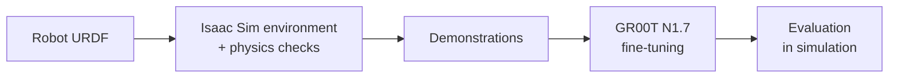

# urdf2vla

**From your robot's URDF to a trained and evaluated Vision-Language-Action (VLA) model in NVIDIA Isaac Sim.**

<video autoplay loop muted playsinline width="100%" src="assets/crx3ia_model.mp4"></video>

<em>A GR00T N1.7 model trained with urdf2vla, running a FANUC CRX-3iA in Isaac Sim (20/20 in evaluation).
Each frame is what the model sees: the wrist camera and the left and right cameras.
<a href="models/">Trained models</a> · <a href="https://huggingface.co/umegan/urdf2vla-crx3ia-gr00t-n1.7">Hugging Face</a></em>

## Who it's for

Robot developers who have an arm with a URDF and want to start VLA development with it — build a simulation
environment, record demonstrations, fine-tune a VLA and measure how well it works — without first becoming experts in
Isaac Sim, Omniverse or VLA training.

## What you can do with it

- **Turn a URDF into a checked pick-and-place environment in Isaac Sim.** The table, objects, bin and cameras are placed
  from your arm's reach. urdf2vla asks only what the URDF can't tell it (which link is the hand, a good starting pose),
  and you can answer by looking at the robot in your browser.
- **Attach or swap the gripper** with one line, using the grippers in NVIDIA's asset library.
- **Record demonstrations** with a scripted controller, the keyboard, or Isaac Lab Mimic to multiply a few into many.
- **Fine-tune NVIDIA Isaac GR00T N1.7** on them and **evaluate the model in simulation** with a success rate, a reason
  for every failure and videos.
- **Run it all on a cloud GPU** (NVIDIA Brev), or let an AI agent (Claude Code, Codex) run the steps and ask you only
  about your robot.

Every step is one command that checks its own result: it moves on, asks a question, or tells you what to change.

## Results

| Robot | Model | Training data | Success in simulation |
|---|---|---|---|
| FANUC CRX-3iA + Robotiq 2F-85 | [`umegan/urdf2vla-crx3ia-gr00t-n1.7`](https://huggingface.co/umegan/urdf2vla-crx3ia-gr00t-n1.7) | [dataset](https://huggingface.co/datasets/umegan/urdf2vla-crx3ia-pickplace) | **20/20** |
| Franka Panda | [`umegan/urdf2vla-franka-gr00t-n1.7`](https://huggingface.co/umegan/urdf2vla-franka-gr00t-n1.7) | [dataset](https://huggingface.co/datasets/umegan/urdf2vla-franka-pickplace) | **19/20** |

Each was trained from 50 scripted demonstrations in about 2 h 40 min on one NVIDIA L40S. Videos and details:
[Trained models](models.md).

## Where it's going

- **Real robots:** run the trained model on the robot's computer (Jetson Thor, an RTX GPU) and close the gap between
  simulation and the real cameras, lighting and objects.
- **More scenes and tasks:** scenes and objects from NVIDIA's SimReady assets, several objects at once, tasks beyond
  pick and place.
- **Two arms working together**, more grippers, and robots described only in USD.
- **More and better data:** demonstrations recorded by people, multiplied with Mimic.

## Current scope

One or two arms with a two-finger gripper, one task (an object into a container), simulation only. Training needs a
GPU with **44 GB or more**; everything else runs on a 16 GB RTX GPU.

## Where to start

For a cloud GPU, start with [NVIDIA Brev setup](guides/brev.md#launchable).

- **[Install](install.md)** — what you need and how to build the containers.
- **[Use it with an AI agent](guides/claude-code.md)** — let Claude Code or Codex run the steps.
- **[Tutorial](tutorial.md)** — the whole pipeline once with the bundled Franka Panda.
- **[Bring your own robot](guides/your-robot.md)** — from a URDF, with the FANUC CRX-3iA as the example.

