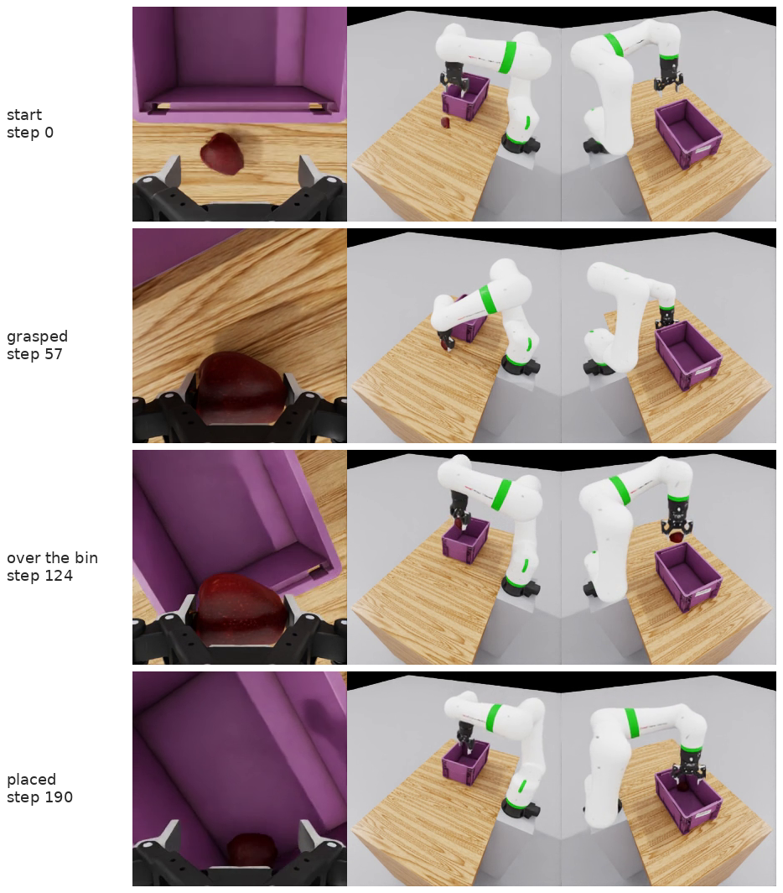

# 学習済みモデル

urdf2vla で、ロボットの URDF から GR00T N1.7 の checkpoint まで通して学習し、Isaac Sim で評価したモデルです。
どれも、urdf2vla で動かすのに要るファイルと一緒に Hugging Face にあります。

| ロボット | モデル | シミュレーションでの成功 | 元のモデル |
|---|---|---|---|
| FANUC CRX-3iA + Robotiq 2F-85 | [`umegan/urdf2vla-crx3ia-gr00t-n1.7`](https://huggingface.co/umegan/urdf2vla-crx3ia-gr00t-n1.7) | **20/20** | `nvidia/GR00T-N1.7-DROID`、スクリプトのデモ 50 個 |

どれも NVIDIA L40S 1 枚で学習・評価しました。各工程の実測は [NVIDIA Brev で動かす](guides/brev.md) にあります。
シミュレーションだけの結果です: 場面は 1 つ、物体は 1 回に 1 つ、照明は固定。

## FANUC CRX-3iA {#crx3ia}

<video controls muted playsinline width="100%" src="../../assets/crx3ia_model.mp4"></video>
<p class="caption"><em>学習したモデルが、りんご・立方体・ライム・洋梨を箱に入れるところ（評価の 4 エピソード、物体ごとに 1 つ）。
各フレームはモデルが見る画像: 手先カメラ、左のカメラ、右のカメラ。</em></p>



| | |
|---|---|
| Hugging Face | [`umegan/urdf2vla-crx3ia-gr00t-n1.7`](https://huggingface.co/umegan/urdf2vla-crx3ia-gr00t-n1.7)（NVIDIA Open Model License） |
| ロボット | FANUC CRX-3iA（6 関節）と NVIDIA の SimReady の Robotiq 2F-85（[例](guides/your-robot.md)） |
| カメラ | 手先 + 左 + 右、各 256×256 |
| 状態 / 行動 | 関節 6 + グリッパ。1 回の推論で 16 step、20 Hz |
| 学習データ | スクリプトのデモ 50 個（59 回中 50 回成功、33 分） |
| 学習 | 10,000 step、batch 32、L40S で約 2 時間 40 分（41.9 GB） |
| 評価 | **20/20**（りんご 5/5、立方体 7/7、ライム 3/3、洋梨 5/5）。中央値 174 step（8.7 秒）、目標から 15 mm |
| release_check | 10/10 |

同じデモを GR00T の DROID の並び（手先 + 外部カメラ 1 台）で学習すると 19/20 でした（洋梨を 1 回離さなかった）。

## モデルを使う

同じロボットのプロジェクト（`examples/` の例）を用意し、その中にモデルをダウンロードして評価します。

```bash
hf download umegan/urdf2vla-crx3ia-gr00t-n1.7 --local-dir projects/crx3ia/training/hf_crx3ia
mkdir -p projects/crx3ia/datasets/demos_gr00t
cp projects/crx3ia/training/hf_crx3ia/urdf2vla_modality_crx3ia.py projects/crx3ia/datasets/demos_gr00t/
urdf2vla evaluate_vla --project projects/crx3ia --model training/hf_crx3ia --episodes 20 --video
```

`evaluate_vla` は `datasets/demos_gr00t/` の modality config からモデルの embodiment を登録するので、そこにコピーします。
入力・出力・学習の詳細は Hugging Face のモデルカードにあります。
