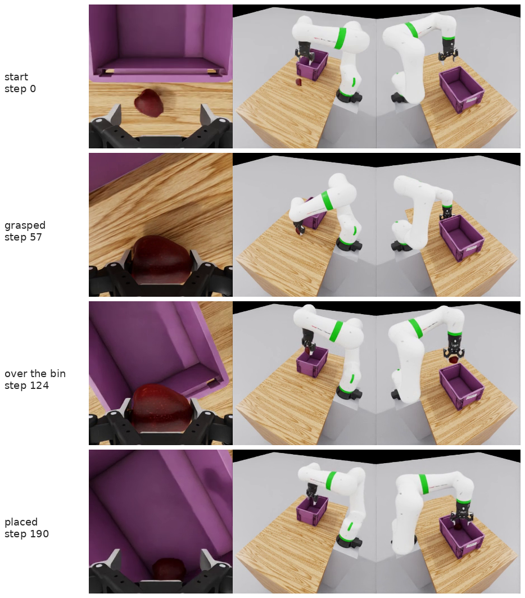
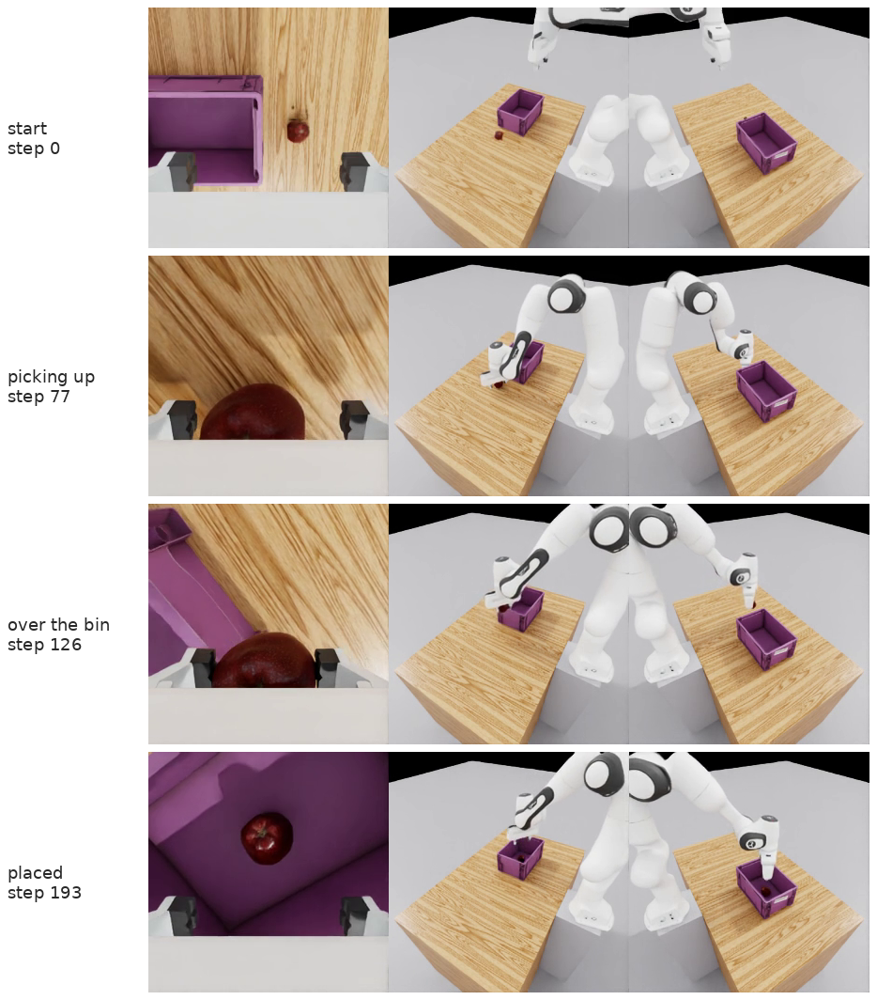

# Published models and datasets

Models trained end to end with urdf2vla, from the robot's URDF to a GR00T N1.7 checkpoint, and evaluated in Isaac Sim.
Each one is on Hugging Face with the files urdf2vla needs to run it.

| Robot | Model | Training data | Success in simulation | Trained from |
|---|---|---|---|---|
| FANUC CRX-3iA + Robotiq 2F-85 | [`umegan/urdf2vla-crx3ia-gr00t-n1.7`](https://huggingface.co/umegan/urdf2vla-crx3ia-gr00t-n1.7) | [`umegan/urdf2vla-crx3ia-pickplace`](https://huggingface.co/datasets/umegan/urdf2vla-crx3ia-pickplace) | **20/20** | `nvidia/GR00T-N1.7-DROID`, 50 scripted demos |
| Franka Panda (its own hand) | [`umegan/urdf2vla-franka-gr00t-n1.7`](https://huggingface.co/umegan/urdf2vla-franka-gr00t-n1.7) | [`umegan/urdf2vla-franka-pickplace`](https://huggingface.co/datasets/umegan/urdf2vla-franka-pickplace) | **19/20** | `nvidia/GR00T-N1.7-DROID`, 50 scripted demos |

All were trained and evaluated on one NVIDIA L40S; see [NVIDIA Brev setup](guides/brev.md) for every measured step.
They are simulation results only: one scene, one object at a time, fixed lighting.

## FANUC CRX-3iA {#crx3ia}

<video controls muted playsinline width="100%" src="../assets/crx3ia_model.mp4"></video>
<p class="caption"><em>The trained model picking an apple, a color cube, a lime and a pear (four evaluation episodes,
one per object). Each frame shows what the model sees: the wrist camera, then the left and right cameras.</em></p>



| | |
|---|---|
| Hugging Face | [`umegan/urdf2vla-crx3ia-gr00t-n1.7`](https://huggingface.co/umegan/urdf2vla-crx3ia-gr00t-n1.7) (NVIDIA Open Model License) |
| Robot | FANUC CRX-3iA (6 joints) with a Robotiq 2F-85 from NVIDIA's SimReady assets ([example](guides/your-robot.md)) |
| Cameras | wrist + left + right, 256×256 each |
| State / action | 6 joint positions + gripper; 16 actions per call at 20 Hz |
| Training data | 50 scripted demos (50 of 59 attempts succeeded, 33 min): [`umegan/urdf2vla-crx3ia-pickplace`](https://huggingface.co/datasets/umegan/urdf2vla-crx3ia-pickplace) |
| Training | 10,000 steps, batch 32, about 2 h 40 min on an L40S (41.9 GB) |
| Evaluation | **20/20** (apple 5/5, cube 7/7, lime 3/3, pear 5/5); median 174 steps (8.7 s), placed 15 mm from the target |
| Release check | 10/10 |

The same demos in GR00T's DROID layout (wrist + one exterior camera) scored 19/20: one pear was never released.

## Franka Panda {#franka}

<video controls muted playsinline width="100%" src="../assets/franka_model.mp4"></video>
<p class="caption"><em>The trained model picking an apple, a color cube, a lime and a pear (four evaluation episodes,
one per object): wrist camera, left camera, right camera.</em></p>



| | |
|---|---|
| Hugging Face | [`umegan/urdf2vla-franka-gr00t-n1.7`](https://huggingface.co/umegan/urdf2vla-franka-gr00t-n1.7) (NVIDIA Open Model License) |
| Robot | Franka Emika Panda (7 joints) with the Franka Hand from its URDF ([Franka CLI tutorial](tutorial.md)) |
| Cameras | wrist + left + right, 256×256 each |
| State / action | 7 joint positions + gripper; 16 actions per call at 20 Hz |
| Training data | 50 scripted demos (50 of 63 attempts succeeded, 30 min): [`umegan/urdf2vla-franka-pickplace`](https://huggingface.co/datasets/umegan/urdf2vla-franka-pickplace) |
| Training | 10,000 steps, batch 32, 2 h 42 min on an L40S (41.6 GB) |
| Evaluation | **19/20** (apple 5/5, cube 7/7, lime 3/3, pear 4/5); median 194 steps (9.7 s), placed 18 mm from the target |
| Release check | 10/10 |

The one failure closed on a pear without lifting it (`missed_grasp`).

## Use a model

Set up the project for the same robot (the example in `examples/`), download the model next to it, and evaluate:

```bash
hf download umegan/urdf2vla-crx3ia-gr00t-n1.7 --local-dir projects/crx3ia/training/hf_crx3ia
mkdir -p projects/crx3ia/datasets/demos_gr00t
cp projects/crx3ia/training/hf_crx3ia/urdf2vla_modality_crx3ia.py projects/crx3ia/datasets/demos_gr00t/
urdf2vla evaluate_vla --project projects/crx3ia --model training/hf_crx3ia --episodes 20 --video
```

`evaluate_vla` registers the model's embodiment from the modality config in `datasets/demos_gr00t/`, which is why the
file is copied there. The model card on Hugging Face has the inputs, outputs and training details.

To train it again, or to train your own variant, download the dataset into the project and run `train_vla`:

```bash
hf download umegan/urdf2vla-franka-pickplace --repo-type dataset --exclude "raw/*" --local-dir projects/franka/datasets/demos_gr00t
urdf2vla train_vla --project projects/franka --dataset demos
```

Each dataset also has the raw recording (`raw/demos.hdf5`) for converting it again, for example with `--layout droid`.
