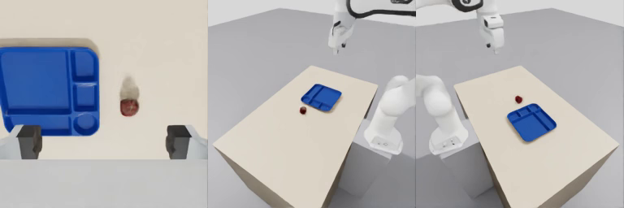

# チュートリアル: Franka で一通り

urdf2vla に同梱の Franka Panda で、URDF から、デモ 50 個の記録、GR00T N1.7 の fine-tune、シミュレーションでの評価まで
全工程を通します。途中で質問されることはないので、インストールの確認にもなります。

[インストール](install.md) を済ませ、2 つのコンテナを起動し、Hugging Face の準備（[手順 5](install.md#huggingface)）を
しておきます。下の時間は NVIDIA L40S で測ったものです。1〜5 と 7 は 16 GB の RTX GPU でも動きます。

| 工程 | コマンド | 時間 |
|---|---|---|
| [1. プロジェクトを作る](#create) | `init` | すぐ |
| [2. 設定する](#configure) | `inspect_robot` 〜 `configure_camera` | 約 1 秒 |
| [3. Isaac Sim に取り込む](#import) | `import_robot`, `launch_sim` | 約 2.5 分（初回はもう少し） |
| [4. 記録する](#record) | `configure_vla_interface`, `setup_teleoperation`, `collect_dataset` | デモ 50 個で約 31 分 |
| [5. 変換する](#convert) | `convert_dataset` | 約 1 分 |
| [6. 学習する](#train) | `train_vla` | 2 時間 42 分（44 GB の GPU が必要） |
| [7. 評価する](#evaluate) | `evaluate_vla` | 20 エピソードで約 8 分 |

## 1. プロジェクトを作る {#create}

```bash
urdf2vla init projects/tutorial_franka --from examples/franka/project.yaml
```

プロジェクトは 1 つのフォルダです。編集するのはその中の `project.yaml` だけです。

## 2. ロボット・台・カメラを設定する {#configure}

```bash
urdf2vla inspect_robot    --project projects/tutorial_franka
urdf2vla configure_robot  --project projects/tutorial_franka
urdf2vla configure_task   --project projects/tutorial_franka
urdf2vla configure_camera --project projects/tutorial_franka
```

`inspect_robot` は URDF から腕・グリッパ・手先を見つけ、`configure_task` は届く範囲に台と箱を置いて物体（りんご、ライム、
洋梨、色付きの立方体）を選び、`configure_camera` は [DROID](https://droid-dataset.github.io/) のデータセットと同じように
手先カメラと 2 台の外部カメラを置きます。

各コマンドは結果を JSON で出します。`status` と `next` で、うまくいったかと次に何を実行するかが分かります。この時点の
配置は [`urdf2vla view`](guides/view.md) で見られます。

## 3. Isaac Sim に取り込む {#import}

```bash
urdf2vla import_robot --project projects/tutorial_franka
urdf2vla launch_sim   --project projects/tutorial_franka
```

`import_robot` は URDF を USD に変換し、ロボットの物理の検査を 10 個実行します（関節が目標に追従し可動範囲に収まる、
グリッパが開閉して限界で止まる）。`launch_sim` は Pick & Place の環境を作り、カメラ・物体と、各物体を掴んで保持できるかを
検査します。各カメラの画像は `snapshots/` に保存されます。

<figure markdown="span">
  
  <figcaption>手先カメラと左右のカメラ。各 256×256 で、VLA が見る画像そのものです。</figcaption>
</figure>

## 4. デモを記録する {#record}

```bash
urdf2vla configure_vla_interface --project projects/tutorial_franka
urdf2vla setup_teleoperation     --project projects/tutorial_franka
urdf2vla collect_dataset         --project projects/tutorial_franka --device scripted --num-demos 50
```

VLA は 3 枚の画像、7 つの関節角、グリッパを受け取り、関節の目標とグリッパの指令を出します。
`collect_dataset --device scripted` はスクリプトの制御で毎回ランダムな物体・位置の作業を行い、成功したエピソードだけを
残します: 63 回中 50 回、30 分。自分で操作するには [デモを記録する](guides/recording.md) を見てください。

## 5. 変換する {#convert}

```bash
urdf2vla convert_dataset --project projects/tutorial_franka
```

GR00T N1.7 が読む形式に変換し、GR00T 自身のローダで読み直して、動画が記録と一致すること、グリッパを開くタイミングを
モデルが学べること（`gripper_timing`）を検査します。

## 6. 学習する {#train}

```bash
urdf2vla train_vla --project projects/tutorial_franka --dataset demos
```

44 GB 以上の GPU なら、`nvidia/GR00T-N1.7-DROID` から GR00T N1.7 を 10,000 step fine-tune し（L40S で 2 時間 42 分、41.6 GB）、
学習したモデルがデモと同じところでグリッパを開くかを検査します（`release_check`: 10/10）。それより小さい GPU では、
他のマシンで学習するための一式を作ります（[学習と評価](guides/training.md#another-machine)）。

## 7. 評価する {#evaluate}

```bash
urdf2vla evaluate_vla --project projects/tutorial_franka \
  --model training/tutorial_franka_demos/checkpoints/checkpoint-10000 --episodes 20 --video
```

GR00T のコンテナでモデルを起動し、Isaac Sim でロボットを動かします。毎回ランダムな物体・位置です。結果は
**20 回中 19 回成功**でした（失敗の 1 回は、洋梨を掴んだが持ち上げられなかった）。`--video` を付けると、各エピソードを
モデルが見る画像のまま `build/eval_videos/` に保存します。

<video controls muted playsinline width="100%" src="../../assets/franka_model.mp4"></video>

`build/eval_report.yaml` には全エピソードと、失敗ごとの名前（`never_closed`、`missed_grasp`、`never_released`、
`released_off_target`）があります。このモデルは Hugging Face の
[`umegan/urdf2vla-franka-gr00t-n1.7`](https://huggingface.co/umegan/urdf2vla-franka-gr00t-n1.7) にあります。

!!! tip "学習したモデルがないとき"
    `evaluate_vla --replay --dataset demos --episodes 3` は、モデルの代わりに変換したデータセットを同じサーバと
    シミュレータで再生します。物体が箱に入れば、データの形式・行動・接続はすべて動いています。何時間も学習する前の
    簡単な確認です。

次へ: [自分のロボットで](guides/your-robot.md)。
