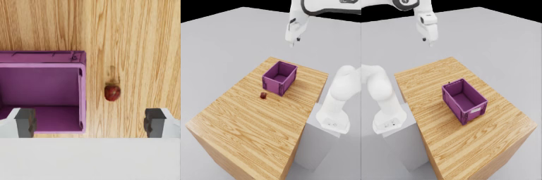

# チュートリアル: Franka で一通り

urdf2vla に同梱の Franka Panda で、URDF から記録したデータセット、GR00T の学習ジョブ、replay での評価までの全工程を
一度通します。途中で質問されることはないので、インストールの確認と、各工程が何を作るかを知るのに最適です。

[インストール](install.md) を済ませ、2 つのコンテナを起動しておきます（`bash docker/run.sh` と
`bash docker/run.sh gr00t`）。下の所要時間は RTX 5080 で、Isaac Sim を一度起動した後に測ったものです。Isaac Sim の最初の
起動はシェーダのコンパイルで数分かかることがあります。

| 工程 | コマンド | 時間 |
|---|---|---|
| [1. プロジェクトを作る](#create) | `init` | すぐ |
| [2. 設定する](#configure) | `inspect_robot` 〜 `configure_camera` | 約 1 秒 |
| [3. Isaac Sim に取り込む](#import) | `import_robot`, `launch_sim` | 約 2 分（初回は物体と箱のダウンロードでもう少し） |
| [4. 記録する](#record) | `configure_vla_interface`, `setup_teleoperation`, `collect_dataset` | デモ 10 個で約 4 分 |
| [5. 変換し、学習を用意する](#convert) | `convert_dataset`, `train_vla` | 約 15 秒 |
| [6. 評価する](#replay) | `evaluate_vla --replay` | 約 1 分 |

## 1. プロジェクトを作る {#create}

```bash
source .venv/bin/activate
urdf2vla init projects/tutorial_franka --from examples/franka/project.yaml
```

プロジェクトは 1 つのフォルダです。中で編集するのは `project.yaml` だけです。Franka の例には、初期姿勢と DROID の
カメラ配置がすでに書いてあります。

## 2. ロボット・台・カメラを設定する {#configure}

```bash
urdf2vla inspect_robot    --project projects/tutorial_franka
urdf2vla configure_robot  --project projects/tutorial_franka
urdf2vla configure_task   --project projects/tutorial_franka
urdf2vla configure_camera --project projects/tutorial_franka
```

これらはコンテナではなく手元のマシンで動きます。`inspect_robot` が URDF を読んで腕・グリッパ・手先の link を見つけ、
`configure_robot` がロボットの設定にまとめ、`configure_task` が台と箱を手の届く範囲に置いて物体（Franka の 8 cm の
指に入るりんご・ライム・洋梨・色付きの立方体）を選び、
`configure_camera` が [DROID](https://droid-dataset.github.io/) のデータセットと同じように手先カメラと 2 台の外部カメラを
置きます。

各コマンドは結果を JSON で出力します。見るのは `status` と `next` です。

```json
{
  "skill": "inspect_robot",
  "status": "ok",
  "next": ["configure_robot"]
}
```

!!! tip "見てみる"
    この時点で、ロボット・台・カメラをブラウザで見られます:
    `urdf2vla view --project projects/tutorial_franka`（[ブラウザでロボットを確かめる](guides/view.md)）

## 3. ロボットを Isaac Sim に取り込む {#import}

```bash
urdf2vla import_robot --project projects/tutorial_franka
urdf2vla launch_sim   --project projects/tutorial_franka
```

`import_robot` は URDF を USD（Isaac Sim の形式）に変換し、ロボット単体で 10 の物理の検査をします。たとえば、すべての
関節が目標に追従するか、可動範囲の中にいるか、グリッパが開閉でき、押されても可動範囲で止まるか、です。

```json
{
  "skill": "import_robot",
  "status": "ok",
  "data": {
    "checks": [
      "articulation_root: OK",
      "all_joints_driven: OK",
      "mimic_constraints_off: OK",
      "joint_name_match: OK",
      "bodies_exist: OK",
      "no_nan: OK",
      "default_pose_tracking: OK",
      "within_limits: OK",
      "gripper_motion:main_gripper: OK",
      "joint_limits_hold:main_gripper: OK"
    ]
  },
  "next": ["launch_sim"]
}
```

`launch_sim` は Isaac Lab Arena で Pick & Place の環境を組み立てて少し動かし、カメラ・場面と、物体ごとに台の上に置けるか・
大きさがカタログどおりか・掴んで保持できるかを検査します。丸い物体はしばらく台に置いて落ち着く向き（りんごは横に倒れる）
を測り、エピソードではその向きで置きます。各カメラの画像は `snapshots/` に保存されます。

<figure markdown="span">
  
  <figcaption>手先カメラ（開いた指の間）と、台を見下ろす左右のカメラ。それぞれ 256×256 で、VLA が見る画像そのものです。</figcaption>
</figure>

## 4. デモを記録する {#record}

```bash
urdf2vla configure_vla_interface --project projects/tutorial_franka
urdf2vla setup_teleoperation --project projects/tutorial_franka
urdf2vla collect_dataset --project projects/tutorial_franka --device scripted --num-demos 10
```

`configure_vla_interface` は VLA が受け取るもの（画像 3 枚、腕の関節角 7 つとグリッパの値）と出力するもの（関節の目標と
グリッパの指令）を決めます。`setup_teleoperation` は、手先を +x・−y・+z に動かす指令で、本当にその向きに動くかを
確かめます。

`collect_dataset --device scripted` は、毎回ランダムに選んだ物体をランダムな位置に置き、その名前を言う指示文
（*"put the pear in the bin"*）でスクリプトに運ばせ、成功したエピソードだけを残します。

```json
{
  "skill": "collect_dataset",
  "status": "ok",
  "data": {
    "dataset": "datasets/demos.hdf5",
    "saved": 10,
    "attempts": 10,
    "success_rate": 1.0,
    "checks": [
      "camera_frames_updated: OK",
      "first_frame_fresh: OK",
      "label_replay: OK"
    ]
  },
  "next": ["convert_dataset"]
}
```

デモ 10 個は工程の確認には十分ですが、役に立つ方策の学習には足りません。学習には 50 個以上を使います。
自分で操作する方法は [デモを記録する](guides/recording.md) を見てください。

## 5. データを変換し、学習を用意する {#convert}

```bash
urdf2vla convert_dataset --project projects/tutorial_franka --dataset demos
urdf2vla train_vla       --project projects/tutorial_franka --dataset demos
```

これらは GR00T のコンテナで動きます。`convert_dataset` はデータセットを LeRobot v2.1 形式で書き、GR00T N1.7 が必要とする
ファイル（`modality.json`、統計、modality config）を加えます。その後、GR00T 自身のデータローダで読み直し、動画の
全フレームを記録した画像と比べます。

GR00T N1.7 の学習には 44 GB 以上の GPU が必要です。`train_vla` は GPU を確かめ、足りればその場で学習を始めます。
足りなければ、大きなマシンで動かすための一式 `training/franka_demos.tar.gz` を作り、そのことを `warnings` で伝えます。
[学習と評価](guides/training.md) を見てください。

## 6. replay の評価で工程を確かめる {#replay}

```bash
urdf2vla evaluate_vla --project projects/tutorial_franka --replay --dataset demos --episodes 3 --video
```

学習済みのモデルがなくても、`--replay` でモデルのまわりをすべて試せます。変換したデータセットの行動を返す代わりの方策で
GR00T の推論サーバを起動し、Isaac Sim をつないで、本番の評価と同じように（記録と同じ物体で）エピソードを
実行します。ここで物体が箱に置かれれば、データの形式・行動の変換・サーバとシミュレータの接続はすべて動いています。

<video controls muted playsinline width="100%" src="../../assets/eval_replay.mp4"></video>

`--video` は、エピソードごとに 3 台のカメラの画像を横に並べた動画（VLA が見るもの）を `build/eval_videos/` に保存します。
学習済みの checkpoint では、`--replay` の代わりに `--model` を付けて同じコマンドを使います。

## できあがったもの

```text
projects/tutorial_franka/
  project.yaml            あなたの設定
  generated/              ロボット・タスク・カメラ・VLA の入出力・teleop の設定
  build/                  USD、各工程の報告（import_report.yaml, launch_report.yaml など）、評価の動画
  snapshots/              各工程のカメラ画像
  datasets/demos.hdf5     記録
  datasets/demos_gr00t/   同じデータの GR00T 用（LeRobot v2.1）
  training/               学習ジョブ（train.sh）とその一式
  logs/                   各コマンドのログと JSON の結果
```

次は [自分のロボットを使う](guides/your-robot.md)。
