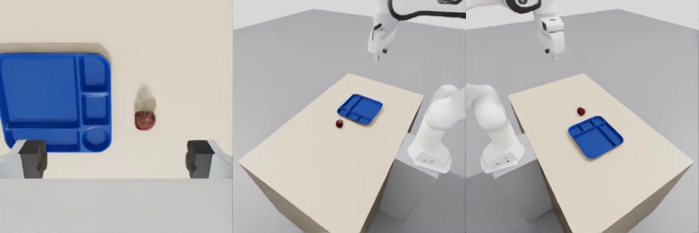

# Tutorial: Franka end to end

This tutorial runs the whole pipeline once with the Franka Panda that ships with urdf2vla: from its URDF to a recorded
dataset, a GR00T training job and a replay evaluation. Nothing in it asks you questions, so it's the best way to check
your installation and to see what each step produces.

You need the [installation](install.md) finished and both containers running (`bash docker/run.sh` and
`bash docker/run.sh gr00t`). The times below were measured on an RTX 5080 after Isaac Sim had started once; the very
first start of Isaac Sim compiles shaders and can take several minutes.

| Step | Commands | Time |
|---|---|---|
| [1. Create the project](#create) | `init` | instant |
| [2. Configure](#configure) | `inspect_robot` → `configure_camera` | ~1 s |
| [3. Import into Isaac Sim](#import) | `import_robot`, `launch_sim` | ~2 min (more the first time: the objects and bin are downloaded) |
| [4. Record](#record) | `configure_vla_interface`, `setup_teleoperation`, `collect_dataset` | ~4 min for 10 demos |
| [5. Convert and package training](#convert) | `convert_dataset`, `train_vla` | ~15 s |
| [6. Evaluate](#replay) | `evaluate_vla --replay` | ~1 min |

## 1. Create the project {#create}

```bash
source .venv/bin/activate
urdf2vla init projects/tutorial_franka --from examples/franka/project.yaml
```

A project is a folder. `project.yaml` is the only file in it that you edit; the Franka example already contains the
starting pose and the DROID camera layout.

## 2. Configure robot, table and cameras {#configure}

```bash
urdf2vla inspect_robot    --project projects/tutorial_franka
urdf2vla configure_robot  --project projects/tutorial_franka
urdf2vla configure_task   --project projects/tutorial_franka
urdf2vla configure_camera --project projects/tutorial_franka
```

These run on your machine, not in a container. `inspect_robot` reads the URDF and finds the arm, the gripper and the
hand link; `configure_robot` turns that into a robot configuration; `configure_task` places a table and a bin within
reach and chooses the objects — an apple, a lime, a pear and a colored cube, all of which fit the Franka's 8 cm
fingers; `configure_camera` places a wrist camera and two external cameras like the
[DROID](https://droid-dataset.github.io/) dataset.

Every command prints its result as JSON. The part to read is `status` and `next`:

```json
{
  "skill": "inspect_robot",
  "status": "ok",
  "next": ["configure_robot"]
}
```

!!! tip "Look at it"
    At this point you can already see the robot, the table and the cameras in your browser:
    `urdf2vla view --project projects/tutorial_franka` — see [Check your robot in the browser](guides/view.md).

## 3. Import the robot into Isaac Sim {#import}

```bash
urdf2vla import_robot --project projects/tutorial_franka
urdf2vla launch_sim   --project projects/tutorial_franka
```

`import_robot` converts the URDF to USD (the format Isaac Sim uses) and runs ten physics checks on the robot alone —
for example that every joint follows its target, stays within its limits, and that the gripper opens, closes and stops
at its limits when pushed:

```json
{
  "skill": "import_robot",
  "status": "ok",
  "data": {
    "checks": [
      "articulation_root: OK",
      "all_joints_driven: OK",
      "mimic_constraints_off: OK",
      "joint_name_match: OK",
      "bodies_exist: OK",
      "no_nan: OK",
      "default_pose_tracking: OK",
      "within_limits: OK",
      "gripper_motion:main_gripper: OK",
      "joint_limits_hold:main_gripper: OK"
    ]
  },
  "next": ["launch_sim"]
}
```

`launch_sim` builds the pick-and-place environment with Isaac Lab Arena, runs it for a moment and checks the cameras,
the scene and, for every object, that it rests on the table, has the size the catalog expects, and stays in the hand
when gripped. Round objects are left on the table for a moment to see how they come to rest (an apple tips onto its
side), and episodes then place them that way. It saves what each
camera sees in `snapshots/`:

<figure markdown="span">
  
  <figcaption>The wrist camera (between the open fingers), and the left and right cameras looking down at the table —
  256×256 each, as the VLA will see them.</figcaption>
</figure>

## 4. Record demonstrations {#record}

```bash
urdf2vla configure_vla_interface --project projects/tutorial_franka
urdf2vla setup_teleoperation --project projects/tutorial_franka
urdf2vla collect_dataset --project projects/tutorial_franka --device scripted --num-demos 10
```

`configure_vla_interface` defines what the VLA receives (three images, seven arm joint angles and a gripper value) and
what it outputs (joint targets and a gripper command). `setup_teleoperation` checks that commanding the hand to move
+x, −y or +z really moves it that way.

`collect_dataset --device scripted` lets a scripted controller do the task — a random object at a random position each
time, with an instruction that names it (*"put the pear in the bin"*) —
and keeps only the episodes that succeed:

```json
{
  "skill": "collect_dataset",
  "status": "ok",
  "data": {
    "dataset": "datasets/demos.hdf5",
    "saved": 10,
    "attempts": 10,
    "success_rate": 1.0,
    "checks": [
      "camera_frames_updated: OK",
      "first_frame_fresh: OK",
      "label_replay: OK"
    ]
  },
  "next": ["convert_dataset"]
}
```

Ten demonstrations are enough to test the pipeline, not to train a useful policy — use 50 or more for training.
To drive the robot yourself instead, see [Record demonstrations](guides/recording.md).

## 5. Convert the data and package training {#convert}

```bash
urdf2vla convert_dataset --project projects/tutorial_franka --dataset demos
urdf2vla train_vla       --project projects/tutorial_franka --dataset demos
```

These run in the GR00T container. `convert_dataset` writes the dataset in the LeRobot v2.1 format with the extra files
GR00T N1.7 needs (`modality.json`, statistics and a modality config), then loads it back with GR00T's own data loader
and compares every video frame with the recording.

GR00T N1.7 training needs a GPU with 44 GB or more. `train_vla` checks yours: if it is big enough it starts training;
otherwise it packages everything into `training/franka_demos.tar.gz` to run on a larger machine, and says so
in `warnings`. See [Train and evaluate](guides/training.md).

## 6. Check the pipeline with a replay evaluation {#replay}

```bash
urdf2vla evaluate_vla --project projects/tutorial_franka --replay --dataset demos --episodes 3
```

Before you have a trained model, `--replay` tests everything around it: it starts the GR00T inference server with a
stand-in policy that plays back the converted dataset, connects Isaac Sim to it, and runs episodes exactly as a real
evaluation would — with the same object as in the recording. If the object lands in the bin here, the data format,
the action conversion and the
server–simulator connection all work.

<video controls muted playsinline width="100%" src="../assets/eval_replay.mp4"></video>

Success is judged from the simulator state (the object in the bin and the gripper open), so no video is needed. To
watch an episode, add `--video`: it saves one video per episode in `build/eval_videos/`, with the three camera images
side by side as the VLA sees them (the video above). With a trained checkpoint the command is the same, with
`--model` instead of `--replay`.

## What you have now

```text
projects/tutorial_franka/
  project.yaml            your settings
  generated/              robot, task, camera, VLA interface and teleop configuration
  build/                  USD, reports of every step (import_report.yaml, launch_report.yaml, …), eval videos
  snapshots/              camera images from each step
  datasets/demos.hdf5     the recording
  datasets/demos_gr00t/   the same data for GR00T (LeRobot v2.1)
  training/               the training job (train.sh) and its package
  logs/                   the log and JSON result of every command
```

Next: [bring your own robot](guides/your-robot.md).
