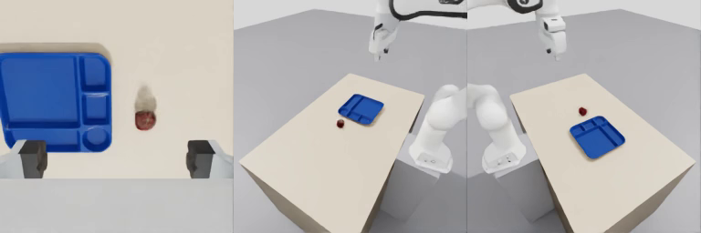

# Tutorial: Franka end to end

This tutorial runs the whole pipeline with the Franka Panda that ships with urdf2vla: from its URDF to 50 recorded
demonstrations, a fine-tuned GR00T N1.7 model and its evaluation in simulation. Nothing asks you questions, so it is
also the way to check your installation.

You need the [installation](install.md) finished, both containers running, and Hugging Face set up
([step 5](install.md#huggingface)). The times below were measured on an NVIDIA L40S; steps 1–5 and 7 also run on a
16 GB RTX GPU.

| Step | Commands | Time |
|---|---|---|
| [1. Create the project](#create) | `init` | instant |
| [2. Configure](#configure) | `inspect_robot` → `configure_camera` | ~1 s |
| [3. Import into Isaac Sim](#import) | `import_robot`, `launch_sim` | ~2.5 min (more the first time) |
| [4. Record](#record) | `configure_vla_interface`, `setup_teleoperation`, `collect_dataset` | ~31 min for 50 demos |
| [5. Convert](#convert) | `convert_dataset` | ~1 min |
| [6. Train](#train) | `train_vla` | 2 h 42 min (needs 44 GB) |
| [7. Evaluate](#evaluate) | `evaluate_vla` | ~8 min for 20 episodes |

## 1. Create the project {#create}

```bash
urdf2vla init projects/tutorial_franka --from examples/franka/project.yaml
```

A project is a folder. `project.yaml` is the only file in it you edit.

## 2. Configure robot, table and cameras {#configure}

```bash
urdf2vla inspect_robot    --project projects/tutorial_franka
urdf2vla configure_robot  --project projects/tutorial_franka
urdf2vla configure_task   --project projects/tutorial_franka
urdf2vla configure_camera --project projects/tutorial_franka
```

`inspect_robot` finds the arm, the gripper and the hand in the URDF; `configure_task` places the table and bin within
reach and picks the objects (an apple, a lime, a pear and a colored cube); `configure_camera` places a wrist camera and
two external cameras like the [DROID](https://droid-dataset.github.io/) dataset.

Every command prints a JSON result; `status` and `next` tell you whether it worked and what to run next. To see the
setup now, run [`urdf2vla view`](guides/view.md).

## 3. Import the robot into Isaac Sim {#import}

```bash
urdf2vla import_robot --project projects/tutorial_franka
urdf2vla launch_sim   --project projects/tutorial_franka
```

`import_robot` converts the URDF to USD and runs 10 physics checks on the robot (joints follow their targets and stay
in their limits, the gripper opens, closes and holds its limits). `launch_sim` builds the pick-and-place environment
and checks the cameras, the objects and that each object stays in the hand when gripped. It saves what each camera
sees in `snapshots/`:

<figure markdown="span">
  
  <figcaption>The wrist camera and the left and right cameras, 256×256 each, as the VLA sees them.</figcaption>
</figure>

## 4. Record demonstrations {#record}

```bash
urdf2vla configure_vla_interface --project projects/tutorial_franka
urdf2vla setup_teleoperation     --project projects/tutorial_franka
urdf2vla collect_dataset         --project projects/tutorial_franka --device scripted --num-demos 50
```

The VLA sees the three images, the 7 joint angles and the gripper, and outputs joint targets and a gripper command.
`collect_dataset --device scripted` lets a scripted controller do the task with a random object at a random position
each time, and keeps only the successful episodes: 50 of 63 attempts, in 30 minutes. To drive the robot yourself, see
[Record demonstrations](guides/recording.md). The 50 demonstrations from this run are on Hugging Face as
[`umegan/urdf2vla-franka-pickplace`](https://huggingface.co/datasets/umegan/urdf2vla-franka-pickplace).

## 5. Convert {#convert}

```bash
urdf2vla convert_dataset --project projects/tutorial_franka
```

This writes the dataset in the format GR00T N1.7 reads, then loads it back with GR00T's own loader and checks that
every video matches the recording and that the model can learn when the gripper opens (`gripper_timing`).

## 6. Train {#train}

```bash
urdf2vla train_vla --project projects/tutorial_franka --dataset demos
```

On a GPU with 44 GB or more, this fine-tunes GR00T N1.7 from `nvidia/GR00T-N1.7-DROID` for 10,000 steps (2 h 42 min,
41.6 GB on the L40S) and then checks that the trained model opens the gripper where the demonstrations do
(`release_check`: 10/10). On a smaller GPU it packages the job for another machine instead — see
[Train and evaluate](guides/training.md#another-machine).

## 7. Evaluate {#evaluate}

```bash
urdf2vla evaluate_vla --project projects/tutorial_franka \
  --model training/tutorial_franka_demos/checkpoints/checkpoint-10000 --episodes 20 --video
```

This starts the model in the GR00T container and lets it drive the robot in Isaac Sim, with a random object at a random
position in every episode. The result: **19 of 20 succeeded** (the one failure closed on a pear without lifting it).
With `--video`, every episode is saved in `build/eval_videos/` as the model sees it:

<video controls muted playsinline width="100%" src="../assets/franka_model.mp4"></video>

`build/eval_report.yaml` has every episode, with a name for each failure (`never_closed`, `missed_grasp`,
`never_released`, `released_off_target`). The model is on Hugging Face as
[`umegan/urdf2vla-franka-gr00t-n1.7`](https://huggingface.co/umegan/urdf2vla-franka-gr00t-n1.7).

!!! tip "Without a trained model"
    `evaluate_vla --replay --dataset demos --episodes 3` plays the converted dataset back through the same server and
    simulator instead of a model. If the object lands in the bin, the data format, the actions and the connection all
    work — a quick check before you spend hours on training.

Next: [bring your own robot](guides/your-robot.md).
